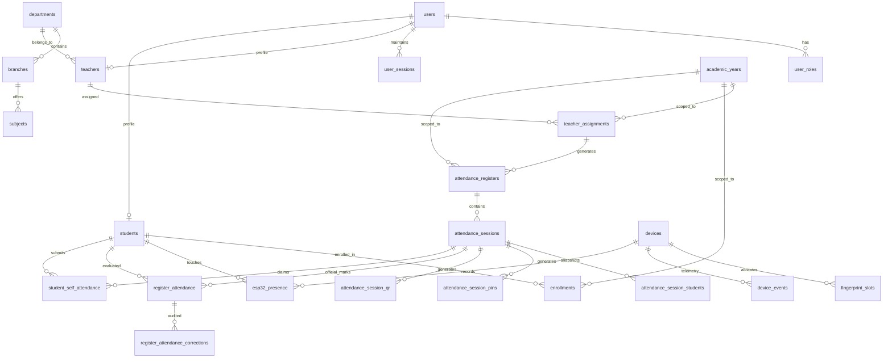

# ANTIGRAVITY — FINAL ATTENDANCE ARCHITECTURE FREEZE

> **Document Status**: **AUTHORITATIVE ARCHITECTURAL BASELINE & SPECIFICATION FREEZE**  
> **Document Identifier**: `ATTENDANCE_ARCHITECTURE_FREEZE.md`  
> **System Name**: College Attendance Web System (Institutional Edition)  
> **Target Deployment**: Local-First On-Premise Edge Server (Windows / Node.js 20+ / MySQL 8.x & SQLite)  
> **Scope Version**: v1.0.0 (Attendance Core & Roster Governance)  
> **Architectural Invariant**: All prior assumptions, draft documents, and conflicting requirements are superseded by this authoritative document.

---

## 1. Final Institutional Responsibility Hierarchy

The College Attendance System mirrors how higher-education institutions naturally operate by establishing a clean operational delegation: **Admin $\rightarrow$ HOD $\rightarrow$ Teacher $\rightarrow$ Class Teacher $\rightarrow$ Student**.

```text
                     ADMIN
                       │
             Creates / assigns HOD
                       │
                       ▼
                      HOD
                       │
        ┌──────────────┼──────────────┐
        ▼              ▼              ▼
     Teachers       Subjects      Class Teachers
        │              │              │
        │              │              ▼
        │              │           Students
        │              │
        └──────┬───────┘
               ▼
       Teacher Assignment
               │
       ┌───────┴────────┐
       ▼                ▼
    THEORY          PRACTICAL
       │                │
       ▼                ▼
 Official Register  Official Register
       │                │
       └───────┬────────┘
               ▼
        Daily Attendance
               │
               ▼
       Finalized Attendance
               │
               ▼
        ADMIN REPORTING
```

### Academic Year as Contextual Umbrella
Academic Year is not something the Admin manually recreates every year. It sits **above the academic structure as temporal context**, an operational boundary, and a reporting filter:

```text
Academic Year
2026–27
   │
   ├── Departments
   │      └── IT
   │           ├── HOD
   │           ├── Teachers
   │           ├── Subjects
   │           ├── Cohorts
   │           └── Registers
   │
   └── Historical Years
          ├── 2025–26
          └── 2024–25
```

---

## 2. Strict Role Boundaries & The 3 Jobs of System Admin

### 2.1 Admin Has ONLY 3 Core Responsibilities
To eliminate administrative overhead and bottlenecks, the System Administrator performs only high-level institutional governance:

1. **College Setup**:
   - Master Departments (e.g. Information Technology, Computer Engineering, Civil Engineering).
   - Degree Branches / Programs under each Department (e.g. B.Tech IT, Diploma IT).
   - **Academic Year Pattern Configuration** (Configured **once**; system auto-derives future years):
     ```text
     Academic Year Pattern
     Start Month: [July]
     Start Day:   [1]

     Current Academic Year:
     2026–27 (01 Jul 2026 → 30 Jun 2027)

     Next automatically prepared:
     2027–28 (01 Jul 2027 → 30 Jun 2028)
     [ Review / Start New Academic Year ]
     ```
2. **HOD Management**:
   - Create HOD accounts (Full Name, Institutional Gmail, Phone).
   - Assign HOD $\rightarrow$ Department.
3. **Institutional Reporting**:
   - Department-wide official attendance analytics.
   - Multi-parameter filtering (Academic Year $\rightarrow$ Department $\rightarrow$ Subject $\rightarrow$ Date Range).

### 2.2 What Admin DOES NOT Do
- Admin does **NOT** add, provision, bulk-upload, or approve students.
- Admin does **NOT** assign student roll numbers.
- Admin does **NOT** create regular faculty accounts.
- Admin does **NOT** create subjects.
- Admin does **NOT** assign subjects or cohorts to teachers.
- Admin does **NOT** create attendance registers.
- Admin does **NOT** manage or edit daily attendance.
- **ADMIN HAS ZERO STUDENT MANAGEMENT UI AND ZERO STUDENT API ROUTES.**

---

## 3. HOD — The Department Administrator & Dual-Role Model

### 3.1 Multi-Assignment Architectural Model & Dual-Role Reality

> [!IMPORTANT]
> **Hard Architectural Requirement:**  
> **“A teacher may simultaneously hold multiple academic assignments, including HOD, Class Teacher, and Subject Teacher. Assignments are independently scoped and must not require separate user accounts or logins.”**

#### System Role vs. Academic Assignments
The system maintains a single login role (`TEACHER`) in `user_roles`. Specific academic responsibilities are **assignments** stored as independent records in `teacher_assignments`:

```text
SYSTEM ROLE
    TEACHER
       │
       ├── HOD assignment (Department scope)
       ├── CLASS_TEACHER assignment (Cohort scope)
       └── SUBJECT_TEACHER assignment (Subject + Component scope)
```

These are **not mutually exclusive roles**. The same `teacher_id` can hold multiple concurrent assignment records:

```text
Teacher Account (e.g. Rahul)
      │
      ├── HOD
      │     └── Information Technology Department
      │
      ├── Class Teacher
      │     └── Diploma IT, Year 2, Semester 3
      │
      └── Subject Teacher
            ├── DBMS → Theory
            ├── DBMS → Practical
            └── Java → Theory
```

#### Example Multi-Assignment Roster
| Teacher | Assignment Type | Academic Scope | Resulting Privileges |
|---|---|---|---|
| Rahul | `HOD` | IT Department | Department administration, create teachers, create subjects, assign staff |
| Rahul | `CLASS_TEACHER` | Diploma IT, Y2, S3 | Cohort student roster management, provisioning, credentials, biometrics |
| Rahul | `SUBJECT_TEACHER` | DBMS, `THEORY` | Continuous official theory register (`DBMS — THEORY`) |
| Rahul | `SUBJECT_TEACHER` | DBMS, `PRACTICAL` | Continuous official practical register (`DBMS — PRACTICAL`) |

#### Unified Faculty Portal Behavior
The faculty member uses a **single faculty login**. Upon authentication, the dashboard and navigation dynamically render sections based on their active assignments:

```text
Faculty Portal
│
├── My Registers       (Always active for Subject Teachers)
├── Attendance         (Always active for Subject Teachers)
├── My Students        (Active if user holds CLASS_TEACHER assignment)
├── Subjects           (Active if user holds SUBJECT_TEACHER assignment)
├── Teachers           (Active if user holds HOD assignment)
├── Department Setup   (Active if user holds HOD assignment)
├── Department Reports (Active if user holds HOD assignment)
├── Notifications
└── Profile
```
If someone is simultaneously **HOD + Class Teacher + Subject Teacher**, all applicable sections appear seamlessly without logging out or switching contexts.

### 3.2 Student Scoping Tiers: HOD vs. Class Teacher vs. Subject Teacher
The system strictly differentiates between **department oversight**, **cohort roster administration**, and **classroom attendance**:

```text
HOD (Department-Wide Visibility)
 │
 └── Own Department (Read-Only)
       ├── View all department students
       ├── View cohort-wise students (Branch, Year, Semester)
       ├── View student enrollment details & class roll numbers
       ├── View student attendance percentages & defaulter status
       └── View department-wide official reports
```

| Scope Level | Academic Authority | Permissions & Invariants |
|:---|:---|:---|
| **HOD** | **Department-Wide** (Own Department) | **Read-Only Oversight**: View all students enrolled under their department; filter cohort-wise (Branch, Year, Sem); view attendance stats and defaulter lists.<br>**Strict Boundary**: CANNOT view other departments. CANNOT create/provision students (Class Teacher responsibility). CANNOT edit student identity. CANNOT alter official attendance records. |
| **Class Teacher** | **Specific Cohort** (Assigned Cohort) | **Full Roster Management**: Exclusively provisions students (single & bulk CSV), generates temporary credential slips, enrolls optical biometric fingerprints on terminals, and approves/rejects fallback self-registrations. |
| **Subject Teacher** | **Assigned Register** (Subject + Component) | **Session Attendance Marking**: Takes daily attendance (P/A/L), reviews ESP32 evidence, adjudicates PIN/QR claims, and finalizes class sessions. |

> **Key Invariant**: The distinction is:
> - **HOD $\rightarrow$ department-wide student visibility** (read-only audit, reports, cohort drilldowns)
> - **Class Teacher $\rightarrow$ specific cohort student management** (provisioning, CSV, roll numbers, biometrics, approvals)
> - **Subject Teacher $\rightarrow$ students enrolled in their assigned subject/cohort** (daily classroom attendance marking)
> And all three can belong to the **same person/account**.

### 3.3 HOD Creates Teachers (Minimal Form, No Forced Fake IDs)
The HOD provisions faculty for their department through an ultra-simple 3-field form:
- **Full Name**
- **Institutional Gmail** (`users.username = teacher@gmail.com`)
- **Phone Number**
- *(Optional)* **Employee ID**: If the college already issues official employee IDs, staff may enter it. If not provided, the system does **NOT** generate synthetic codes like `EMP-IT-XXXX`.
  - `users.id` $\longrightarrow$ Internal database identity
  - `teachers.id` $\longrightarrow$ Teacher record
  - `employee_id` $\longrightarrow$ Optional institutional identifier (`NULL` if omitted)
  - `users.email` / `users.username` $\longrightarrow$ Official login identity
- **Department Context**: Automatically known from the HOD's department (`teachers.department_id = hod.department_id`).
- **System Automation**:
  - Sets Gmail as permanent login ID.
  - Generates secure 8-character temporary password (stored only as a `bcrypt` hash).
  - Issues temporary credential slip to faculty.

### 3.3 HOD Creates Subjects
Instead of requiring complex curriculum matrices, the HOD creates subjects with minimal input:
- **Subject Code** (e.g., `IT401`)
- **Subject Name** (e.g., `Database Management Systems`)
- **Branch** (dropdown of branches in HOD's department)
- **Year** (1 to 4)
- **Semester** (1 to 8)
- **No Theory/Practical Question**: The HOD is **NOT asked** *"Does this subject have Theory + Practical?"* during creation. A subject is purely an academic subject. Theory and Practical components belong strictly to the **Teaching Assignment**.

### 3.4 HOD Assigns Teachers (Theory / Practical Split)
When the HOD assigns an instructor to a subject:
- **Teacher**: Select from department faculty.
- **Subject**: Select from department subjects.
- **Teaching Type**:
  - `○ Theory`
  - `○ Practical`
*(There is NO "ALL" register option).*

#### Two-Teacher or Single-Teacher Model:
1. **Two Different Teachers**:
   - Teacher A $\rightarrow$ DBMS $\rightarrow$ `Theory` $\longrightarrow$ Auto-creates **DBMS — THEORY Register**
   - Teacher B $\rightarrow$ DBMS $\rightarrow$ `Practical` $\longrightarrow$ Auto-creates **DBMS — PRACTICAL Register**
2. **One Teacher for Both Components**:
   - HOD makes two quick assignments:
   - **Theory and Practical always remain separate, continuous official registers.**

### 3.4 HOD Assigns Class Teachers
The HOD assigns the **Class Teacher** for each cohort:
- **Teacher**: Select faculty member.
- **Role**: `Class Teacher`
- **Cohort**: Branch, Year, Semester.
- *That teacher immediately receives exclusive roster authority for that cohort.*

---

## 4. Class Teacher & Student Roster Ownership

Student roster management belongs **EXCLUSIVELY to the designated CLASS TEACHER**:

```text
HOD
 │
 └── Assigns Class Teacher
          │
          ▼
    Class Teacher (Assigned Cohort)
          │
          ├── Adds individual student (Roll No + Enrollment ID)
          ├── Bulk CSV student roster import
          ├── Generates & exports temporary student credentials
          ├── Manages student biometric fingerprint enrollment on terminals
          ├── Reviews & approves/rejects fallback self-registrations
          └── Toggles cohort self-registration window ON/OFF
```

- **Backend Enforcement**: Any API attempt to modify cohort rosters or provision students requires an active `CLASS_TEACHER` assignment for that specific cohort.
- **Dual Identifiers**:
  - **Official Enrollment Number** (`students.official_enrollment_no` = `users.username`): Permanent institutional ID (e.g., `2024IT001`). Immutable login ID.
  - **Class Roll Number** (`enrollments.class_roll_no`): Internal classroom sort order (Roll 1, 2, 3... 45).

---

## 5. Automatic Official Digital Registers & Continuous Lifetime

### 5.1 Zero-Click Register Creation
- When an HOD assigns a teacher to a subject and component (`Theory` or `Practical`), the system **automatically generates the official institutional digital register (`attendance_registers`, `is_official = 1`)**.
- There is **no manual "Create Register" button**.
- The teacher opens the Faculty Portal and immediately sees their official assigned registers.

### 5.2 Continuous Register Lifetime
- An Official Register is a **long-running institutional container** spanning the entire semester/academic period.
- It is **NOT** recreated every day or month.
- Each actual class conducted is an **`attendance_session`** stored inside that continuous register.

### 5.3 Official vs. Personal Registers
- **OFFICIAL Registers** (`is_official = TRUE`):
  - Created automatically via HOD teacher assignment.
  - Form the sole basis of official student attendance % and academic transcripts.
  - Visible in Admin Department Reports and HOD dashboards.
- **PERSONAL Registers** (`is_official = FALSE`):
  - Created voluntarily by teachers for clubs (e.g. Robotics Club), tutorials, workshops, or seminars.
  - Visible exclusively to the creating teacher.
  - **Strict Query Exclusion**: Excluded from Admin department reports, defaulter reports, and official attendance statistics at the database query level (`WHERE is_official = 1`).

---

## 6. Calendar-First Digital Register UI Specification

The digital register interface uses a modern **CALENDAR-FIRST** interactive workflow:

```text
┌──────────────────────────────────────────────────────────────────────────────────────────────────┐
│  DBMS — THEORY ATTENDANCE REGISTER                                                               │
│  Department: Information Technology  |  Branch: Diploma IT  |  Year: 2  |  Sem: 3  |  2026-27    │
│  Teacher: teacher@gmail.com          |  Component: THEORY   |  Cohort: IT-Dip-Y2-S3             │
├──────────────────────────────────────────────────────────────────────────────────────────────────┤
│  [Total Conducted: 24]    [Avg Attendance: 84.2%]    [Students Below 75%: 4]   [This Month: 8]   │
├──────────────────────────────────────────────────────────────────────────────────────────────────┤
│  ‹ August 2026                 SEPTEMBER 2026                               October 2026 ›       │
│                                                                                                  │
│   Mon          Tue          Wed          Thu          Fri          Sat          Sun          │
│  ┌───────────┬───────────┬───────────┬───────────┬───────────┬───────────┬───────────┐       │
│  │ 31        │ 1         │ 2         │ 3         │ 4         │ 5         │ 6         │       │
│  │           │ DBMS-TH   │           │ DBMS-TH   │           │           │           │       │
│  │           │ 10:00-11  │           │ 10:00-11  │           │           │           │       │
│  │           │ ✓32 ✕3 L0 │           │ ✓30 ✕4 L1 │           │           │           │       │
│  │           │ 91% [FIN] │           │ 86% [FIN] │           │           │           │       │
│  ├───────────┼───────────┼───────────┼───────────┼───────────┼───────────┼───────────┤       │
│  │ 7         │ 8         │ 9         │ 10        │ 11 TODAY  │ 12        │ 13        │       │
│  │           │ DBMS-TH   │           │ DBMS-TH   │ DBMS-TH   │           │           │       │
│  │           │ 10:00-11  │           │ 10:00-11  │ 10:00-11  │           │           │       │
│  │           │ ✓31 ✕4 L0 │           │ ✓33 ✕2 L0 │ ● LIVE    │           │           │       │
│  │           │ 88% [FIN] │           │ 94% [FIN] │ [OPEN]    │           │           │       │
│  └───────────┴───────────┴───────────┴───────────┴───────────┴───────────┴───────────┘       │
└──────────────────────────────────────────────────────────────────────────────────────────────────┘
```

1. **Month View is the Primary Register UI**:
   - Sticky header with full academic context.
   - Cells show session time, Present count (`✓`), Absent count (`✕`), Late count (`L`), attendance %, and state badge (`DRAFT`, `OPEN`, `CLOSED`, `FINALIZED`).
   - Today's date is highlighted with a `● LIVE` badge if an open class session is active.
2. **Clicking a Date Opens Daily Attendance Session**:
   - Displays student list: Roll | Student Name | Status toggle (`PRESENT` / `ABSENT` / `LATE`).
   - Primary interface for teacher editing, biometric sync, and claim adjudication.
3. **Student History View**:
   - Clicking a student's name opens their cumulative session history across dates in that register.

---

## 7. Attendance Sessions & The Three Independent Streams

### 7.1 Session Lifecycle
$$\text{DRAFT} \longrightarrow \text{OPEN} \longrightarrow \text{CLOSED} \longrightarrow \text{FINALIZED}$$
- **Roster Snapshot**: Creating a session captures an immutable snapshot into `attendance_session_students` (`student_id`, `enrollment_id`, `class_roll_no`, `included`).
- **Auto-Close Boundary**: Automated background timer (`auto_close_at`) can ONLY transition `OPEN` $\rightarrow$ `CLOSED`. Auto-close NEVER finalizes a session.
- **Universal Marking Invariant**: A session CANNOT transition from `CLOSED` to `FINALIZED` if any included student (`included = 1`) remains unadjudicated. Every included student must have an explicit status (`PRESENT`, `ABSENT`, or `LATE`), else `HTTP 422 Unprocessable Entity`.

### 7.2 The Three Independent Streams
```text
┌────────────────────────────────────────────────────────────────────────────────────────┐
│                              THREE INDEPENDENT STREAMS                                 │
├─────────────────────────┬───────────────────────────────┬──────────────────────────────┤
│        STREAM 1         │           STREAM 2            │           STREAM 3           │
│     ESP32 Presence      │       Teacher Register        │    Student Self-Attendance   │
├─────────────────────────┼───────────────────────────────┼──────────────────────────────┤
│ Table: esp32_presence   │ Table: register_attendance    │ Table: student_self_attend   │
│ Autonomous hardware log │ Sole official institutional   │ Soft presence claims         │
│ Fingerprint touch scan  │ record of truth               │ Submitted via Button/PIN/QR  │
│ Device offline buffer   │ Status: PRESENT / ABSENT /    │ Status: PENDING / ACCEPTED / │
│ Supporting evidence     │         LATE                  │         REJECTED             │
│ NEVER auto-creates      │ Sources: MANUAL / ESP32_SYNC /│ Requires teacher review      │
│ official attendance     │          SELF_REQUEST         │ NEVER auto-marks PRESENT     │
└─────────────────────────┴───────────────────────────────┴──────────────────────────────┘
```

1. **Stream 1 (`esp32_presence`)**: Autonomous hardware scans; supporting evidence only.
2. **Stream 2 (`register_attendance`)**: Sole official source of truth. Teacher can click `[Sync from ESP32]` to pre-fill draft marks, edit, and finalize.
3. **Stream 3 (`student_self_attendance`)**: Student soft claims (Button, 4–6 digit hashed PIN, dynamic HMAC QR). Always `PENDING` until teacher explicitly adjudicates.

---

## 8. Calculation Engine & 75% Threshold

### 8.1 Official Percentage Formula
$$\text{Official Attendance } \% = \frac{\text{count}(\text{PRESENT}) + \text{count}(\text{LATE})}{\text{Total Finalized Sessions where } \text{included} = 1} \times 100$$
*(Calculated strictly from finalized sessions in official registers. Personal registers, raw ESP32 scans, and pending claims are completely excluded.)*

### 8.2 Defaulter Prediction Mathematics ($T = 0.75$)
- **Safe Absences Remaining** ($Current \% \ge 75\%$):
  $$X = \left\lfloor \frac{P - (0.75 \times C)}{0.75} \right\rfloor$$
- **Recovery Classes Required** ($Current \% < 75\%$):
  $$Y = \left\lceil \frac{(0.75 \times C) - P}{0.25} \right\rceil$$

---

## 9. Reconciled Relational ERD & Complete Schema (Entity-Driven, Non-Redundant)

### 9.1 Non-Negotiable Rule: Table Count is NOT a Quota
> [!IMPORTANT]
> **No Forced Table Count**: The database design does **NOT** target an arbitrary number of tables (e.g. 24 or 27). The schema is derived strictly from real institutional entities. No table is retained or added simply to reach a count. Every table exists exclusively because it serves a distinct, non-duplicated business purpose.

### 9.2 Verification of Register Hierarchy Entities
1. **`attendance_registers` (The Continuous Container)**:
   - Long-running semester container created automatically upon teacher assignment.
   - Holds curriculum component (`THEORY` or `PRACTICAL`) and official status (`is_official`).
2. **`attendance_sessions` (The Conducted Class Event)**:
   - Class session conducted on a specific date (`session_date`) and time window inside that register.
   - Controls lifecycle (`DRAFT` $\rightarrow$ `OPEN` $\rightarrow$ `CLOSED` $\rightarrow$ `FINALIZED`).
3. **`register_attendance` (The Official Truth)**:
   - Official attendance mark for a student in that session (`PRESENT`, `ABSENT`, or `LATE`).
   - Represents the teacher's final institutional decision.

### 9.3 Reconciliation & Removal of Duplicate Concepts
- **`cohort_enrollments` vs. `enrollments`**: `cohort_enrollments` eliminated; unified solely into **`enrollments`**.
- **`attendance_records` vs. `register_attendance`**: `attendance_records` eliminated; unified solely into **`register_attendance`**.
- **`biometric_touch_stream` vs. `esp32_presence`**: `biometric_touch_stream` eliminated; unified solely into **`esp32_presence`** (hardware `UNIQUE(event_id)` deduplication).
- **`device_heartbeats` vs. `device_events`**: `device_heartbeats` eliminated; telemetry consolidated into **`device_events`** and `devices.last_heartbeat_at`.

### 9.4 Relational Entity-Relationship Diagram



### 9.5 Complete Table Definitions

```sql
-- =============================================================================
-- 1. CENTRAL AUTHENTICATION & SESSIONS
-- =============================================================================
CREATE TABLE users (
  id INT AUTO_INCREMENT PRIMARY KEY,
  username VARCHAR(100) NOT NULL UNIQUE,          -- Teacher Gmail / Student Enrollment No
  email VARCHAR(150) NULL UNIQUE,                 -- Institutional Gmail / Email
  password_hash VARCHAR(255) NULL,
  temp_password_hash VARCHAR(255) NULL,           -- bcrypt temporary password hash
  must_change_password BOOLEAN NOT NULL DEFAULT FALSE,
  google_sub VARCHAR(255) NULL UNIQUE,            -- Verified Google account subject identifier
  status ENUM('PROVISIONED', 'PENDING', 'ACTIVE', 'REJECTED', 'SUSPENDED') NOT NULL DEFAULT 'ACTIVE',
  rejection_reason VARCHAR(255) NULL,
  created_at TIMESTAMP DEFAULT CURRENT_TIMESTAMP,
  updated_at TIMESTAMP DEFAULT CURRENT_TIMESTAMP ON UPDATE CURRENT_TIMESTAMP
);

CREATE TABLE user_roles (
  id INT AUTO_INCREMENT PRIMARY KEY,
  user_id INT NOT NULL,
  role ENUM('SYSTEM_ADMIN', 'TEACHER', 'STUDENT') NOT NULL,
  created_at TIMESTAMP DEFAULT CURRENT_TIMESTAMP,
  FOREIGN KEY (user_id) REFERENCES users(id) ON DELETE CASCADE,
  UNIQUE KEY uq_user_role (user_id, role)
);

CREATE TABLE user_sessions (
  id INT AUTO_INCREMENT PRIMARY KEY,
  user_id INT NOT NULL,
  refresh_token_hash VARCHAR(255) NOT NULL UNIQUE,
  user_agent VARCHAR(255) NULL,
  ip_address VARCHAR(45) NULL,
  expires_at DATETIME NOT NULL,
  is_revoked BOOLEAN NOT NULL DEFAULT FALSE,
  created_at TIMESTAMP DEFAULT CURRENT_TIMESTAMP,
  FOREIGN KEY (user_id) REFERENCES users(id) ON DELETE CASCADE
);

CREATE TABLE system_settings (
  id INT AUTO_INCREMENT PRIMARY KEY,
  setting_key VARCHAR(100) NOT NULL UNIQUE,
  setting_value TEXT NOT NULL,
  description VARCHAR(255) NULL,
  updated_by INT NULL,
  updated_at TIMESTAMP DEFAULT CURRENT_TIMESTAMP ON UPDATE CURRENT_TIMESTAMP,
  FOREIGN KEY (updated_by) REFERENCES users(id) ON DELETE SET NULL
);

-- =============================================================================
-- 2. MASTER ACADEMIC STRUCTURE (ADMIN CONSOLE)
-- =============================================================================
CREATE TABLE departments (
  id INT AUTO_INCREMENT PRIMARY KEY,
  name VARCHAR(150) NOT NULL UNIQUE,
  code VARCHAR(50) NOT NULL UNIQUE,
  hod_user_id INT NULL,                           -- Assigned HOD user account
  is_active BOOLEAN NOT NULL DEFAULT TRUE,
  created_at TIMESTAMP DEFAULT CURRENT_TIMESTAMP,
  FOREIGN KEY (hod_user_id) REFERENCES users(id) ON DELETE SET NULL
);

CREATE TABLE branches (
  id INT AUTO_INCREMENT PRIMARY KEY,
  department_id INT NOT NULL,
  name VARCHAR(150) NOT NULL,
  code VARCHAR(50) NOT NULL,
  is_active BOOLEAN NOT NULL DEFAULT TRUE,
  created_at TIMESTAMP DEFAULT CURRENT_TIMESTAMP,
  FOREIGN KEY (department_id) REFERENCES departments(id) ON DELETE RESTRICT,
  UNIQUE KEY uq_dept_branch (department_id, code)
);

CREATE TABLE academic_years (
  id INT AUTO_INCREMENT PRIMARY KEY,
  year_label VARCHAR(50) NOT NULL UNIQUE,         -- e.g. "2026-27"
  start_date DATE NOT NULL,
  end_date DATE NOT NULL,
  is_current BOOLEAN NOT NULL DEFAULT FALSE,
  created_at TIMESTAMP DEFAULT CURRENT_TIMESTAMP
);

-- Subjects created by HOD for their department (No Theory/Practical flags needed)
CREATE TABLE subjects (
  id INT AUTO_INCREMENT PRIMARY KEY,
  department_id INT NOT NULL,
  branch_id INT NOT NULL,
  year INT NOT NULL,
  semester INT NOT NULL,
  name VARCHAR(150) NOT NULL,
  code VARCHAR(50) NOT NULL UNIQUE,
  is_active BOOLEAN NOT NULL DEFAULT TRUE,
  created_at TIMESTAMP DEFAULT CURRENT_TIMESTAMP,
  FOREIGN KEY (department_id) REFERENCES departments(id) ON DELETE RESTRICT,
  FOREIGN KEY (branch_id) REFERENCES branches(id) ON DELETE RESTRICT
);

-- =============================================================================
-- 3. PROFILES, ASSIGNMENTS & COHORTS
-- =============================================================================
CREATE TABLE teachers (
  id INT AUTO_INCREMENT PRIMARY KEY,
  user_id INT NOT NULL UNIQUE,
  department_id INT NOT NULL,                     -- HOD's department
  employee_id VARCHAR(50) NULL UNIQUE,            -- Optional institutional identifier (NULL if not provided)
  full_name VARCHAR(150) NOT NULL,
  phone VARCHAR(20) NULL,
  created_at TIMESTAMP DEFAULT CURRENT_TIMESTAMP,
  FOREIGN KEY (user_id) REFERENCES users(id) ON DELETE CASCADE,
  FOREIGN KEY (department_id) REFERENCES departments(id) ON DELETE RESTRICT
);

-- HOD assigns teachers with specific component: THEORY or PRACTICAL
CREATE TABLE teacher_assignments (
  id INT AUTO_INCREMENT PRIMARY KEY,
  teacher_id INT NOT NULL,
  assignment_type ENUM('SUBJECT_TEACHER', 'CLASS_TEACHER', 'HOD') NOT NULL,
  subject_id INT NULL,                            -- Set for SUBJECT_TEACHER, NULL for CLASS_TEACHER/HOD
  session_type_scope ENUM('THEORY', 'PRACTICAL') NOT NULL DEFAULT 'THEORY',
  department_id INT NOT NULL,
  branch_id INT NOT NULL,
  year INT NOT NULL,
  semester INT NOT NULL,
  academic_year_id INT NOT NULL,
  assigned_by INT NOT NULL,                       -- HOD or Admin user ID
  is_active BOOLEAN NOT NULL DEFAULT TRUE,
  created_at TIMESTAMP DEFAULT CURRENT_TIMESTAMP,
  FOREIGN KEY (teacher_id) REFERENCES teachers(id) ON DELETE CASCADE,
  FOREIGN KEY (subject_id) REFERENCES subjects(id) ON DELETE RESTRICT,
  FOREIGN KEY (department_id) REFERENCES departments(id) ON DELETE RESTRICT,
  FOREIGN KEY (branch_id) REFERENCES branches(id) ON DELETE RESTRICT,
  FOREIGN KEY (academic_year_id) REFERENCES academic_years(id) ON DELETE RESTRICT,
  FOREIGN KEY (assigned_by) REFERENCES users(id) ON DELETE RESTRICT
);

CREATE TABLE students (
  id INT AUTO_INCREMENT PRIMARY KEY,
  user_id INT NOT NULL UNIQUE,
  official_enrollment_no VARCHAR(50) NOT NULL UNIQUE,
  full_name VARCHAR(150) NOT NULL,
  entry_mode ENUM('teacher_provisioned', 'self_registered') NOT NULL DEFAULT 'teacher_provisioned',
  created_at TIMESTAMP DEFAULT CURRENT_TIMESTAMP,
  FOREIGN KEY (user_id) REFERENCES users(id) ON DELETE CASCADE
);

CREATE TABLE enrollments (
  id INT AUTO_INCREMENT PRIMARY KEY,
  student_id INT NOT NULL,
  department_id INT NOT NULL,
  branch_id INT NOT NULL,
  year INT NOT NULL,
  semester INT NOT NULL,
  academic_year_id INT NOT NULL,
  class_roll_no INT NOT NULL,
  status ENUM('ENROLLED', 'COMPLETED', 'PROMOTED', 'DROPPED') NOT NULL DEFAULT 'ENROLLED',
  created_at TIMESTAMP DEFAULT CURRENT_TIMESTAMP,
  FOREIGN KEY (student_id) REFERENCES students(id) ON DELETE CASCADE,
  FOREIGN KEY (department_id) REFERENCES departments(id) ON DELETE RESTRICT,
  FOREIGN KEY (branch_id) REFERENCES branches(id) ON DELETE RESTRICT,
  FOREIGN KEY (academic_year_id) REFERENCES academic_years(id) ON DELETE RESTRICT,
  UNIQUE KEY uq_cohort_roll (department_id, branch_id, year, semester, academic_year_id, class_roll_no),
  UNIQUE KEY uq_student_year (student_id, academic_year_id)
);

CREATE TABLE cohort_registration_settings (
  id INT AUTO_INCREMENT PRIMARY KEY,
  department_id INT NOT NULL,
  branch_id INT NOT NULL,
  year INT NOT NULL,
  semester INT NOT NULL,
  academic_year_id INT NOT NULL,
  registration_open BOOLEAN NOT NULL DEFAULT TRUE,
  changed_by INT NOT NULL,                        -- Class Teacher user ID
  updated_at TIMESTAMP DEFAULT CURRENT_TIMESTAMP ON UPDATE CURRENT_TIMESTAMP,
  FOREIGN KEY (department_id) REFERENCES departments(id) ON DELETE RESTRICT,
  FOREIGN KEY (branch_id) REFERENCES branches(id) ON DELETE RESTRICT,
  FOREIGN KEY (academic_year_id) REFERENCES academic_years(id) ON DELETE RESTRICT,
  FOREIGN KEY (changed_by) REFERENCES users(id) ON DELETE RESTRICT,
  UNIQUE KEY uq_cohort_reg (department_id, branch_id, year, semester, academic_year_id)
);

-- =============================================================================
-- 4. DIGITAL REGISTERS & SESSIONS
-- =============================================================================
CREATE TABLE attendance_registers (
  id INT AUTO_INCREMENT PRIMARY KEY,
  teacher_id INT NOT NULL,
  name VARCHAR(200) NOT NULL,                     -- e.g. "DBMS — THEORY" or "DBMS — PRACTICAL"
  subject_id INT NULL,
  assignment_id INT NULL,
  department_id INT NULL,
  branch_id INT NULL,
  year INT NULL,
  semester INT NULL,
  academic_year_id INT NULL,
  component_type ENUM('THEORY', 'PRACTICAL') NOT NULL DEFAULT 'THEORY',
  register_type ENUM('OFFICIAL', 'PERSONAL') NOT NULL DEFAULT 'OFFICIAL',
  is_official BOOLEAN NOT NULL DEFAULT TRUE,     -- FALSE = personal register, excluded from Admin reports
  is_active BOOLEAN NOT NULL DEFAULT TRUE,
  created_at TIMESTAMP DEFAULT CURRENT_TIMESTAMP,
  updated_at TIMESTAMP DEFAULT CURRENT_TIMESTAMP ON UPDATE CURRENT_TIMESTAMP,
  FOREIGN KEY (teacher_id) REFERENCES teachers(id) ON DELETE RESTRICT,
  FOREIGN KEY (subject_id) REFERENCES subjects(id) ON DELETE RESTRICT,
  FOREIGN KEY (assignment_id) REFERENCES teacher_assignments(id) ON DELETE SET NULL,
  FOREIGN KEY (department_id) REFERENCES departments(id) ON DELETE SET NULL,
  FOREIGN KEY (branch_id) REFERENCES branches(id) ON DELETE SET NULL,
  FOREIGN KEY (academic_year_id) REFERENCES academic_years(id) ON DELETE SET NULL
);

CREATE TABLE attendance_sessions (
  id INT AUTO_INCREMENT PRIMARY KEY,
  register_id INT NOT NULL,                       -- Parent continuous register
  teacher_id INT NOT NULL,
  subject_id INT NOT NULL,
  department_id INT NOT NULL,
  branch_id INT NOT NULL,
  year INT NOT NULL,
  semester INT NOT NULL,
  academic_year_id INT NOT NULL,
  session_type ENUM('THEORY', 'PRACTICAL', 'TUTORIAL', 'EXTRA') NOT NULL DEFAULT 'THEORY',
  label VARCHAR(100) NULL,
  session_date DATE NOT NULL,                     -- Anchor date for Calendar-First UI
  start_time DATETIME NOT NULL,
  end_time DATETIME NULL,
  state ENUM('DRAFT', 'OPEN', 'CLOSED', 'FINALIZED') NOT NULL DEFAULT 'DRAFT',
  auto_close_at DATETIME NULL,
  created_at TIMESTAMP DEFAULT CURRENT_TIMESTAMP,
  FOREIGN KEY (register_id) REFERENCES attendance_registers(id) ON DELETE CASCADE,
  FOREIGN KEY (teacher_id) REFERENCES teachers(id) ON DELETE RESTRICT,
  FOREIGN KEY (subject_id) REFERENCES subjects(id) ON DELETE RESTRICT,
  FOREIGN KEY (department_id) REFERENCES departments(id) ON DELETE RESTRICT,
  FOREIGN KEY (branch_id) REFERENCES branches(id) ON DELETE RESTRICT,
  FOREIGN KEY (academic_year_id) REFERENCES academic_years(id) ON DELETE RESTRICT
);

CREATE TABLE attendance_session_students (
  id INT AUTO_INCREMENT PRIMARY KEY,
  session_id INT NOT NULL,
  student_id INT NOT NULL,
  enrollment_id INT NOT NULL,
  class_roll_no INT NOT NULL,
  included BOOLEAN NOT NULL DEFAULT TRUE,
  created_at TIMESTAMP DEFAULT CURRENT_TIMESTAMP,
  FOREIGN KEY (session_id) REFERENCES attendance_sessions(id) ON DELETE CASCADE,
  FOREIGN KEY (student_id) REFERENCES students(id) ON DELETE RESTRICT,
  FOREIGN KEY (enrollment_id) REFERENCES enrollments(id) ON DELETE RESTRICT,
  UNIQUE KEY uq_session_student (session_id, student_id)
);

CREATE TABLE attendance_session_pins (
  id INT AUTO_INCREMENT PRIMARY KEY,
  session_id INT NOT NULL,
  pin_code VARCHAR(10) NOT NULL,
  expires_at DATETIME NOT NULL,
  created_at TIMESTAMP DEFAULT CURRENT_TIMESTAMP,
  FOREIGN KEY (session_id) REFERENCES attendance_sessions(id) ON DELETE CASCADE
);

CREATE TABLE attendance_session_qr (
  id INT AUTO_INCREMENT PRIMARY KEY,
  session_id INT NOT NULL,
  token_hash VARCHAR(255) NOT NULL,
  expires_at DATETIME NOT NULL,
  created_at TIMESTAMP DEFAULT CURRENT_TIMESTAMP,
  FOREIGN KEY (session_id) REFERENCES attendance_sessions(id) ON DELETE CASCADE
);

-- =============================================================================
-- 5. THE THREE INDEPENDENT ATTENDANCE STREAMS
-- =============================================================================
-- STREAM 1: Raw Physical Biometric Presence Evidence
CREATE TABLE esp32_presence (
  id INT AUTO_INCREMENT PRIMARY KEY,
  device_id INT NOT NULL,
  student_id INT NOT NULL,
  event_id VARCHAR(100) NOT NULL UNIQUE,          -- Hardware UUID for offline deduplication
  scan_time DATETIME NOT NULL,
  payload_json TEXT NULL,
  created_at TIMESTAMP DEFAULT CURRENT_TIMESTAMP,
  FOREIGN KEY (student_id) REFERENCES students(id) ON DELETE RESTRICT
);

-- STREAM 2: Official Institutional Attendance Record (Sole Source of Truth)
CREATE TABLE register_attendance (
  id INT AUTO_INCREMENT PRIMARY KEY,
  session_id INT NOT NULL,
  student_id INT NOT NULL,
  attendance_status ENUM('PRESENT', 'ABSENT', 'LATE') NOT NULL,
  source ENUM('MANUAL', 'ESP32_SYNC', 'SELF_REQUEST') NOT NULL DEFAULT 'MANUAL',
  teacher_notes TEXT NULL,
  marked_by INT NOT NULL,
  marked_at TIMESTAMP DEFAULT CURRENT_TIMESTAMP,
  FOREIGN KEY (session_id) REFERENCES attendance_sessions(id) ON DELETE CASCADE,
  FOREIGN KEY (student_id) REFERENCES students(id) ON DELETE RESTRICT,
  FOREIGN KEY (marked_by) REFERENCES users(id) ON DELETE RESTRICT,
  UNIQUE KEY uq_register_student (session_id, student_id)
);

-- Audited Post-Finalization Corrections (Admin-Only)
CREATE TABLE register_attendance_corrections (
  id INT AUTO_INCREMENT PRIMARY KEY,
  register_record_id INT NOT NULL,
  previous_status ENUM('PRESENT', 'ABSENT', 'LATE') NOT NULL,
  new_status ENUM('PRESENT', 'ABSENT', 'LATE') NOT NULL,
  corrected_by INT NOT NULL,
  reason TEXT NOT NULL,
  created_at TIMESTAMP DEFAULT CURRENT_TIMESTAMP,
  FOREIGN KEY (register_record_id) REFERENCES register_attendance(id) ON DELETE CASCADE,
  FOREIGN KEY (corrected_by) REFERENCES users(id) ON DELETE RESTRICT
);

-- STREAM 3: Student Presence Claims / Requests
CREATE TABLE student_self_attendance (
  id INT AUTO_INCREMENT PRIMARY KEY,
  session_id INT NOT NULL,
  student_id INT NOT NULL,
  verification_method ENUM('BUTTON', 'PIN', 'QR') NOT NULL,
  request_status ENUM('PENDING', 'ACCEPTED', 'REJECTED') NOT NULL DEFAULT 'PENDING',
  submitted_at TIMESTAMP DEFAULT CURRENT_TIMESTAMP,
  reviewed_at DATETIME NULL,
  reviewed_by INT NULL,
  FOREIGN KEY (session_id) REFERENCES attendance_sessions(id) ON DELETE CASCADE,
  FOREIGN KEY (student_id) REFERENCES students(id) ON DELETE RESTRICT,
  FOREIGN KEY (reviewed_by) REFERENCES users(id) ON DELETE SET NULL,
  UNIQUE KEY uq_self_request (session_id, student_id)
);

-- =============================================================================
-- 6. HARDWARE TERMINALS & TELEMETRY
-- =============================================================================
CREATE TABLE devices (
  id INT AUTO_INCREMENT PRIMARY KEY,
  device_uid VARCHAR(100) NOT NULL UNIQUE,
  name VARCHAR(100) NOT NULL,
  department_id INT NOT NULL,
  branch_id INT NOT NULL,
  year INT NOT NULL,
  semester INT NOT NULL,
  academic_year_id INT NOT NULL,
  secret_hash VARCHAR(255) NOT NULL,
  certificate_fingerprint VARCHAR(255) NULL,
  is_active BOOLEAN NOT NULL DEFAULT TRUE,
  last_heartbeat_at TIMESTAMP NULL,
  created_at TIMESTAMP DEFAULT CURRENT_TIMESTAMP,
  FOREIGN KEY (department_id) REFERENCES departments(id) ON DELETE RESTRICT,
  FOREIGN KEY (branch_id) REFERENCES branches(id) ON DELETE RESTRICT,
  FOREIGN KEY (academic_year_id) REFERENCES academic_years(id) ON DELETE RESTRICT
);

CREATE TABLE fingerprint_slots (
  id INT AUTO_INCREMENT PRIMARY KEY,
  device_id INT NOT NULL,
  slot_id INT NOT NULL,                           -- Flash memory slot (1 to 1000)
  student_id INT NOT NULL,
  enrolled_at TIMESTAMP DEFAULT CURRENT_TIMESTAMP,
  is_active BOOLEAN NOT NULL DEFAULT TRUE,
  FOREIGN KEY (device_id) REFERENCES devices(id) ON DELETE CASCADE,
  FOREIGN KEY (student_id) REFERENCES students(id) ON DELETE CASCADE,
  UNIQUE KEY uq_device_slot (device_id, slot_id),
  UNIQUE KEY uq_device_student (device_id, student_id)
);

CREATE TABLE device_events (
  id INT AUTO_INCREMENT PRIMARY KEY,
  device_id INT NOT NULL,
  event_type ENUM('HEARTBEAT', 'SCAN_SUCCESS', 'SCAN_FAIL', 'ERROR') NOT NULL,
  payload_json TEXT NULL,
  created_at TIMESTAMP DEFAULT CURRENT_TIMESTAMP,
  FOREIGN KEY (device_id) REFERENCES devices(id) ON DELETE CASCADE
);

-- =============================================================================
-- 7. NOTIFICATIONS & SECURITY AUDIT LOGS
-- =============================================================================
CREATE TABLE notifications (
  id INT AUTO_INCREMENT PRIMARY KEY,
  user_id INT NOT NULL,
  title VARCHAR(200) NOT NULL,
  message TEXT NOT NULL,
  is_read BOOLEAN NOT NULL DEFAULT FALSE,
  link_url VARCHAR(255) NULL,
  created_at TIMESTAMP DEFAULT CURRENT_TIMESTAMP,
  FOREIGN KEY (user_id) REFERENCES users(id) ON DELETE CASCADE
);

CREATE TABLE audit_logs (
  id INT AUTO_INCREMENT PRIMARY KEY,
  user_id INT NULL,
  action VARCHAR(100) NOT NULL,
  entity_type VARCHAR(100) NOT NULL,
  entity_id VARCHAR(50) NULL,
  details_json TEXT NULL,
  ip_address VARCHAR(45) NULL,
  created_at TIMESTAMP DEFAULT CURRENT_TIMESTAMP,
  FOREIGN KEY (user_id) REFERENCES users(id) ON DELETE SET NULL
);
```

---

## 10. Drastically Simplified User Interfaces

### 10.1 System Admin UI
```text
ADMIN
────────────────────────────
🏫 College Setup
   • Departments
   • Branches / Programs
   • Academic Years (Automatic temporal anchor)

👨‍🏫 HOD Management
   • HODs (Create HOD & Assign to Department)

📊 Attendance Reports
   • Department Reports (Filter by Subject, Theory/Practical)

⚙ Settings
```

### 10.2 HOD UI (Department Administrator)
```text
HOD (Information Technology)
────────────────────────────
🏠 Dashboard (Quick KPIs: Teachers, Subjects, Students, Dept %)

👨‍🏫 Teachers
   • My Teachers (List & Status)
   • Add Teacher (Full Name, Institutional Gmail, Phone)

📚 Subjects
   • My Subjects (List)
   • Add Subject (Code, Name, Branch, Year, Sem)

👥 Class Management
   • Class Teachers (Assign Cohort Roster Owner)
   • Subject Teachers (Assign Theory or Practical)
   • Cohorts Overview

📊 Reports
   • Department Attendance (Defaulter lists, Register stats)

🔔 Notifications

👤 Profile
```

### 10.3 Teacher UI
```text
TEACHER / FACULTY
────────────────────────────
🏠 Dashboard (Today's Schedule & Quick Links)

📋 My Registers (Calendar-First UI)
   ├── DBMS — Theory Register
   ├── DBMS — Practical Register
   └── Operating Systems — Theory Register

👥 My Students (Active ONLY if assigned as Class Teacher for a cohort)
   ├── Cohort Student Roster
   ├── Add Student / Bulk CSV Import
   ├── Temporary Credential Slips
   ├── Biometric Fingerprint Enrollment
   └── Registration Requests Approval

📅 Attendance Live Console

📊 Reports (My Register Defaulters & Stats)

🔔 Notifications

👤 Profile
```

---

## 11. Final End-to-End Workflow

```text
ADMIN
 │
 ├── Creates departments & programs
 │
 ├── System manages academic years
 │
 └── Creates HOD & assigns to Department
       │
       ▼
      HOD
       │
       ├── Creates teachers (Name, Gmail, Phone)
       │
       ├── Creates subjects (Code, Name, Branch, Year, Sem)
       │
       ├── Assigns Class Teacher (Assigns Cohort Roster Authority)
       │         │
       │         ▼
       │     CLASS TEACHER
       │         ├── Provisions students (Single / Bulk CSV)
       │         ├── Exports temporary credential slips
       │         └── Enrolls student fingerprints on kiosks
       │
       └── Assigns Subject Teacher (Theory or Practical)
                │
                ├── THEORY ───► Auto-Creates [Subject] THEORY Register
                │
                └── PRACTICAL ─► Auto-Creates [Subject] PRACTICAL Register
                       │
                       ▼
                    TEACHER
                       │
                       ▼
              CALENDAR-FIRST UI (Month View)
                       │
                       ▼
              Click Date ──► Daily Attendance Session
                       │
                       ├── Manual Mark
                       ├── ESP32 Sync
                       └── Student Self-Attendance Adjudication
                       │
                       ▼
                register_attendance
                       │
                       ▼
                Finalized Sessions
                       │
                       ▼
                     ADMIN & HOD
                       │
              Department-Wise Reports (Subject / Component Breakdown)
```

---

> **ARCHITECTURAL FREEZE ATTESTATION**:  
> This document embodies the final, simplified, real-world college operational model. All prior specifications and assumptions are officially superseded and frozen.
