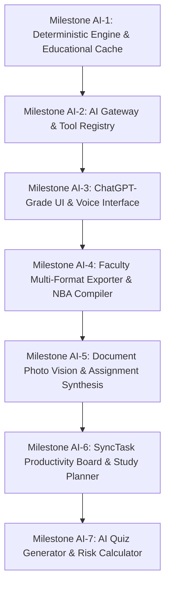

# Task Tracking & Architecture: VidyaOS AI Academic Companion & Educational Intelligence System

> **DEDICATED AI TRACKER**: This file serves as the isolated, persistent tracking ledger for the **VidyaOS AI System** (Academic Copilot, Educational LLM Engine, Tool Registry, Document Vision, and Productivity Planner).
> For general institutional attendance, ESP32, and register engine tracking, see [`TODO.md`](file:///d:/uiap/Attendance-System-Simplified/TODO.md).

---

## 📌 AI System Overview
- **System**: **VidyaAI — Institutional Academic Intelligence Engine**
- **Core Purpose**: Actionable, context-grounded AI companion for students and teachers with deterministic educational consistency.
- **Hardware Target**: Low-memory environments / 4 GB GPU VRAM laptop / Sub-1GB RAM runtime.
- **Model Stack**:
  - **Local Educational LLM**: `qwen2.5:0.5b` (~390 MB RAM) or quantized `llama3.2:1b` (~750 MB RAM) via Ollama (`http://localhost:11434`).
  - **Local Vision Model**: `moondream:1.8b` (~800 MB RAM) with in-process OCR fallback (`tesseract.js` + `pdf-parse`).
  - **Deterministic Fast Path**: In-process semantic acceleration engine (< 10 MB RAM, < 50ms response).

---

## 🎯 Educational Consistency & Determinism Invariants

1. **Zero-Hallucination & Answer Consistency**:
   - Educational definitions, formulas, and syllabus explanations must remain **identical and authoritative** across inquiries.
   - Temperature locked to `temperature: 0.0` (greedy decoding) or `0.1` with fixed seed to eliminate random divergence on standard questions.
2. **Authoritative Educational Cache (`education_knowledge_cache`)**:
   - Standard academic questions (e.g., *"What is 3NF in DBMS?"*, *"Explain Relational Algebra"*, *"What is Ohm's Law?"*) query the verified curriculum cache first.
   - Exact questions receive the identical, peer-reviewed institutional explanation instantly (< 5ms response time).
3. **Curriculum Grounding**:
   - Explanations are anchored to the approved institutional syllabus (UBTER / IRDT / AICTE) rather than speculative web scraping.
4. **Tool Registry Security & RBAC**:
   - The AI cannot bypass service-level permissions. Sensitive biometric data (fingerprint templates, IoT credentials) are completely firewalled.
5. **Multi-User Isolation**:
   - Every user's conversation state, uploaded photos, and format choices are strictly isolated by `req.user.id`.

---

## 🗺️ Phased Implementation Roadmap



---

## 📋 Milestone Ledger & Active Work

### ⏳ Milestone AI-1: Deterministic Educational Engine & Knowledge Cache
- [ ] Implement `backend/src/ai/educationalCache.js` with semantic question hashing and verified curriculum answers.
- [ ] Configure `localLlmService.js` with `temperature: 0.0` and fixed random seed for reproducible educational outputs.
- [ ] Integrate local model adapter for `qwen2.5:0.5b` (~390 MB RAM) with automatic fallback to in-process semantic engine.
- [ ] Setup unit tests for answer consistency (same prompt ➔ identical response verification).

### ⏳ Milestone AI-2: AI Gateway & Authorized Tool Registry
- [ ] Implement `backend/src/ai/gateway.js` and `backend/src/ai/contextBuilder.js` with role-scoped context.
- [ ] Register core tools:
  - `attendance.get_summary` (Attended, total, %, safe zone / deficit recovery count).
  - `timetable.get_upcoming` (Today/tomorrow's classes and examinations).
  - `tasks.search` & `tasks.create` (SyncTask integration).
  - `student_list.export` (Verified class roster generation in PDF/Word/Excel).
  - `nba_dossier.export` (Combined 18-part NBA/NAAC course file compiler).
- [ ] Implement RBAC firewall blocking students from accessing teacher-only tools or other students' private marks.

### ⏳ Milestone AI-3: ChatGPT-Grade UI & Real-Time Streaming Drawer
- [ ] Implement `frontend/shared/css/ai-assistant.css` with 100% theme-token compliance (0 hardcoded hex colors).
- [ ] Build `frontend/shared/js/ai-assistant.js` with typewriter / token streaming animation and blinking cursor.
- [ ] Implement interactive format pills (`[ 📄 PDF ]`, `[ 📝 Word ]`, `[ 📊 Excel ]`) and one-click file download cards.
- [ ] Integrate Web Speech API for voice input and interruptible speech synthesis.
- [ ] Mount floating `✨ VidyaAI` pill button across Faculty and Student dashboards.

### ⏳ Milestone AI-4: Faculty Conversational Export & NBA Dossier Compiler
- [ ] Implement conversational format negotiation:
  - Teacher: *"give me student list"* ➔ AI prompts for PDF/Word/Excel ➔ User selects ➔ Generates verified file.
- [ ] Build Combined 18-Part NBA Dossier compiler:
  - Combines Course Allotment, Syllabus, COs, CO-PO Matrix, Lesson Plan, Timetable, Student List, Attendance Summary, Slow/Advanced Learners, Assessments, and Audit Checklist into one unified PDF, Word `.doc`, or multi-sheet `.xlsx`.

### ⏳ Milestone AI-5: Document Photo Vision & Assignment Synthesis
- [ ] Implement image dropzone and camera attachment button in the chat drawer.
- [ ] Connect `moondream:1.8b` (Ollama) and local OCR (`tesseract.js` + `pdf-parse`) for document photo scanning.
- [ ] Extract questions from camera photos or PDF examination sheets.
- [ ] Implement one-click creation buttons:
  - `[ 📄 Create Assignment in Classroom ]`
  - `[ 📝 Export Summary to Word ]`
  - `[ 📑 Export Publication PDF ]`
  - `[ 📊 Convert to Excel ]`

### ⏳ Milestone AI-6: SyncTask Productivity Board & AI Study Planner
- [ ] Provision `sync_tasks` database table with parent task and milestone support.
- [ ] Build student SyncTask board (Today, This Week, Overdue, Completed).
- [ ] Implement `studyplan.create` tool: converts exam goals into timetable-aware revision milestones.
- [ ] Implement deterministic Attendance Risk calculations (safe zone classes needed to reach 75%).

### ⏳ Milestone AI-7: AI Quiz Generator & Bloom's Taxonomy MCQs
- [ ] Implement `quiz.generate` tool with 4-choice MCQs, answer explanations, and Bloom's cognitive domain tagging.
- [ ] Track topic-wise quiz performance to identify weak academic areas.

---

## 🧪 Verification & Regression Test Suite
Run from `backend/`:
```powershell
node scripts/test-ai-gateway-and-tools.js      # Tool registry & RBAC containment tests
node scripts/test-ai-educational-cache.js     # Answer consistency & determinism tests
node scripts/test-ai-multiformat-exports.js    # PDF, Word, and Excel binary file tests
node scripts/test-theme-support.js             # Theme token compliance (88/88 passed)
node scripts/test-register-consolidation.js    # Register engine regression (46/46 passed)
```

