# UIAP College Attendance System — Database Schema & ERD Specification

> **Version:** 1.0.0 (Authoritative Implementation Baseline)  
> **Database Engine:** MySQL 8.x (InnoDB Engine)  
> **Character Set / Collation:** `utf8mb4` / `utf8mb4_unicode_ci`  
> **Target Deployment:** Local-First Windows Edge Server (Offline-capable)

---

## 1. Entity-Relationship Diagram (ERD)

Below is the complete relational architecture governing all **26 tables** in the College Attendance System:

```mermaid
erDiagram
    users {
        int id PK
        varchar username UK
        varchar email UK
        varchar password_hash
        varchar temp_password_hash
        boolean must_change_password
        varchar google_sub UK
        enum status
        varchar rejection_reason
        timestamp created_at
        timestamp updated_at
    }

    user_roles {
        int id PK
        int user_id FK
        enum role
        timestamp created_at
    }

    user_sessions {
        int id PK
        int user_id FK
        varchar refresh_token_hash UK
        varchar user_agent
        varchar ip_address
        datetime expires_at
        boolean is_revoked
        timestamp created_at
        timestamp updated_at
    }

    departments {
        int id PK
        varchar name UK
        varchar code UK
        boolean is_active
        timestamp created_at
        timestamp updated_at
    }

    branches {
        int id PK
        int department_id FK
        varchar name
        varchar code
        boolean is_active
        timestamp created_at
        timestamp updated_at
    }

    academic_years {
        int id PK
        varchar label UK
        date start_date
        date end_date
        boolean is_current
        timestamp created_at
        timestamp updated_at
    }

    subjects {
        int id PK
        int department_id FK
        int branch_id FK
        int year
        int semester
        varchar name
        varchar code
        boolean is_active
        timestamp created_at
        timestamp updated_at
    }

    teachers {
        int id PK
        int user_id FK
        varchar employee_id UK
        varchar full_name
        varchar phone
        timestamp created_at
        timestamp updated_at
    }

    teacher_assignments {
        int id PK
        int teacher_id FK
        enum assignment_type
        int subject_id FK
        int department_id FK
        int branch_id FK
        int year
        int semester
        int academic_year_id FK
        int assigned_by FK
        boolean is_active
        timestamp created_at
        timestamp updated_at
    }

    students {
        int id PK
        int user_id FK
        varchar official_enrollment_no UK
        varchar full_name
        enum entry_mode
        timestamp created_at
        timestamp updated_at
    }

    enrollments {
        int id PK
        int student_id FK
        int department_id FK
        int branch_id FK
        int year
        int semester
        int academic_year_id FK
        int class_roll_no
        enum status
        timestamp created_at
        timestamp updated_at
    }

    cohort_registration_settings {
        int id PK
        int department_id FK
        int branch_id FK
        int year
        int semester
        int academic_year_id FK
        boolean registration_open
        int changed_by FK
        timestamp changed_at
    }

    attendance_sessions {
        int id PK
        int teacher_id FK
        int subject_id FK
        int department_id FK
        int branch_id FK
        int year
        int semester
        int academic_year_id FK
        enum session_type
        varchar label
        datetime start_time
        datetime end_time
        enum state
        datetime auto_close_at
        timestamp created_at
        timestamp updated_at
    }

    attendance_session_students {
        int id PK
        int session_id FK
        int student_id FK
        int enrollment_id FK
        int class_roll_no
        boolean included
        timestamp created_at
    }

    attendance_session_pins {
        int id PK
        int session_id FK
        varchar pin_code
        datetime expires_at
        boolean is_active
        int generated_by FK
        timestamp created_at
    }

    attendance_session_qr {
        int id PK
        int session_id FK
        varchar token_hash
        datetime expires_at
        boolean is_active
        int generated_by FK
        timestamp created_at
    }

    devices {
        int id PK
        varchar device_uid UK
        varchar name
        int department_id FK
        int branch_id FK
        int year
        int semester
        int academic_year_id FK
        varchar secret_hash
        varchar certificate_fingerprint
        boolean is_active
        timestamp last_heartbeat_at
        timestamp created_at
        timestamp updated_at
    }

    fingerprint_slots {
        int id PK
        int device_id FK
        int slot_id
        int student_id FK
        timestamp enrolled_at
        boolean is_active
    }

    device_events {
        int id PK
        int device_id FK
        enum event_type
        json payload_json
        timestamp created_at
    }

    esp32_presence {
        int id PK
        varchar event_id UK
        int device_id FK
        int student_id FK
        datetime scan_time
        json payload_json
        timestamp created_at
    }

    register_attendance {
        int id PK
        int session_id FK
        int student_id FK
        enum attendance_status
        enum source
        text teacher_notes
        int marked_by FK
        timestamp marked_at
        timestamp updated_at
    }

    register_attendance_corrections {
        int id PK
        int register_id FK
        enum previous_status
        enum new_status
        int corrected_by FK
        text reason
        timestamp created_at
    }

    student_self_attendance {
        int id PK
        int session_id FK
        int student_id FK
        enum verification_method
        enum request_status
        timestamp submitted_at
        datetime reviewed_at
        int reviewed_by FK
    }

    notifications {
        int id PK
        int user_id FK
        varchar title
        text message
        enum type
        boolean is_read
        varchar link_url
        timestamp created_at
    }

    audit_logs {
        int id PK
        int user_id FK
        varchar action
        varchar entity_type
        varchar entity_id
        json details_json
        varchar ip_address
        timestamp created_at
    }

    system_settings {
        int id PK
        varchar setting_key UK
        text setting_value
        varchar description
        int updated_by FK
        timestamp updated_at
    }

    users ||--o{ user_roles : "has"
    users ||--o{ user_sessions : "maintains"
    users ||--o| teachers : "profile"
    users ||--o| students : "profile"
    users ||--o{ notifications : "receives"
    users ||--o{ audit_logs : "triggers"
    users ||--o{ system_settings : "manages"
    users ||--o{ teacher_assignments : "assigns"
    users ||--o{ cohort_registration_settings : "configures"
    users ||--o{ register_attendance : "marks"
    users ||--o{ register_attendance_corrections : "corrects"
    users ||--o{ student_self_attendance : "reviews"

    departments ||--o{ branches : "contains"
    departments ||--o{ subjects : "offers"
    departments ||--o{ enrollments : "cohort_dept"
    departments ||--o{ teacher_assignments : "scoped_dept"
    departments ||--o{ cohort_registration_settings : "scoped_dept_settings"
    departments ||--o{ attendance_sessions : "session_dept"
    departments ||--o{ devices : "allocated_dept"

    branches ||--o{ subjects : "categorizes"
    branches ||--o{ enrollments : "cohort_branch"
    branches ||--o{ teacher_assignments : "scoped_branch"
    branches ||--o{ cohort_registration_settings : "scoped_branch_settings"
    branches ||--o{ attendance_sessions : "session_branch"
    branches ||--o{ devices : "allocated_branch"

    academic_years ||--o{ enrollments : "scopes_enrollment"
    academic_years ||--o{ teacher_assignments : "scopes_assignments"
    academic_years ||--o{ cohort_registration_settings : "scopes_settings"
    academic_years ||--o{ attendance_sessions : "scopes_sessions"
    academic_years ||--o{ devices : "assigns_devices"

    teachers ||--o{ teacher_assignments : "assigned_to"
    teachers ||--o{ attendance_sessions : "conducts"
    subjects ||--o{ teacher_assignments : "taught_by"
    subjects ||--o{ attendance_sessions : "belongs_to"

    students ||--o{ enrollments : "enrolls_in"
    students ||--o{ fingerprint_slots : "mapped_to"
    students ||--o{ esp32_presence : "scans_as"
    students ||--o{ register_attendance : "recorded_in"
    students ||--o{ student_self_attendance : "requests"
    students ||--o{ attendance_session_students : "rostered_in"

    enrollments ||--o{ attendance_session_students : "snapshots_enrollment"

    attendance_sessions ||--o{ attendance_session_students : "freezes_roster"
    attendance_sessions ||--o{ attendance_session_pins : "generates_pin"
    attendance_sessions ||--o{ attendance_session_qr : "generates_qr"
    attendance_sessions ||--o{ register_attendance : "contains_records"
    attendance_sessions ||--o{ student_self_attendance : "receives_requests"

    register_attendance ||--o{ register_attendance_corrections : "audits_corrections"

    devices ||--o{ fingerprint_slots : "stores_slots"
    devices ||--o{ device_events : "logs_activity"
    devices ||--o{ esp32_presence : "detects"
```

---

## 2. Table Catalog & Data Dictionary

### Group A: Central Identity & Authentication

#### 1. `users`
Central authentication credentials, activation state, and system-wide account status. Single source of truth for authentication.
| Column | Type | Constraints | Description |
|---|---|---|---|
| `id` | INT AUTO_INCREMENT | PK | Unique user identifier |
| `username` | VARCHAR(100) | NOT NULL, UNIQUE | Permanent login ID (Student: `official_enrollment_no`; Faculty: employee_id/email; Admin: username) |
| `email` | VARCHAR(150) | NULL, UNIQUE | Verified email / Gmail |
| `password_hash` | VARCHAR(255) | NULL | bcrypt hash of permanent password |
| `temp_password_hash` | VARCHAR(255) | NULL | bcrypt hash of temporary password (cleared on activation) |
| `must_change_password` | BOOLEAN | NOT NULL DEFAULT FALSE | Mandatory password change flag on first login |
| `google_sub` | VARCHAR(255) | NULL, UNIQUE | Google OAuth unique subject identifier |
| `status` | ENUM | NOT NULL DEFAULT 'ACTIVE' | `'PROVISIONED'`, `'PENDING'`, `'ACTIVE'`, `'REJECTED'`, `'SUSPENDED'` |
| `rejection_reason` | VARCHAR(255) | NULL | Explanation if registration is rejected |
| `created_at` | TIMESTAMP | DEFAULT CURRENT_TIMESTAMP | Account creation timestamp |
| `updated_at` | TIMESTAMP | ON UPDATE CURRENT_TIMESTAMP | Last modification timestamp |

#### 2. `user_roles`
Clean system-level roles without academic scoping columns.
| Column | Type | Constraints | Description |
|---|---|---|---|
| `id` | INT AUTO_INCREMENT | PK | Primary key |
| `user_id` | INT | NOT NULL, FK -> `users(id)` ON DELETE CASCADE | Reference to user |
| `role` | ENUM | NOT NULL | `'SYSTEM_ADMIN'`, `'TEACHER'`, `'STUDENT'` |
| `created_at` | TIMESTAMP | DEFAULT CURRENT_TIMESTAMP | Assigned timestamp |
| *Index / Constraint* | | UNIQUE(`user_id`, `role`) | Ensures role uniqueness per user |

#### 3. `user_sessions`
Tracks active sessions and rotated refresh tokens.
| Column | Type | Constraints | Description |
|---|---|---|---|
| `id` | INT AUTO_INCREMENT | PK | Primary key |
| `user_id` | INT | NOT NULL, FK -> `users(id)` ON DELETE CASCADE | Reference to authenticated user |
| `refresh_token_hash` | VARCHAR(255) | NOT NULL, UNIQUE | SHA-256 hash of refresh token |
| `user_agent` | VARCHAR(255) | NULL | Browser/device user agent |
| `ip_address` | VARCHAR(45) | NULL | IPv4/IPv6 client address |
| `expires_at` | DATETIME | NOT NULL | Token expiration timestamp |
| `is_revoked` | BOOLEAN | NOT NULL DEFAULT FALSE | Immediate revocation flag |
| `created_at` | TIMESTAMP | DEFAULT CURRENT_TIMESTAMP | Issuance timestamp |
| `updated_at` | TIMESTAMP | ON UPDATE CURRENT_TIMESTAMP | Last updated timestamp |

---

### Group B: Academic Master Tables (Database-Backed & Seeded)

#### 4. `departments`
Seeded list of institutional academic departments (IT, CE, ME, CL, EE).
| Column | Type | Constraints | Description |
|---|---|---|---|
| `id` | INT AUTO_INCREMENT | PK | Primary key |
| `name` | VARCHAR(100) | NOT NULL, UNIQUE | Full department title (e.g. "Information Technology") |
| `code` | VARCHAR(20) | NOT NULL, UNIQUE | Department shorthand code (e.g. "IT") |
| `is_active` | BOOLEAN | NOT NULL DEFAULT TRUE | Soft-delete / activation toggle |
| `created_at` | TIMESTAMP | DEFAULT CURRENT_TIMESTAMP | Created timestamp |
| `updated_at` | TIMESTAMP | ON UPDATE CURRENT_TIMESTAMP | Updated timestamp |

#### 5. `branches`
Educational qualifications/branches belonging to departments (B.Tech, Diploma, BCA).
| Column | Type | Constraints | Description |
|---|---|---|---|
| `id` | INT AUTO_INCREMENT | PK | Primary key |
| `department_id` | INT | NOT NULL, FK -> `departments(id)` ON DELETE RESTRICT | Parent department |
| `name` | VARCHAR(100) | NOT NULL | Branch title (e.g. "B.Tech - Information Technology") |
| `code` | VARCHAR(20) | NOT NULL | Branch code (e.g. "BTECH") |
| `is_active` | BOOLEAN | NOT NULL DEFAULT TRUE | Active toggle |
| `created_at` | TIMESTAMP | DEFAULT CURRENT_TIMESTAMP | Created timestamp |
| `updated_at` | TIMESTAMP | ON UPDATE CURRENT_TIMESTAMP | Updated timestamp |
| *Constraint* | | UNIQUE(`department_id`, `code`) | Branch code unique within department |

#### 6. `academic_years`
Scopes all annual academic records, teacher assignments, and cohort enrollments.
| Column | Type | Constraints | Description |
|---|---|---|---|
| `id` | INT AUTO_INCREMENT | PK | Primary key |
| `label` | VARCHAR(20) | NOT NULL, UNIQUE | Academic year format (e.g. "2026-27") |
| `start_date` | DATE | NOT NULL | Academic year opening date |
| `end_date` | DATE | NOT NULL | Academic year closing date |
| `is_current` | BOOLEAN | NOT NULL DEFAULT FALSE | Active year flag |
| `created_at` | TIMESTAMP | DEFAULT CURRENT_TIMESTAMP | Created timestamp |
| `updated_at` | TIMESTAMP | ON UPDATE CURRENT_TIMESTAMP | Updated timestamp |

#### 7. `subjects`
Master course catalog taught within cohorts.
| Column | Type | Constraints | Description |
|---|---|---|---|
| `id` | INT AUTO_INCREMENT | PK | Primary key |
| `department_id` | INT | NOT NULL, FK -> `departments(id)` | Offering department |
| `branch_id` | INT | NOT NULL, FK -> `branches(id)` | Enrolled branch |
| `year` | INT | NOT NULL | Academic year level (1–4) |
| `semester` | INT | NOT NULL | Semester (1–8) |
| `name` | VARCHAR(150) | NOT NULL | Subject name (e.g. "Database Management Systems") |
| `code` | VARCHAR(30) | NOT NULL | Subject syllabus code (e.g. "IT401") |
| `is_active` | BOOLEAN | NOT NULL DEFAULT TRUE | Status toggle |
| `created_at` | TIMESTAMP | DEFAULT CURRENT_TIMESTAMP | Created timestamp |
| `updated_at` | TIMESTAMP | ON UPDATE CURRENT_TIMESTAMP | Updated timestamp |
| *Constraint* | | UNIQUE(`department_id`, `branch_id`, `year`, `semester`, `code`) | Unique subject code per cohort level |

---

### Group C: Faculty & Functional Assignments

#### 8. `teachers`
Profile information for academic teaching faculty.
| Column | Type | Constraints | Description |
|---|---|---|---|
| `id` | INT AUTO_INCREMENT | PK | Primary key |
| `user_id` | INT | NOT NULL, UNIQUE, FK -> `users(id)` ON DELETE CASCADE | 1-to-1 link to central user |
| `employee_id` | VARCHAR(50) | NOT NULL, UNIQUE | Institutional employee / faculty code |
| `full_name` | VARCHAR(150) | NOT NULL | Teacher full name |
| `phone` | VARCHAR(20) | NULL | Contact phone number |
| `created_at` | TIMESTAMP | DEFAULT CURRENT_TIMESTAMP | Profile creation timestamp |
| `updated_at` | TIMESTAMP | ON UPDATE CURRENT_TIMESTAMP | Last modification timestamp |

#### 9. `teacher_assignments`
Dynamic functional scopes. Decoupled from JWT tokens; resolved on every request.
| Column | Type | Constraints | Description |
|---|---|---|---|
| `id` | INT AUTO_INCREMENT | PK | Primary key |
| `teacher_id` | INT | NOT NULL, FK -> `teachers(id)` ON DELETE CASCADE | Assigned faculty |
| `assignment_type` | ENUM | NOT NULL | `'SUBJECT_TEACHER'`, `'CLASS_TEACHER'`, `'HOD'` |
| `subject_id` | INT | NULL, FK -> `subjects(id)` | Subject taught (NULL for CLASS_TEACHER and HOD) |
| `department_id` | INT | NOT NULL, FK -> `departments(id)` | Assigned cohort department |
| `branch_id` | INT | NOT NULL, FK -> `branches(id)` | Assigned cohort branch |
| `year` | INT | NOT NULL | Assigned cohort year (1–4) |
| `semester` | INT | NOT NULL | Assigned cohort semester (1–8) |
| `academic_year_id` | INT | NOT NULL, FK -> `academic_years(id)` | Applicable academic year |
| `assigned_by` | INT | NOT NULL, FK -> `users(id)` | Admin user who authorized the assignment |
| `is_active` | BOOLEAN | NOT NULL DEFAULT TRUE | Active assignment toggle |
| `created_at` | TIMESTAMP | DEFAULT CURRENT_TIMESTAMP | Assignment timestamp |
| `updated_at` | TIMESTAMP | ON UPDATE CURRENT_TIMESTAMP | Last updated timestamp |

---

### Group D: Students & Cohort Enrollments

#### 10. `students`
Permanent student master identity profile. Contains NO credentials (credentials reside in `users`).
| Column | Type | Constraints | Description |
|---|---|---|---|
| `id` | INT AUTO_INCREMENT | PK | Primary key |
| `user_id` | INT | NOT NULL, UNIQUE, FK -> `users(id)` ON DELETE CASCADE | 1-to-1 link to central authentication record |
| `official_enrollment_no` | VARCHAR(50) | NOT NULL, UNIQUE | University-issued permanent ID (matches `users.username`) |
| `full_name` | VARCHAR(150) | NOT NULL | Student official name |
| `entry_mode` | ENUM | NOT NULL DEFAULT 'teacher_provisioned' | `'teacher_provisioned'`, `'self_registered'`, `'admin_created'` |
| `created_at` | TIMESTAMP | DEFAULT CURRENT_TIMESTAMP | Creation timestamp |
| `updated_at` | TIMESTAMP | ON UPDATE CURRENT_TIMESTAMP | Last update timestamp |

#### 11. `enrollments`
Historical & active cohort memberships. Stores `class_roll_no`.
| Column | Type | Constraints | Description |
|---|---|---|---|
| `id` | INT AUTO_INCREMENT | PK | Primary key |
| `student_id` | INT | NOT NULL, FK -> `students(id)` ON DELETE CASCADE | Enrolled student |
| `department_id` | INT | NOT NULL, FK -> `departments(id)` | Cohort department |
| `branch_id` | INT | NOT NULL, FK -> `branches(id)` | Cohort branch |
| `year` | INT | NOT NULL | Cohort year level (1–4) |
| `semester` | INT | NOT NULL | Cohort semester (1–8) |
| `academic_year_id` | INT | NOT NULL, FK -> `academic_years(id)` | Scoped academic year |
| `class_roll_no` | INT | NOT NULL | Roll number within this specific cohort & academic year |
| `status` | ENUM | NOT NULL DEFAULT 'ENROLLED' | `'ENROLLED'`, `'COMPLETED'`, `'PROMOTED'`, `'DROPPED'` |
| `created_at` | TIMESTAMP | DEFAULT CURRENT_TIMESTAMP | Enrollment timestamp |
| `updated_at` | TIMESTAMP | ON UPDATE CURRENT_TIMESTAMP | Modification timestamp |
| *Constraint 1* | | UNIQUE(`department_id`, `branch_id`, `year`, `semester`, `academic_year_id`, `class_roll_no`) | Roll number is strictly unique per cohort per academic year |
| *Constraint 2* | | UNIQUE(`student_id`, `academic_year_id`) | Student can only be enrolled in one cohort per academic year |

#### 12. `cohort_registration_settings`
Class teacher toggle for self-registration access.
| Column | Type | Constraints | Description |
|---|---|---|---|
| `id` | INT AUTO_INCREMENT | PK | Primary key |
| `department_id` | INT | NOT NULL, FK -> `departments(id)` | Cohort department |
| `branch_id` | INT | NOT NULL, FK -> `branches(id)` | Cohort branch |
| `year` | INT | NOT NULL | Cohort year (1–4) |
| `semester` | INT | NOT NULL | Cohort semester (1–8) |
| `academic_year_id` | INT | NOT NULL, FK -> `academic_years(id)` | Academic year |
| `registration_open` | BOOLEAN | NOT NULL DEFAULT TRUE | ON/OFF toggle for self-registration |
| `changed_by` | INT | NOT NULL, FK -> `users(id)` | Class Teacher user who toggled |
| `changed_at` | TIMESTAMP | ON UPDATE CURRENT_TIMESTAMP | Toggle timestamp |
| *Constraint* | | UNIQUE(`department_id`, `branch_id`, `year`, `semester`, `academic_year_id`) | One toggle record per cohort per year |

---

### Group E: Attendance Sessions & Roster Snapshots

#### 13. `attendance_sessions`
Full 16-attribute attendance session record.
| Column | Type | Constraints | Description |
|---|---|---|---|
| `id` | INT AUTO_INCREMENT | PK | Unique session ID |
| `teacher_id` | INT | NOT NULL, FK -> `teachers(id)` | Teacher who created/conducts the session |
| `subject_id` | INT | NOT NULL, FK -> `subjects(id)` | Subject being taught |
| `department_id` | INT | NOT NULL, FK -> `departments(id)` | Cohort department |
| `branch_id` | INT | NOT NULL, FK -> `branches(id)` | Cohort branch |
| `year` | INT | NOT NULL | Cohort year (1–4) |
| `semester` | INT | NOT NULL | Cohort semester (1–8) |
| `academic_year_id` | INT | NOT NULL, FK -> `academic_years(id)` | Academic year |
| `session_type` | ENUM | NOT NULL DEFAULT 'THEORY' | `'THEORY'`, `'PRACTICAL'`, `'TUTORIAL'`, `'EXTRA'` |
| `label` | VARCHAR(100) | NULL | Descriptive title (e.g. "Lab Batch A", "Lecture 14") |
| `start_time` | DATETIME | NOT NULL | Session scheduled or start timestamp |
| `end_time` | DATETIME | NULL | Session closure timestamp |
| `state` | ENUM | NOT NULL DEFAULT 'DRAFT' | `'DRAFT'`, `'OPEN'`, `'CLOSED'`, `'FINALIZED'` |
| `auto_close_at` | DATETIME | NULL | Expiration timestamp for automatic closing of submissions |
| `created_at` | TIMESTAMP | DEFAULT CURRENT_TIMESTAMP | Creation timestamp |
| `updated_at` | TIMESTAMP | ON UPDATE CURRENT_TIMESTAMP | Last modification timestamp |

#### 14. `attendance_session_students`
Historical snapshot of enrolled students frozen when the session is initialized.
| Column | Type | Constraints | Description |
|---|---|---|---|
| `id` | INT AUTO_INCREMENT | PK | Primary key |
| `session_id` | INT | NOT NULL, FK -> `attendance_sessions(id)` ON DELETE CASCADE | Associated session |
| `student_id` | INT | NOT NULL, FK -> `students(id)` | Rostered student |
| `enrollment_id` | INT | NOT NULL, FK -> `enrollments(id)` | Frozen enrollment snapshot |
| `class_roll_no` | INT | NOT NULL | Frozen class roll number |
| `included` | BOOLEAN | NOT NULL DEFAULT TRUE | If FALSE, student is excluded from session denominator |
| `created_at` | TIMESTAMP | DEFAULT CURRENT_TIMESTAMP | Snapshot timestamp |
| *Constraint* | | UNIQUE(`session_id`, `student_id`) | Student only rostered once per session |

#### 15. `attendance_session_pins`
Time-limited 6-digit PIN codes for soft self-attendance.
| Column | Type | Constraints | Description |
|---|---|---|---|
| `id` | INT AUTO_INCREMENT | PK | Primary key |
| `session_id` | INT | NOT NULL, FK -> `attendance_sessions(id)` ON DELETE CASCADE | Associated session |
| `pin_code` | VARCHAR(10) | NOT NULL | Numerical PIN code |
| `expires_at` | DATETIME | NOT NULL | Expiration timestamp |
| `created_at` | TIMESTAMP | DEFAULT CURRENT_TIMESTAMP | Creation timestamp |

#### 16. `attendance_session_qr`
Time-limited rotating QR token hashes for soft self-attendance.
| Column | Type | Constraints | Description |
|---|---|---|---|
| `id` | INT AUTO_INCREMENT | PK | Primary key |
| `session_id` | INT | NOT NULL, FK -> `attendance_sessions(id)` ON DELETE CASCADE | Associated session |
| `token_hash` | VARCHAR(255) | NOT NULL | Cryptographic token hash |
| `expires_at` | DATETIME | NOT NULL | Expiration timestamp |
| `created_at` | TIMESTAMP | DEFAULT CURRENT_TIMESTAMP | Creation timestamp |

---

### Group F: Hardware Devices & Biometric Mapping

#### 17. `devices`
Registered ESP32 devices explicitly assigned to a cohort.
| Column | Type | Constraints | Description |
|---|---|---|---|
| `id` | INT AUTO_INCREMENT | PK | Device primary key |
| `device_uid` | VARCHAR(100) | NOT NULL, UNIQUE | MAC address or hardware serial number |
| `name` | VARCHAR(100) | NOT NULL | Device label (e.g. "Lab 3 - ESP32 #1") |
| `department_id` | INT | NOT NULL, FK -> `departments(id)` | Assigned Department |
| `branch_id` | INT | NOT NULL, FK -> `branches(id)` | Assigned Branch |
| `year` | INT | NOT NULL | Assigned Year |
| `semester` | INT | NOT NULL | Assigned Semester |
| `academic_year_id` | INT | NOT NULL, FK -> `academic_years(id)` | Assigned Academic Year |
| `secret_hash` | VARCHAR(255) | NOT NULL | Shared secret hash for HMAC / Auth header |
| `certificate_fingerprint` | VARCHAR(255) | NULL | SHA-256 fingerprint of server TLS certificate |
| `is_active` | BOOLEAN | NOT NULL DEFAULT TRUE | Device active status |
| `last_heartbeat_at` | TIMESTAMP | NULL | Heartbeat tracking |
| `created_at` | TIMESTAMP | DEFAULT CURRENT_TIMESTAMP | Registration timestamp |
| `updated_at` | TIMESTAMP | ON UPDATE CURRENT_TIMESTAMP | Last updated timestamp |

#### 18. `fingerprint_slots`
Maps optical sensor slots (1–1000) to students per device.
| Column | Type | Constraints | Description |
|---|---|---|---|
| `id` | INT AUTO_INCREMENT | PK | Primary key |
| `device_id` | INT | NOT NULL, FK -> `devices(id)` ON DELETE CASCADE | Associated ESP32 hardware |
| `slot_id` | INT | NOT NULL | R307/AS608 sensor memory slot (1–1000) |
| `student_id` | INT | NOT NULL, FK -> `students(id)` ON DELETE CASCADE | Enrolled student |
| `enrolled_at` | TIMESTAMP | DEFAULT CURRENT_TIMESTAMP | Enrollment timestamp |
| `is_active` | BOOLEAN | NOT NULL DEFAULT TRUE | Slot active flag |
| *Constraint 1* | | UNIQUE(`device_id`, `slot_id`) | One student per sensor slot on a given device |
| *Constraint 2* | | UNIQUE(`device_id`, `student_id`) | A student occupies at most one slot on a given device |

#### 19. `device_events`
Hardware heartbeat, sync, command, and error log.
| Column | Type | Constraints | Description |
|---|---|---|---|
| `id` | INT AUTO_INCREMENT | PK | Primary key |
| `device_id` | INT | NOT NULL, FK -> `devices(id)` ON DELETE CASCADE | Associated device |
| `event_type` | ENUM | NOT NULL | `'HEARTBEAT'`, `'SCAN_SYNC'`, `'COMMAND_ACK'`, `'ERROR'` |
| `payload_json` | JSON | NULL | Additional event payload |
| `created_at` | TIMESTAMP | DEFAULT CURRENT_TIMESTAMP | Event log timestamp |

---

### Group G: Three Independent Attendance Streams

#### 20. `esp32_presence` (Stream 1)
Raw physical presence evidence from ESP32 fingerprint scans.
| Column | Type | Constraints | Description |
|---|---|---|---|
| `id` | INT AUTO_INCREMENT | PK | Primary key |
| `event_id` | VARCHAR(64) | NOT NULL, UNIQUE | Event deduplication ID generated by ESP32/gateway |
| `device_id` | INT | NOT NULL, FK -> `devices(id)` | Originating device |
| `student_id` | INT | NOT NULL, FK -> `students(id)` | Identified student |
| `scan_time` | DATETIME | NOT NULL | Physical scan timestamp |
| `payload_json` | JSON | NULL | Raw telemetry |
| `created_at` | TIMESTAMP | DEFAULT CURRENT_TIMESTAMP | Server receipt timestamp |
| *Constraint* | | **UNIQUE(`event_id`)** | Deduplicates identical transmission events. Multiple distinct scans are retained as raw evidence. |

#### 21. `register_attendance` (Stream 2)
Authoritative official attendance record recorded by the teacher.
| Column | Type | Constraints | Description |
|---|---|---|---|
| `id` | INT AUTO_INCREMENT | PK | Primary key |
| `session_id` | INT | NOT NULL, FK -> `attendance_sessions(id)` ON DELETE CASCADE | Associated session |
| `student_id` | INT | NOT NULL, FK -> `students(id)` | Student |
| `attendance_status` | ENUM | NOT NULL | `'PRESENT'`, `'ABSENT'`, `'LATE'` |
| `source` | ENUM | NOT NULL DEFAULT 'MANUAL' | `'MANUAL'`, `'ESP32_SYNC'`, `'SELF_REQUEST'` |
| `teacher_notes` | TEXT | NULL | Teacher optional justification |
| `marked_by` | INT | NOT NULL, FK -> `users(id)` | Faculty user who finalized/marked |
| `marked_at` | TIMESTAMP | DEFAULT CURRENT_TIMESTAMP | Initial record timestamp |
| `updated_at` | TIMESTAMP | ON UPDATE CURRENT_TIMESTAMP | Update timestamp |
| *Constraint* | | UNIQUE(`session_id`, `student_id`) | Exactly one official register record per student per session |

#### 22. `register_attendance_corrections`
Immutable audit trail for legal administrative corrections on finalized sessions.
| Column | Type | Constraints | Description |
|---|---|---|---|
| `id` | INT AUTO_INCREMENT | PK | Correction audit ID |
| `register_id` | INT | NOT NULL, FK -> `register_attendance(id)` ON DELETE CASCADE | Target register record |
| `previous_status` | ENUM | NOT NULL | Original status before correction (`PRESENT`, `ABSENT`, `LATE`) |
| `new_status` | ENUM | NOT NULL | Corrected status (`PRESENT`, `ABSENT`, `LATE`) |
| `corrected_by` | INT | NOT NULL, FK -> `users(id)` | Administrator who authorized correction |
| `reason` | TEXT | NOT NULL | Mandatory justification (e.g. Medical certificate reference) |
| `created_at` | TIMESTAMP | DEFAULT CURRENT_TIMESTAMP | Audit creation timestamp |

#### 23. `student_self_attendance` (Stream 3)
Soft mobile self-attendance requests submitted by students.
| Column | Type | Constraints | Description |
|---|---|---|---|
| `id` | INT AUTO_INCREMENT | PK | Primary key |
| `session_id` | INT | NOT NULL, FK -> `attendance_sessions(id)` ON DELETE CASCADE | Associated session |
| `student_id` | INT | NOT NULL, FK -> `students(id)` | Submitting student |
| `verification_method` | ENUM | NOT NULL | `'PIN'`, `'QR'`, `'MANUAL_REQUEST'` |
| `request_status` | ENUM | NOT NULL DEFAULT 'PENDING' | `'PENDING'`, `'ACCEPTED'`, `'REJECTED'` |
| `submitted_at` | TIMESTAMP | DEFAULT CURRENT_TIMESTAMP | Submission timestamp |
| `reviewed_at` | TIMESTAMP | NULL | Review timestamp |
| `reviewed_by` | INT | NULL, FK -> `users(id)` | Teacher user who approved/rejected |
| *Constraint* | | UNIQUE(`session_id`, `student_id`) | One self-attendance request per student per session |

---

### Group H: System Logs & Settings

#### 24. `notifications`
In-app notification storage for teachers and students.
| Column | Type | Constraints | Description |
|---|---|---|---|
| `id` | INT AUTO_INCREMENT | PK | Primary key |
| `user_id` | INT | NOT NULL, FK -> `users(id)` ON DELETE CASCADE | Recipient |
| `title` | VARCHAR(150) | NOT NULL | Notification title |
| `message` | TEXT | NOT NULL | Notification body |
| `is_read` | BOOLEAN | NOT NULL DEFAULT FALSE | Read indicator |
| `link_url` | VARCHAR(255) | NULL | Frontend navigation target |
| `created_at` | TIMESTAMP | DEFAULT CURRENT_TIMESTAMP | Notification timestamp |

#### 25. `audit_logs`
Immutable administrative and security audit trail.
| Column | Type | Constraints | Description |
|---|---|---|---|
| `id` | INT AUTO_INCREMENT | PK | Primary key |
| `user_id` | INT | NULL, FK -> `users(id)` ON DELETE SET NULL | Acting user |
| `action` | VARCHAR(100) | NOT NULL | Action name (e.g. `SESSION_FINALIZED`) |
| `entity_type` | VARCHAR(100) | NOT NULL | Affected entity (e.g. `attendance_session`) |
| `entity_id` | VARCHAR(100) | NULL | Entity identifier |
| `details_json` | JSON | NULL | Before/after state or additional metadata |
| `ip_address` | VARCHAR(45) | NULL | Originating client IP |
| `created_at` | TIMESTAMP | DEFAULT CURRENT_TIMESTAMP | Immutable timestamp |

#### 26. `system_settings`
Global system configuration key-value storage.
| Column | Type | Constraints | Description |
|---|---|---|---|
| `id` | INT AUTO_INCREMENT | PK | Primary key |
| `setting_key` | VARCHAR(100) | NOT NULL, UNIQUE | Config key |
| `setting_value` | TEXT | NOT NULL | Config value |
| `description` | VARCHAR(255) | NULL | Setting explanation |
| `updated_by` | INT | NULL, FK -> `users(id)` | Last modified by |
| `updated_at` | TIMESTAMP | ON UPDATE CURRENT_TIMESTAMP | Last updated timestamp |
