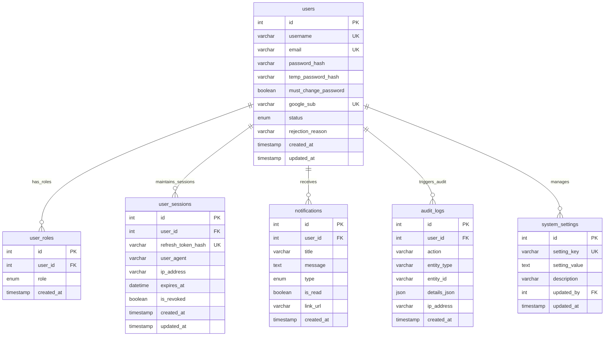
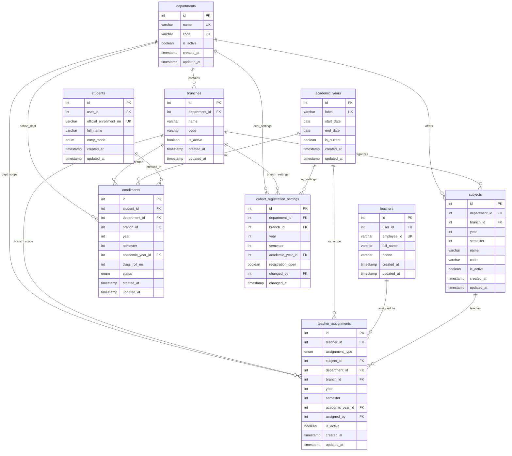
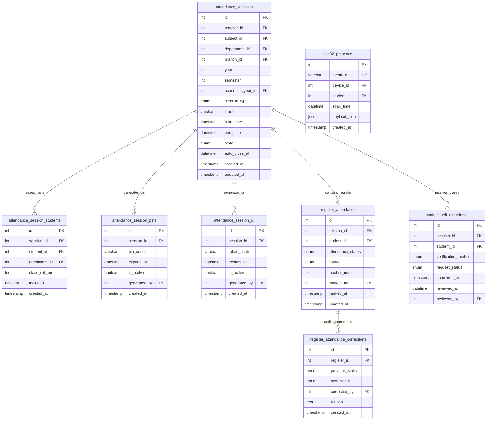
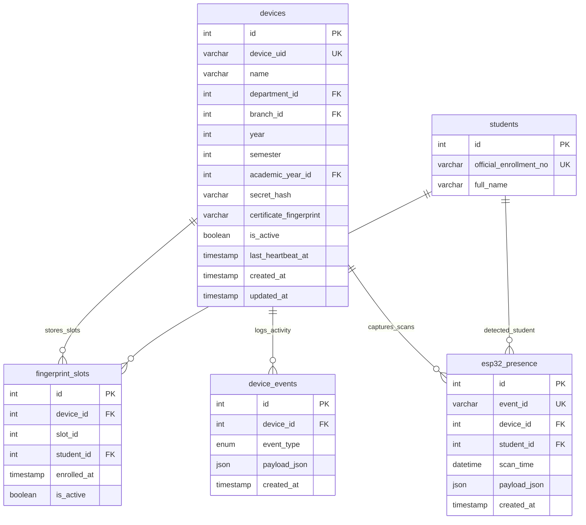

# Team Role Guide: Database Designer (MySQL 8.x Architecture & DBA)

> **Role Title:** Relational Database Architect & DBA  
> **Document Identifier:** `docs/attendance/roles/04_DATABASE_DESIGNER.md`  
> **Primary Responsibility:** Relational Schema, Migrations, Indexing, Integrity & Backups (`backend/database/`)  
> **Target Audience:** Database Designer / MySQL Database Administrator  
> **Collaborates With:** Back-End Developer (Queries & Transactions), Front-End Developer (Entity Models), Application Developer (Slot Data)

---

## 1. Role Executive Summary & Mission

As the **Database Designer**, you are the foundational guardian of institutional data. Your responsibility is to ensure that the on-premise **MySQL 8.x database** is architected for absolute referential integrity, lightning-fast query execution, and zero data loss.

Your primary missions are:
1. **Schema Integrity & Invariant Enforcement:** Designing and maintaining the complete 26-table catalog responsible for the institutional ER diagram, foreign key relationships, cascade/restrict rules, and unique constraints.
2. **Transaction Isolation:** Guaranteeing that multi-table mutations (such as student provisioning, session roster snapshots, and register finalizations) execute with ACID safety.
3. **High-Performance Indexing:** Ensuring that real-time live attendance queries, daily aggregation reports, and ESP32 deduplication execute in single-digit milliseconds.
4. **Disaster Recovery & Operational Runbooks:** Automating local daily backups (`mysqldump`), crash recovery, and database connection pool tuning on the Windows edge server.

---

## 2. What You Need to Know (Core Architecture & Rules)

### 2.1 Database Engine Standards
| Parameter | Standard / Configuration |
|---|---|
| **Database Engine** | MySQL 8.0+ / 8.4 LTS |
| **Storage Engine** | InnoDB exclusively (ACID compliant, row-level locking, foreign keys) |
| **Character Set** | `utf8mb4` (supports full Unicode, emoji, multilingual names) |
| **Collation** | `utf8mb4_unicode_ci` (case-insensitive, institutional name sorting) |
| **Timezone** | Strict UTC (`+00:00`) for all timestamps. Local time formatting is handled by backend/frontend. |
| **Foreign Keys** | `FOREIGN_KEY_CHECKS = 1` enforced in production. Cascades applied strictly where life-cycles are 1:1. |

### 2.2 Core Relational Invariants You Must Protect
1. **The Cohort Invariant:**
   - There is **no standalone `classes` table**.
   - An academic cohort is deterministically identified by the compound attributes:
     $$\textbf{Cohort} = \textbf{department\_id} + \textbf{branch\_id} + \textbf{year} + \textbf{semester} + \textbf{academic\_year\_id}$$
   - Tables such as `enrollments`, `attendance_sessions`, `devices`, and `cohort_registration_settings` must enforce unique composite indexes over these attributes.
2. **The Student Username Parity Invariant:**
   - For all student users:
     $$\textbf{users.username} = \textbf{students.official\_enrollment\_no}$$
   - Since standard MySQL cannot cross-table validate via `CHECK` constraints, you must instruct the Back-End Developer to execute all student creation and updates within an explicit `START TRANSACTION ... COMMIT` block.
3. **Dual Roll Number Isolation:**
   - `students.official_enrollment_no`: Globally unique across the entire institution.
   - `enrollments.class_roll_no`: Unique strictly within that specific cohort and academic year:
     ```sql
     UNIQUE KEY uq_cohort_roll (department_id, branch_id, year, semester, academic_year_id, class_roll_no)
     ```
4. **The Three Attendance Streams Isolation:**
   - **Stream 1:** `esp32_presence` (Hardware scans, deduplicated via `UNIQUE(event_id)`).
   - **Stream 2:** `register_attendance` (Official register, `UNIQUE(session_id, student_id)`).
   - **Stream 3:** `student_self_attendance` (Soft requests, `UNIQUE(session_id, student_id)`).
   - The three streams must **never share a database table**.
5. **Session Roster Immutability:**
   - When an attendance session is created, the cohort enrollments are snapshotted into `attendance_session_students`.
   - Even if student enrollments are altered later, historical session rosters remain permanently preserved.
6. **Hardware Slot Invariant:**
   - Sensor slot 42 is not a student identity.
   - Student identity is resolved strictly through:
     ```sql
     UNIQUE KEY uq_device_slot (device_id, slot_id)
     ```

### 2.3 The 5-Tier Actor Hierarchy & Relational Partitioning Matrix

The Database Designer must understand how the 26-table schema partitions authority across the five institutional tiers. System roles in `user_roles` combined with dynamic scope rows in `teacher_assignments` establish strict relational boundaries:

$$\textbf{System Admin} \succ \textbf{HOD} \succ \textbf{Class Teacher} \succ \textbf{Subject Teacher} \succ \textbf{Student}$$

| Actor Tier | Relational Anchoring & Joins | Tables Governed (Write / Mutate) | Tables Consulted (Read / Aggregate) |
|---|---|---|---|
| **1. System Admin** | Unrestricted global access (`user_roles.role = 'SYSTEM_ADMIN'`) | • Master Core: `departments`, `branches`, `academic_years`, `subjects`, `system_settings`<br>• Device Core: `devices`<br>• Identity Core: `users`, `user_roles`, `user_sessions`<br>• Audit Core: `register_attendance_corrections`, `audit_logs` | All 26 Tables |
| **2. HOD** | `teacher_assignments.assignment_type = 'HOD'` joined on `departments.id` | • Institutional announcements / notifications for department | • `cohort_enrollments`, `attendance_sessions`, `register_attendance`, `attendance_session_students`<br>(Scoped strictly to `cohort.department_id`) |
| **3. Class Teacher** | `teacher_assignments.assignment_type = 'CLASS_TEACHER'` joined on compound cohort tuple: `(department_id, branch_id, year, semester, academic_year_id)` | • `students`, `cohort_enrollments`<br>• `cohort_registration_settings`, `pending_registrations`<br>• **`fingerprint_slots`** (assigning student to device slot) | • `attendance_sessions`, `register_attendance` for their specific cohort<br>• `notifications` |
| **4. Subject Teacher** | `attendance_sessions.teacher_id = users.id` AND `teacher_assignments.assignment_type = 'SUBJECT_TEACHER'` | • `attendance_sessions` (state transitions)<br>• `attendance_session_students` (roster snapshot)<br>• `register_attendance` (marking draft & 1-click sync)<br>• `student_self_attendance` (claim adjudication) | • `students`, `cohort_enrollments`<br>• `esp32_presence` (matched biometric evidence) |
| **5. Student** | `students.id = users.id` joined on `cohort_enrollments.student_id` | • `student_self_attendance` (self presence claims)<br>• `user_sessions` (auth session token updates)<br>• `notifications` (read status updates) | • Personal `register_attendance` records<br>• Enrolled `cohort_enrollments` & subjects<br>• Personal profile in `students` |

---

### 2.4 The 4 Cross-Actor Lifecycle Flows from the Database Transaction Perspective

The database schema must enforce relational invariants, row-level locks, and atomic transactions across all four canonical lifecycle flows:

#### Flow 1: Academic Setup, Provisioning & Biometric Slot Allocation
1. **Master Structure Ingestion:**
   - Admin inserts institutional entities into `departments`, `branches`, `academic_years`, and `subjects`.
   - Admin inserts classroom terminal into `devices` with `is_active = TRUE`.
   - Admin binds faculty roles by inserting into `teacher_assignments (teacher_id, assignment_type, department_id, branch_id, ...)`.
2. **Atomic Student Provisioning Transaction:**
   - Class Teacher triggers bulk onboarding. The database receives an atomic transaction:
     ```sql
     START TRANSACTION;
     -- 1. Create central user credential
     INSERT INTO users (username, password_hash, status, needs_password_change) 
     VALUES ('2024IT047', '$2b$10$tempHash...', 'PROVISIONED', TRUE);
     SET @new_user_id = LAST_INSERT_ID();
     -- 2. Bind default STUDENT system role
     INSERT INTO user_roles (user_id, role) VALUES (@new_user_id, 'STUDENT');
     -- 3. Create student profile
     INSERT INTO students (id, official_enrollment_no, full_name, email)
     VALUES (@new_user_id, '2024IT047', 'Aarav Patel', 'aarav@college.edu');
     -- 4. Enroll student into cohort with unique roll number
     INSERT INTO cohort_enrollments (student_id, department_id, branch_id, year, semester, academic_year_id, class_roll_no)
     VALUES (@new_user_id, 1, 2, 2, 4, 1, 15);
     COMMIT;
     ```
   - **Guaranteed Invariant:** Roll number collision within the cohort triggers `uq_cohort_roll` violation, cleanly aborting the entire transaction.
3. **Classroom Biometric Binding:**
   - When the student places their finger on the classroom ESP32 terminal during enrollment mode, the ESP32 ACKs slot assignment.
   - The database stores the hardware mapping:
     ```sql
     INSERT INTO fingerprint_slots (device_id, slot_id, student_id, enrolled_at)
     VALUES (5, 43, @new_user_id, NOW())
     ON DUPLICATE KEY UPDATE student_id = @new_user_id, enrolled_at = NOW();
     ```
   - **Guaranteed Invariant:** `uq_device_slot (device_id, slot_id)` prevents two students from ever occupying the same sensor slot on a terminal.

#### Flow 2: Live Classroom Attendance & Three-Stream Marking
1. **Session Creation & Snapshot Freezing:**
   - Subject Teacher starts lecture. Database executes:
     ```sql
     START TRANSACTION;
     INSERT INTO attendance_sessions (cohort_id, subject_id, teacher_id, delivery_mode, state, auto_close_at)
     VALUES (12, 101, 8, 'LECTURE', 'OPEN', DATE_ADD(NOW(), INTERVAL 30 MINUTE));
     SET @session_id = LAST_INSERT_ID();
     -- Snapshot all currently active cohort students into session roster
     INSERT INTO attendance_session_students (session_id, student_id, included)
     SELECT @session_id, ce.student_id, TRUE
     FROM cohort_enrollments ce
     WHERE ce.cohort_id = 12 AND ce.is_active = TRUE;
     COMMIT;
     ```
2. **Dual Stream Ingestion:**
   - **Stream 1 (ESP32 Webhook):** Hardware posts scans $\rightarrow$ `INSERT IGNORE INTO esp32_presence (session_id, device_id, student_id, event_id, scanned_at) VALUES (?, ?, ?, ?, ?)`. The `uq_event_id` prevents duplicate physical records.
   - **Stream 3 (Student Claims):** Student submits PIN/QR $\rightarrow$ `INSERT INTO student_self_attendance (session_id, student_id, submission_mode, claim_status) VALUES (?, ?, 'PIN', 'PENDING')`.
3. **Stream 2 (Teacher 1-Click Sync):**
   - Teacher clicks sync $\rightarrow$ backend queries matched presence and upserts into `register_attendance`:
     ```sql
     INSERT INTO register_attendance (session_id, student_id, attendance_status, marked_by_user_id)
     SELECT ep.session_id, ep.student_id, 'PRESENT', 8
     FROM esp32_presence ep
     WHERE ep.session_id = @session_id
     ON DUPLICATE KEY UPDATE attendance_status = 'PRESENT', marked_by_user_id = 8;
     ```
4. **Universal Marking Validation & Lock:**
   - Before transitioning to `FINALIZED`, the database integrity check confirms 100% attendance coverage:
     ```sql
     SELECT COUNT(*) AS unmarked_count
     FROM attendance_session_students ass
     LEFT JOIN register_attendance ra ON ra.session_id = ass.session_id AND ra.student_id = ass.student_id
     WHERE ass.session_id = @session_id AND ass.included = TRUE 
       AND (ra.attendance_status IS NULL OR ra.attendance_status NOT IN ('PRESENT', 'ABSENT', 'LATE'));
     ```
   - If `unmarked_count = 0`, execute `UPDATE attendance_sessions SET state = 'FINALIZED', finalized_at = NOW() WHERE id = @session_id;`.

#### Flow 3: Defaulter Aggregation & Indexed Queries
1. **Performance Indexing for Defaulter Reports:**
   - Calculations join `attendance_sessions`, `attendance_session_students`, and `register_attendance`.
   - The Database Designer ensures optimal composite indexing:
     - `idx_register_lookup (session_id, student_id, attendance_status)`
     - `idx_session_state (cohort_id, state, session_date)`
   - This eliminates full table scans across multi-thousand student semester registries.

#### Flow 4: Audited Post-Finalization Corrections
1. **The ACID Audited Correction Transaction:**
   - System Admin overrides a student's status on a locked session. The database must execute with row-level locking:
     ```sql
     START TRANSACTION;
     -- 1. Read and lock target register row
     SELECT attendance_status INTO @old_status 
     FROM register_attendance 
     WHERE session_id = 450 AND student_id = 120 
     FOR UPDATE;

     -- 2. Mutate official register
     UPDATE register_attendance 
     SET attendance_status = 'PRESENT', marked_by_user_id = 1, remarks = 'Audited correction per medical doc'
     WHERE session_id = 450 AND student_id = 120;

     -- 3. Insert into immutable corrections log
     INSERT INTO register_attendance_corrections (
         session_id, student_id, old_status, new_status, 
         corrected_by_user_id, justification, created_at
     ) VALUES (
         450, 120, @old_status, 'PRESENT', 
         1, 'Medical Certificate ref #MED-2026-44 approved by Principal', NOW()
     );

     -- 4. Record to system audit trail
     INSERT INTO audit_logs (
         actor_user_id, action, target_entity, target_entity_id, details, created_at
     ) VALUES (
         1, 'ATTENDANCE_CORRECTED', 'register_attendance', '450:120', 
         'Status changed from ABSENT to PRESENT', NOW()
     );
     COMMIT;
     ```
   - **Guaranteed Invariant:** `register_attendance_corrections` has **zero `UPDATE` or `DELETE` grants**. It is an append-only forensic ledger.

---

## 3. What You Are Doing (Detailed Deliverables)

### 3.1 Directory Structure to Build & Maintain
```
backend/database/
├── migrations/
│   ├── 001_initial_schema.sql       # Authoritative 26-table DDL schema
│   └── 002_performance_indexes.sql # Optimized composite indexes
├── seeds/
│   └── 001_initial_master_data.sql  # Departments, branches, academic years, admin user
├── scripts/
│   ├── backup.ps1                   # Automated daily PowerShell backup script
│   ├── restore.ps1                  # Disaster recovery database restore script
│   └── verify_integrity.sql        # Diagnostic script checking relational consistency
└── docs/
    └── ERD.mermaid                  # Visual entity-relationship diagram
```

### 3.2 Master Entity-Relationship Diagram (Mermaid ERD)

Below is the authoritative, complete relational architecture governing **all 26 database tables** in the College Attendance System. Every entity defines its full set of columns, primary keys (`PK`), foreign keys (`FK`), unique keys (`UK`), data types, and comments.

#### 3.2.1 Complete Institutional ER Diagram (All 26 Tables)

```mermaid
erDiagram
    %% =========================================================================
    %% GROUP A: CENTRAL IDENTITY, AUTHENTICATION & GOVERNANCE
    %% =========================================================================

    users {
        int id PK "Primary key"
        varchar username UK "Login ID / Official enrollment no"
        varchar email UK "Institutional / Google email"
        varchar password_hash "bcrypt hash of permanent password"
        varchar temp_password_hash "bcrypt hash of temporary password"
        boolean must_change_password "Mandatory password change flag"
        varchar google_sub UK "Google OAuth unique subject ID"
        enum status "PROVISIONED|PENDING|ACTIVE|REJECTED|SUSPENDED"
        varchar rejection_reason "Rejection justification note"
        timestamp created_at "Account creation timestamp"
        timestamp updated_at "Account modification timestamp"
    }

    user_roles {
        int id PK "Primary key"
        int user_id FK "References users(id)"
        enum role "SYSTEM_ADMIN|TEACHER|STUDENT"
        timestamp created_at "Role assignment timestamp"
    }

    user_sessions {
        int id PK "Primary key"
        int user_id FK "References users(id)"
        varchar refresh_token_hash UK "SHA-256 hash of refresh token"
        varchar user_agent "Client browser / device user agent"
        varchar ip_address "Client IPv4/IPv6 address"
        datetime expires_at "Session expiration timestamp"
        boolean is_revoked "Session revocation flag"
        timestamp created_at "Session initialization timestamp"
        timestamp updated_at "Session update timestamp"
    }

    notifications {
        int id PK "Primary key"
        int user_id FK "References users(id)"
        varchar title "Notification alert headline"
        text message "Notification message body"
        enum type "INFO|WARNING|SUCCESS|DANGER"
        boolean is_read "Read status indicator"
        varchar link_url "Frontend navigation target URL"
        timestamp created_at "Notification dispatch timestamp"
    }

    audit_logs {
        int id PK "Primary key"
        int user_id FK "References users(id)"
        varchar action "Action identifier (e.g. SESSION_FINALIZED)"
        varchar entity_type "Target entity name"
        varchar entity_id "Target entity primary key"
        json details_json "Before/after state snapshot payload"
        varchar ip_address "Originating client IPv4/IPv6"
        timestamp created_at "Immutable audit creation timestamp"
    }

    system_settings {
        int id PK "Primary key"
        varchar setting_key UK "Unique configuration key"
        text setting_value "Configuration value payload"
        varchar description "Setting description"
        int updated_by FK "References users(id)"
        timestamp updated_at "Auto-updated timestamp"
    }

    %% =========================================================================
    %% GROUP B: ACADEMIC MASTER HIERARCHY
    %% =========================================================================

    departments {
        int id PK "Primary key"
        varchar name UK "Full department name"
        varchar code UK "Department shorthand code"
        boolean is_active "Active status toggle"
        timestamp created_at "Creation timestamp"
        timestamp updated_at "Update timestamp"
    }

    branches {
        int id PK "Primary key"
        int department_id FK "References departments(id)"
        varchar name "Degree branch title"
        varchar code "Branch shorthand code"
        boolean is_active "Active status toggle"
        timestamp created_at "Creation timestamp"
        timestamp updated_at "Update timestamp"
    }

    academic_years {
        int id PK "Primary key"
        varchar label UK "Academic year label (e.g. 2026-27)"
        date start_date "Academic year opening date"
        date end_date "Academic year closing date"
        boolean is_current "Active institutional year flag"
        timestamp created_at "Creation timestamp"
        timestamp updated_at "Update timestamp"
    }

    subjects {
        int id PK "Primary key"
        int department_id FK "References departments(id)"
        int branch_id FK "References branches(id)"
        int year "Cohort year level (1-4)"
        int semester "Cohort semester (1-8)"
        varchar name "Subject course name"
        varchar code "Subject syllabus code"
        boolean is_active "Active status toggle"
        timestamp created_at "Creation timestamp"
        timestamp updated_at "Update timestamp"
    }

    %% =========================================================================
    %% GROUP C: FACULTY & FUNCTIONAL ASSIGNMENTS
    %% =========================================================================

    teachers {
        int id PK "Primary key"
        int user_id FK "References users(id)"
        varchar employee_id UK "Official faculty employee code"
        varchar full_name "Faculty legal full name"
        varchar phone "Contact phone number"
        timestamp created_at "Profile creation timestamp"
        timestamp updated_at "Profile modification timestamp"
    }

    teacher_assignments {
        int id PK "Primary key"
        int teacher_id FK "References teachers(id)"
        enum assignment_type "SUBJECT_TEACHER|CLASS_TEACHER|HOD"
        int subject_id FK "References subjects(id)"
        int department_id FK "References departments(id)"
        int branch_id FK "References branches(id)"
        int year "Cohort year (1-4)"
        int semester "Cohort semester (1-8)"
        int academic_year_id FK "References academic_years(id)"
        int assigned_by FK "References users(id)"
        boolean is_active "Active assignment toggle"
        timestamp created_at "Assignment creation timestamp"
        timestamp updated_at "Assignment update timestamp"
    }

    %% =========================================================================
    %% GROUP D: STUDENTS & COHORT ENROLLMENTS
    %% =========================================================================

    students {
        int id PK "Primary key"
        int user_id FK "References users(id)"
        varchar official_enrollment_no UK "University permanent ID"
        varchar full_name "Student legal full name"
        enum entry_mode "teacher_provisioned|self_registered|admin_created"
        timestamp created_at "Creation timestamp"
        timestamp updated_at "Modification timestamp"
    }

    enrollments {
        int id PK "Primary key"
        int student_id FK "References students(id)"
        int department_id FK "References departments(id)"
        int branch_id FK "References branches(id)"
        int year "Cohort year level (1-4)"
        int semester "Cohort semester (1-8)"
        int academic_year_id FK "References academic_years(id)"
        int class_roll_no "Cohort-specific roll number"
        enum status "ENROLLED|COMPLETED|PROMOTED|DROPPED"
        timestamp created_at "Enrollment creation timestamp"
        timestamp updated_at "Enrollment update timestamp"
    }

    cohort_registration_settings {
        int id PK "Primary key"
        int department_id FK "References departments(id)"
        int branch_id FK "References branches(id)"
        int year "Cohort year (1-4)"
        int semester "Cohort semester (1-8)"
        int academic_year_id FK "References academic_years(id)"
        boolean registration_open "Self-registration toggle"
        int changed_by FK "References users(id)"
        timestamp changed_at "Toggle modification timestamp"
    }

    %% =========================================================================
    %% GROUP E: ATTENDANCE SESSIONS & ROSTER SNAPSHOTS
    %% =========================================================================

    attendance_sessions {
        int id PK "Primary key"
        int teacher_id FK "References teachers(id)"
        int subject_id FK "References subjects(id)"
        int department_id FK "References departments(id)"
        int branch_id FK "References branches(id)"
        int year "Cohort year (1-4)"
        int semester "Cohort semester (1-8)"
        int academic_year_id FK "References academic_years(id)"
        enum session_type "THEORY|PRACTICAL|TUTORIAL|EXTRA"
        varchar label "Descriptive session label"
        datetime start_time "Session start timestamp"
        datetime end_time "Session closure timestamp"
        enum state "DRAFT|OPEN|CLOSED|FINALIZED"
        datetime auto_close_at "Automated submission cutoff"
        timestamp created_at "Session creation timestamp"
        timestamp updated_at "Session update timestamp"
    }

    attendance_session_students {
        int id PK "Primary key"
        int session_id FK "References attendance_sessions(id)"
        int student_id FK "References students(id)"
        int enrollment_id FK "References enrollments(id)"
        int class_roll_no "Frozen snapshot roll number"
        boolean included "Denominator inclusion flag"
        timestamp created_at "Snapshot freeze timestamp"
    }

    attendance_session_pins {
        int id PK "Primary key"
        int session_id FK "References attendance_sessions(id)"
        varchar pin_code "6-digit numerical verification PIN"
        datetime expires_at "PIN expiration timestamp"
        boolean is_active "Active PIN toggle"
        int generated_by FK "References users(id)"
        timestamp created_at "PIN generation timestamp"
    }

    attendance_session_qr {
        int id PK "Primary key"
        int session_id FK "References attendance_sessions(id)"
        varchar token_hash "Rotating HMAC cryptographic signature"
        datetime expires_at "QR token expiration timestamp"
        boolean is_active "Active QR token toggle"
        int generated_by FK "References users(id)"
        timestamp created_at "QR generation timestamp"
    }

    %% =========================================================================
    %% GROUP F: HARDWARE TERMINALS & BIOMETRIC MAPPING
    %% =========================================================================

    devices {
        int id PK "Primary key"
        varchar device_uid UK "ESP32 MAC address / hardware UID"
        varchar name "Classroom / Lab device label"
        int department_id FK "References departments(id)"
        int branch_id FK "References branches(id)"
        int year "Cohort year (1-4)"
        int semester "Cohort semester (1-8)"
        int academic_year_id FK "References academic_years(id)"
        varchar secret_hash "Pre-shared key HMAC authentication hash"
        varchar certificate_fingerprint "Server TLS certificate fingerprint"
        boolean is_active "Device activation toggle"
        timestamp last_heartbeat_at "Last received heartbeat timestamp"
        timestamp created_at "Registration timestamp"
        timestamp updated_at "Device update timestamp"
    }

    fingerprint_slots {
        int id PK "Primary key"
        int device_id FK "References devices(id)"
        int slot_id "Optical sensor memory slot (1-1000)"
        int student_id FK "References students(id)"
        timestamp enrolled_at "Enrollment timestamp"
        boolean is_active "Slot active toggle"
    }

    device_events {
        int id PK "Primary key"
        int device_id FK "References devices(id)"
        enum event_type "HEARTBEAT|SCAN_SYNC|COMMAND_ACK|ERROR"
        json payload_json "Hardware telemetry details"
        timestamp created_at "Event logging timestamp"
    }

    %% =========================================================================
    %% GROUP G: THREE INDEPENDENT ATTENDANCE STREAMS & CORRECTIONS
    %% =========================================================================

    esp32_presence {
        int id PK "Primary key"
        varchar event_id UK "Unique hardware scan UUID"
        int device_id FK "References devices(id)"
        int student_id FK "References students(id)"
        datetime scan_time "Physical optical touch timestamp"
        json payload_json "Raw telemetry payload"
        timestamp created_at "Server receipt timestamp"
    }

    register_attendance {
        int id PK "Primary key"
        int session_id FK "References attendance_sessions(id)"
        int student_id FK "References students(id)"
        enum attendance_status "PRESENT|ABSENT|LATE"
        enum source "MANUAL|ESP32_SYNC|SELF_REQUEST"
        text teacher_notes "Faculty justification remarks"
        int marked_by FK "References users(id)"
        timestamp marked_at "Initial record timestamp"
        timestamp updated_at "Record update timestamp"
    }

    register_attendance_corrections {
        int id PK "Primary key"
        int register_id FK "References register_attendance(id)"
        enum previous_status "Original status (PRESENT|ABSENT|LATE)"
        enum new_status "Corrected status (PRESENT|ABSENT|LATE)"
        int corrected_by FK "References users(id)"
        text reason "Mandatory legal correction reason"
        timestamp created_at "Correction audit timestamp"
    }

    student_self_attendance {
        int id PK "Primary key"
        int session_id FK "References attendance_sessions(id)"
        int student_id FK "References students(id)"
        enum verification_method "PIN|QR|MANUAL_REQUEST"
        enum request_status "PENDING|ACCEPTED|REJECTED"
        timestamp submitted_at "Claim submission timestamp"
        datetime reviewed_at "Faculty review timestamp"
        int reviewed_by FK "References users(id)"
    }

    %% =========================================================================
    %% RELATIONAL CARDINALITIES & FOREIGN KEY CONSTRAINTS
    %% =========================================================================

    users ||--o{ user_roles : "has_roles"
    users ||--o{ user_sessions : "maintains_sessions"
    users ||--o| teachers : "has_teacher_profile"
    users ||--o| students : "has_student_profile"
    users ||--o{ notifications : "receives_notifications"
    users ||--o{ audit_logs : "triggers_audit"
    users ||--o{ system_settings : "updates_settings"
    users ||--o{ teacher_assignments : "assigns_teachers"
    users ||--o{ cohort_registration_settings : "modifies_reg_settings"
    users ||--o{ attendance_session_pins : "generates_pins"
    users ||--o{ attendance_session_qr : "generates_qr"
    users ||--o{ register_attendance : "marks_register"
    users ||--o{ register_attendance_corrections : "authorizes_corrections"
    users ||--o{ student_self_attendance : "reviews_claims"

    departments ||--o{ branches : "contains_branches"
    departments ||--o{ subjects : "offers_subjects"
    departments ||--o{ enrollments : "cohort_dept_enrollments"
    departments ||--o{ teacher_assignments : "scoped_dept_assignments"
    departments ||--o{ cohort_registration_settings : "scoped_dept_reg_settings"
    departments ||--o{ attendance_sessions : "session_department"
    departments ||--o{ devices : "allocated_department"

    branches ||--o{ subjects : "categorizes_subjects"
    branches ||--o{ enrollments : "cohort_branch_enrollments"
    branches ||--o{ teacher_assignments : "scoped_branch_assignments"
    branches ||--o{ cohort_registration_settings : "scoped_branch_reg_settings"
    branches ||--o{ attendance_sessions : "session_branch"
    branches ||--o{ devices : "allocated_branch"

    academic_years ||--o{ enrollments : "scopes_enrollments"
    academic_years ||--o{ teacher_assignments : "scopes_assignments"
    academic_years ||--o{ cohort_registration_settings : "scopes_reg_settings"
    academic_years ||--o{ attendance_sessions : "scopes_sessions"
    academic_years ||--o{ devices : "scopes_devices"

    teachers ||--o{ teacher_assignments : "assigned_to"
    teachers ||--o{ attendance_sessions : "conducts_sessions"

    subjects ||--o{ teacher_assignments : "taught_in_assignments"
    subjects ||--o{ attendance_sessions : "subject_taught"

    students ||--o{ enrollments : "enrolled_in"
    students ||--o{ fingerprint_slots : "mapped_slots"
    students ||--o{ esp32_presence : "biometric_scans"
    students ||--o{ register_attendance : "recorded_attendance"
    students ||--o{ student_self_attendance : "claims_self_attendance"
    students ||--o{ attendance_session_students : "frozen_in_roster"

    enrollments ||--o{ attendance_session_students : "snapshots_enrollment"

    attendance_sessions ||--o{ attendance_session_students : "freezes_roster"
    attendance_sessions ||--o{ attendance_session_pins : "generates_pin"
    attendance_sessions ||--o{ attendance_session_qr : "generates_qr"
    attendance_sessions ||--o{ register_attendance : "contains_register"
    attendance_sessions ||--o{ student_self_attendance : "receives_claims"

    register_attendance ||--o{ register_attendance_corrections : "audits_corrections"

    devices ||--o{ fingerprint_slots : "allocates_slots"
    devices ||--o{ device_events : "logs_events"
    devices ||--o{ esp32_presence : "captures_presence"
```

---

#### 3.2.2 Sub-Domain Entity-Relationship Diagrams (Targeted Modular Views)

To assist each engineering role in focusing on their specific architectural domain, the complete schema is decomposed into 4 dedicated sub-domain ERDs below:

##### A. Identity, Authentication & Governance Sub-ERD
Governs root user identity, credential lifecycle, role allocations, active JWT refresh sessions, and audit logging:



##### B. Academic Master Hierarchy & Scoped Assignments Sub-ERD
Governs institutional taxonomy, dynamic cohort definitions ($\text{Dept} + \text{Branch} + \text{Year} + \text{Sem} + \text{AY}$), faculty roles, and student enrollment:



##### C. Attendance Sessions & Three-Stream Attendance Verification Sub-ERD
Governs classroom session lifecycle (`DRAFT` $\rightarrow$ `OPEN` $\rightarrow$ `CLOSED` $\rightarrow$ `FINALIZED`), frozen roster snapshots, the three independent streams, and legal post-finalization audit corrections:



##### D. Hardware Terminals & Optical Biometric Mapping Sub-ERD
Governs physical ESP32 terminals, sensor memory slot mapping (slots 1–1000), device telemetry events, and raw physical presence captures:



---

### 3.3 Comprehensive 26-Table Schema Catalog & Data Dictionary (All Tables Responsible for the ER Diagram)

Every table, column type, relationship, and integrity constraint is specified below:

---

#### Group A: Central Identity & Authentication

##### 1. `users`
The root identity and authentication authority for all system actors (Students, Faculty, System Admin).
| Column | Type | Constraints | Description |
|---|---|---|---|
| `id` | INT AUTO_INCREMENT | PRIMARY KEY | Unique user identity number |
| `username` | VARCHAR(100) | NOT NULL, UNIQUE | Permanent login ID (Students: `official_enrollment_no`; Faculty: employee_id/email; Admin: username) |
| `email` | VARCHAR(150) | NULL, UNIQUE | Verified email address / Google Gmail |
| `password_hash` | VARCHAR(255) | NULL | bcrypt hash of permanent password (cost factor $\ge 10$) |
| `temp_password_hash` | VARCHAR(255) | NULL | bcrypt hash of temporary password (cleared upon activation) |
| `must_change_password` | BOOLEAN | NOT NULL DEFAULT FALSE | Forces redirection to password setup on first login |
| `google_sub` | VARCHAR(255) | NULL, UNIQUE | Google OAuth unique subject identifier |
| `status` | ENUM | NOT NULL DEFAULT 'ACTIVE' | `'PROVISIONED'`, `'PENDING'`, `'ACTIVE'`, `'REJECTED'`, `'SUSPENDED'` |
| `rejection_reason` | VARCHAR(255) | NULL | Explanation text if Class Teacher rejects registration |
| `created_at` | TIMESTAMP | DEFAULT CURRENT_TIMESTAMP | Account creation timestamp |
| `updated_at` | TIMESTAMP | ON UPDATE CURRENT_TIMESTAMP | Modification timestamp |

##### 2. `user_roles`
Clean system-level roles decoupled from academic scopes.
| Column | Type | Constraints | Description |
|---|---|---|---|
| `id` | INT AUTO_INCREMENT | PRIMARY KEY | Primary key |
| `user_id` | INT | NOT NULL, FK -> `users(id)` ON DELETE CASCADE | Associated user |
| `role` | ENUM | NOT NULL | `'SYSTEM_ADMIN'`, `'TEACHER'`, `'STUDENT'` |
| `created_at` | TIMESTAMP | DEFAULT CURRENT_TIMESTAMP | Assignment timestamp |
| *Constraint* | | **UNIQUE KEY (`user_id`, `role`)** | Ensures no duplicate role assignments per user |

##### 3. `user_sessions`
Tracks active client sessions and rotated refresh token hashes for immediate revocation.
| Column | Type | Constraints | Description |
|---|---|---|---|
| `id` | INT AUTO_INCREMENT | PRIMARY KEY | Session identifier |
| `user_id` | INT | NOT NULL, FK -> `users(id)` ON DELETE CASCADE | Associated user |
| `refresh_token_hash` | VARCHAR(255) | NOT NULL, UNIQUE | SHA-256 hash of issued refresh token |
| `user_agent` | VARCHAR(255) | NULL | Client browser or mobile app user agent |
| `ip_address` | VARCHAR(45) | NULL | Client IP address (IPv4 / IPv6) |
| `expires_at` | DATETIME | NOT NULL | Session expiry timestamp (7–30 days) |
| `is_revoked` | BOOLEAN | NOT NULL DEFAULT FALSE | Revocation flag (set to TRUE on logout) |
| `created_at` | TIMESTAMP | DEFAULT CURRENT_TIMESTAMP | Session initialization timestamp |

---

#### Group B: Master Academic Data

##### 4. `departments`
Master college departments (IT, CSE, ME, Civil, Electrical).
| Column | Type | Constraints | Description |
|---|---|---|---|
| `id` | INT AUTO_INCREMENT | PRIMARY KEY | Department ID |
| `name` | VARCHAR(150) | NOT NULL | Full department title (e.g. "Information Technology") |
| `code` | VARCHAR(50) | NOT NULL, UNIQUE | Shorthand department code (e.g. "IT") |
| `is_active` | BOOLEAN | NOT NULL DEFAULT TRUE | Active toggle |
| `created_at` | TIMESTAMP | DEFAULT CURRENT_TIMESTAMP | Created timestamp |

##### 5. `branches`
Educational qualifications/degree branches under a department (B.Tech, Diploma, BCA, MCA).
| Column | Type | Constraints | Description |
|---|---|---|---|
| `id` | INT AUTO_INCREMENT | PRIMARY KEY | Branch ID |
| `department_id` | INT | NOT NULL, FK -> `departments(id)` ON DELETE RESTRICT | Parent department |
| `name` | VARCHAR(150) | NOT NULL | Branch title (e.g. "B.Tech - Information Technology") |
| `code` | VARCHAR(50) | NOT NULL | Branch code (e.g. "BTECH") |
| `is_active` | BOOLEAN | NOT NULL DEFAULT TRUE | Status toggle |
| `created_at` | TIMESTAMP | DEFAULT CURRENT_TIMESTAMP | Created timestamp |
| *Constraint* | | **UNIQUE KEY (`department_id`, `code`)** | Branch code unique within department |

##### 6. `academic_years`
Universal temporal boundary for all cohort enrollments and teacher assignments.
| Column | Type | Constraints | Description |
|---|---|---|---|
| `id` | INT AUTO_INCREMENT | PRIMARY KEY | Academic year ID |
| `year_label` | VARCHAR(50) | NOT NULL, UNIQUE | Academic year label (e.g. "2026-27") |
| `is_current` | BOOLEAN | NOT NULL DEFAULT FALSE | Active institutional academic year flag |
| `created_at` | TIMESTAMP | DEFAULT CURRENT_TIMESTAMP | Created timestamp |

##### 7. `subjects`
Master subject catalog offered by academic cohorts.
| Column | Type | Constraints | Description |
|---|---|---|---|
| `id` | INT AUTO_INCREMENT | PRIMARY KEY | Subject ID |
| `department_id` | INT | NOT NULL, FK -> `departments(id)` ON DELETE RESTRICT | Offering department |
| `branch_id` | INT | NOT NULL, FK -> `branches(id)` ON DELETE RESTRICT | Target branch |
| `name` | VARCHAR(150) | NOT NULL | Subject name (e.g. "Database Management Systems") |
| `code` | VARCHAR(50) | NOT NULL, UNIQUE | Institutional course code (e.g. "IT401") |
| `semester` | INT | NOT NULL | Semester taught (1–8) |
| `is_active` | BOOLEAN | NOT NULL DEFAULT TRUE | Active status |
| `created_at` | TIMESTAMP | DEFAULT CURRENT_TIMESTAMP | Created timestamp |

---

#### Group C: Academic Profiles & Scoped Assignments

##### 8. `teachers`
Master faculty profiles.
| Column | Type | Constraints | Description |
|---|---|---|---|
| `id` | INT AUTO_INCREMENT | PRIMARY KEY | Teacher profile ID |
| `user_id` | INT | NOT NULL, UNIQUE, FK -> `users(id)` ON DELETE CASCADE | 1-to-1 link to central user record |
| `employee_id` | VARCHAR(50) | NOT NULL, UNIQUE | Official faculty employee code |
| `full_name` | VARCHAR(150) | NOT NULL | Teacher full legal name |
| `phone` | VARCHAR(20) | NULL | Contact phone number |
| `created_at` | TIMESTAMP | DEFAULT CURRENT_TIMESTAMP | Created timestamp |
| `updated_at` | TIMESTAMP | ON UPDATE CURRENT_TIMESTAMP | Modification timestamp |

##### 9. `teacher_assignments`
Dynamic functional scopes. Decoupled from JWT tokens; resolved dynamically per request.
| Column | Type | Constraints | Description |
|---|---|---|---|
| `id` | INT AUTO_INCREMENT | PRIMARY KEY | Assignment ID |
| `teacher_id` | INT | NOT NULL, FK -> `teachers(id)` ON DELETE CASCADE | Faculty member |
| `assignment_type` | ENUM | NOT NULL | `'SUBJECT_TEACHER'`, `'CLASS_TEACHER'`, `'HOD'` |
| `subject_id` | INT | NULL, FK -> `subjects(id)` ON DELETE RESTRICT | Assigned subject (NULL for CLASS_TEACHER / HOD) |
| `department_id` | INT | NOT NULL, FK -> `departments(id)` ON DELETE RESTRICT | Assigned cohort department |
| `branch_id` | INT | NOT NULL, FK -> `branches(id)` ON DELETE RESTRICT | Assigned cohort branch |
| `year` | INT | NOT NULL | Cohort year level (1–4) |
| `semester` | INT | NOT NULL | Cohort semester (1–8) |
| `academic_year_id` | INT | NOT NULL, FK -> `academic_years(id)` ON DELETE RESTRICT | Scoped academic year |
| `assigned_by` | INT | NOT NULL, FK -> `users(id)` ON DELETE RESTRICT | Administrator who authorized assignment |
| `is_active` | BOOLEAN | NOT NULL DEFAULT TRUE | Active assignment toggle |
| `created_at` | TIMESTAMP | DEFAULT CURRENT_TIMESTAMP | Created timestamp |

##### 10. `students`
Permanent student master identity profile. Contains NO credentials (credentials reside in `users`).
| Column | Type | Constraints | Description |
|---|---|---|---|
| `id` | INT AUTO_INCREMENT | PRIMARY KEY | Student master profile ID |
| `user_id` | INT | NOT NULL, UNIQUE, FK -> `users(id)` ON DELETE CASCADE | 1-to-1 link to central user |
| `official_enrollment_no` | VARCHAR(50) | NOT NULL, UNIQUE | University-issued permanent ID (strictly equals `users.username`) |
| `full_name` | VARCHAR(150) | NOT NULL | Student full legal name |
| `entry_mode` | ENUM | NOT NULL DEFAULT 'teacher_provisioned' | `'teacher_provisioned'`, `'self_registered'`, `'admin_created'` |
| `created_at` | TIMESTAMP | DEFAULT CURRENT_TIMESTAMP | Created timestamp |
| `updated_at` | TIMESTAMP | ON UPDATE CURRENT_TIMESTAMP | Modification timestamp |

##### 11. `enrollments`
Historical & active cohort memberships. Holds `class_roll_no`.
| Column | Type | Constraints | Description |
|---|---|---|---|
| `id` | INT AUTO_INCREMENT | PRIMARY KEY | Enrollment ID |
| `student_id` | INT | NOT NULL, FK -> `students(id)` ON DELETE CASCADE | Enrolled student |
| `department_id` | INT | NOT NULL, FK -> `departments(id)` ON DELETE RESTRICT | Cohort department |
| `branch_id` | INT | NOT NULL, FK -> `branches(id)` ON DELETE RESTRICT | Cohort branch |
| `year` | INT | NOT NULL | Cohort year (1–4) |
| `semester` | INT | NOT NULL | Cohort semester (1–8) |
| `academic_year_id` | INT | NOT NULL, FK -> `academic_years(id)` ON DELETE RESTRICT | Scoped academic year |
| `class_roll_no` | INT | NOT NULL | Roll number within this specific cohort & academic year |
| `status` | ENUM | NOT NULL DEFAULT 'ENROLLED' | `'ENROLLED'`, `'COMPLETED'`, `'PROMOTED'`, `'DROPPED'` |
| `created_at` | TIMESTAMP | DEFAULT CURRENT_TIMESTAMP | Created timestamp |
| *Constraint 1* | | **UNIQUE KEY (`department_id`, `branch_id`, `year`, `semester`, `academic_year_id`, `class_roll_no`)** | Roll number unique per cohort per academic year |
| *Constraint 2* | | **UNIQUE KEY (`student_id`, `academic_year_id`)** | Student enrolled in at most one cohort per academic year |

##### 12. `cohort_registration_settings`
Class Teacher toggle governing student self-registration availability.
| Column | Type | Constraints | Description |
|---|---|---|---|
| `id` | INT AUTO_INCREMENT | PRIMARY KEY | Primary key |
| `department_id` | INT | NOT NULL, FK -> `departments(id)` ON DELETE RESTRICT | Cohort department |
| `branch_id` | INT | NOT NULL, FK -> `branches(id)` ON DELETE RESTRICT | Cohort branch |
| `year` | INT | NOT NULL | Cohort year (1–4) |
| `semester` | INT | NOT NULL | Cohort semester (1–8) |
| `academic_year_id` | INT | NOT NULL, FK -> `academic_years(id)` ON DELETE RESTRICT | Scoped academic year |
| `registration_open` | BOOLEAN | NOT NULL DEFAULT TRUE | ON/OFF toggle for student self-registration |
| `changed_by` | INT | NOT NULL, FK -> `users(id)` ON DELETE RESTRICT | Class Teacher who toggled status |
| `updated_at` | TIMESTAMP | ON UPDATE CURRENT_TIMESTAMP | Modification timestamp |
| *Constraint* | | **UNIQUE KEY (`department_id`, `branch_id`, `year`, `semester`, `academic_year_id`)** | One toggle record per cohort per academic year |

---

#### Group D: Attendance Core & Session Roster

##### 13. `attendance_sessions`
Governs classroom session lifecycle across the 4 finite states.
| Column | Type | Constraints | Description |
|---|---|---|---|
| `id` | INT AUTO_INCREMENT | PRIMARY KEY | Attendance session ID |
| `teacher_id` | INT | NOT NULL, FK -> `teachers(id)` ON DELETE RESTRICT | Faculty member conducting session |
| `subject_id` | INT | NOT NULL, FK -> `subjects(id)` ON DELETE RESTRICT | Subject being taught |
| `department_id` | INT | NOT NULL, FK -> `departments(id)` ON DELETE RESTRICT | Cohort department |
| `branch_id` | INT | NOT NULL, FK -> `branches(id)` ON DELETE RESTRICT | Cohort branch |
| `year` | INT | NOT NULL | Cohort year (1–4) |
| `semester` | INT | NOT NULL | Cohort semester (1–8) |
| `academic_year_id` | INT | NOT NULL, FK -> `academic_years(id)` ON DELETE RESTRICT | Scoped academic year |
| `session_type` | ENUM | NOT NULL DEFAULT 'THEORY' | `'THEORY'`, `'PRACTICAL'`, `'TUTORIAL'`, `'EXTRA'` |
| `label` | VARCHAR(100) | NULL | Descriptive title (e.g. "Lecture 14", "Lab Batch A") |
| `start_time` | DATETIME | NOT NULL | Scheduled or active start timestamp |
| `end_time` | DATETIME | NULL | Session closure timestamp |
| `state` | ENUM | NOT NULL DEFAULT 'DRAFT' | `'DRAFT'`, `'OPEN'`, `'CLOSED'`, `'FINALIZED'` |
| `auto_close_at` | DATETIME | NULL | Automated submission cut-off timestamp (closes to CLOSED only) |
| `created_at` | TIMESTAMP | DEFAULT CURRENT_TIMESTAMP | Creation timestamp |

##### 14. `attendance_session_students`
Immutable historical snapshot of enrolled cohort students frozen when session is initialized.
| Column | Type | Constraints | Description |
|---|---|---|---|
| `id` | INT AUTO_INCREMENT | PRIMARY KEY | Snapshot record ID |
| `session_id` | INT | NOT NULL, FK -> `attendance_sessions(id)` ON DELETE CASCADE | Associated session |
| `student_id` | INT | NOT NULL, FK -> `students(id)` ON DELETE RESTRICT | Rostered student |
| `enrollment_id` | INT | NOT NULL, FK -> `enrollments(id)` ON DELETE RESTRICT | Frozen enrollment record |
| `class_roll_no` | INT | NOT NULL | Frozen class roll number |
| `included` | BOOLEAN | NOT NULL DEFAULT TRUE | Toggle for practical subgroups; if FALSE, excluded from denominator |
| `created_at` | TIMESTAMP | DEFAULT CURRENT_TIMESTAMP | Snapshot creation timestamp |
| *Constraint* | | **UNIQUE KEY (`session_id`, `student_id`)** | Student rostered at most once per session |

##### 15. `attendance_session_pins`
Time-limited 4–6 digit numerical PIN codes for soft presence verification.
| Column | Type | Constraints | Description |
|---|---|---|---|
| `id` | INT AUTO_INCREMENT | PRIMARY KEY | Primary key |
| `session_id` | INT | NOT NULL, FK -> `attendance_sessions(id)` ON DELETE CASCADE | Associated session |
| `pin_hash` | VARCHAR(255) | NOT NULL | bcrypt hash of numerical PIN code |
| `generated_at` | TIMESTAMP | DEFAULT CURRENT_TIMESTAMP | Generation timestamp |
| `expires_at` | DATETIME | NOT NULL | Expiry timestamp (default 15 minutes) |
| `is_active` | BOOLEAN | NOT NULL DEFAULT TRUE | Invalidation toggle (set FALSE on regeneration) |
| `generated_by` | INT | NOT NULL, FK -> `users(id)` ON DELETE RESTRICT | Teacher user who generated PIN |

##### 16. `attendance_session_qr`
Time-limited cryptographic rotating HMAC QR tokens for soft presence verification.
| Column | Type | Constraints | Description |
|---|---|---|---|
| `id` | INT AUTO_INCREMENT | PRIMARY KEY | Primary key |
| `session_id` | INT | NOT NULL, FK -> `attendance_sessions(id)` ON DELETE CASCADE | Associated session |
| `token_hash` | VARCHAR(255) | NOT NULL | HMAC cryptographic token signature hash |
| `generated_at` | TIMESTAMP | DEFAULT CURRENT_TIMESTAMP | Generation timestamp |
| `expires_at` | DATETIME | NOT NULL | Expiry timestamp (default 10 minutes) |
| `is_active` | BOOLEAN | NOT NULL DEFAULT TRUE | Invalidation toggle (set FALSE on regeneration) |
| `generated_by` | INT | NOT NULL, FK -> `users(id)` ON DELETE RESTRICT | Teacher user who generated QR |

---

#### Group E: The Three Independent Attendance Streams

##### 17. `esp32_presence` (Stream 1 — Hardware Presence Evidence)
Raw physical biometric scans captured autonomously by classroom ESP32 terminals.
| Column | Type | Constraints | Description |
|---|---|---|---|
| `id` | INT AUTO_INCREMENT | PRIMARY KEY | Primary key |
| `device_id` | INT | NOT NULL, FK -> `devices(id)` ON DELETE RESTRICT | Originating terminal |
| `student_id` | INT | NOT NULL, FK -> `students(id)` ON DELETE RESTRICT | Student resolved via `(device_id + slot_id)` |
| `event_id` | VARCHAR(100) | NOT NULL, UNIQUE | Unique UUID generated by ESP32 for offline deduplication |
| `scanned_at` | DATETIME | NOT NULL | Physical scan timestamp |
| `created_at` | TIMESTAMP | DEFAULT CURRENT_TIMESTAMP | Server receipt timestamp |
| *Constraint* | | **UNIQUE KEY (`event_id`)** | Deduplicates network replay retries while preserving all distinct touches |

##### 18. `register_attendance` (Stream 2 — Authoritative Teacher Register)
The official institutional attendance record used for transcripts and semester eligibility.
| Column | Type | Constraints | Description |
|---|---|---|---|
| `id` | INT AUTO_INCREMENT | PRIMARY KEY | Register record ID |
| `session_id` | INT | NOT NULL, FK -> `attendance_sessions(id)` ON DELETE CASCADE | Associated session |
| `student_id` | INT | NOT NULL, FK -> `students(id)` ON DELETE RESTRICT | Rostered student |
| `attendance_status` | ENUM | NOT NULL | `'PRESENT'`, `'ABSENT'`, `'LATE'` |
| `source` | ENUM | NOT NULL | `'MANUAL'`, `'ESP32_SYNC'`, `'SELF_REQUEST'` |
| `teacher_notes` | TEXT | NULL | Teacher justification notes (e.g. "Late due to rain") |
| `marked_at` | TIMESTAMP | DEFAULT CURRENT_TIMESTAMP | Recording timestamp |
| *Constraint* | | **UNIQUE KEY (`session_id`, `student_id`)** | Exactly one register record per student per session |

##### 19. `register_attendance_corrections`
Immutable audit trail for legal administrative corrections on finalized sessions.
| Column | Type | Constraints | Description |
|---|---|---|---|
| `id` | INT AUTO_INCREMENT | PRIMARY KEY | Correction audit ID |
| `register_id` | INT | NOT NULL, FK -> `register_attendance(id)` ON DELETE CASCADE | Target register record |
| `previous_status` | ENUM | NOT NULL | Original status before correction |
| `new_status` | ENUM | NOT NULL | Corrected status |
| `corrected_by` | INT | NOT NULL, FK -> `users(id)` ON DELETE RESTRICT | Administrator who authorized correction |
| `reason` | TEXT | NOT NULL | Justification (e.g. Medical certificate reference) |
| `created_at` | TIMESTAMP | DEFAULT CURRENT_TIMESTAMP | Audit creation timestamp |

##### 20. `student_self_attendance` (Stream 3 — Soft Verification Claims)
Student presence claims submitted via mobile web or app.
| Column | Type | Constraints | Description |
|---|---|---|---|
| `id` | INT AUTO_INCREMENT | PRIMARY KEY | Request ID |
| `session_id` | INT | NOT NULL, FK -> `attendance_sessions(id)` ON DELETE CASCADE | Associated session |
| `student_id` | INT | NOT NULL, FK -> `students(id)` ON DELETE RESTRICT | Submitting student |
| `verification_mode` | ENUM | NOT NULL | `'BUTTON'`, `'PIN'`, `'QR'` |
| `request_status` | ENUM | NOT NULL DEFAULT 'PENDING' | `'PENDING'`, `'ACCEPTED'`, `'REJECTED'` |
| `submitted_at` | TIMESTAMP | DEFAULT CURRENT_TIMESTAMP | Submission timestamp |
| `reviewed_at` | DATETIME | NULL | Review timestamp by teacher |
| *Constraint* | | **UNIQUE KEY (`session_id`, `student_id`)** | Exactly one self-attendance claim per student per session |

---

#### Group F: Hardware Devices & Biometric Mapping

##### 21. `devices`
Classroom and laboratory ESP32 terminals explicitly assigned to an academic cohort.
| Column | Type | Constraints | Description |
|---|---|---|---|
| `id` | INT AUTO_INCREMENT | PRIMARY KEY | Device ID |
| `device_uid` | VARCHAR(100) | NOT NULL, UNIQUE | Hardware MAC address or unique serial number |
| `name` | VARCHAR(100) | NOT NULL | Terminal label (e.g. "Lab 3 - ESP32 #1") |
| `department_id` | INT | NOT NULL, FK -> `departments(id)` ON DELETE RESTRICT | Assigned Department |
| `branch_id` | INT | NOT NULL, FK -> `branches(id)` ON DELETE RESTRICT | Assigned Branch |
| `year` | INT | NOT NULL | Assigned Year (1–4) |
| `semester` | INT | NOT NULL | Assigned Semester (1–8) |
| `academic_year_id` | INT | NOT NULL, FK -> `academic_years(id)` ON DELETE RESTRICT | Assigned Academic Year |
| `secret_hash` | VARCHAR(255) | NOT NULL | Pre-shared key hash for `X-Device-Secret` webhook header |
| `certificate_fingerprint` | VARCHAR(255) | NULL | SHA-256 fingerprint of server TLS certificate |
| `is_active` | BOOLEAN | NOT NULL DEFAULT TRUE | Device activation status |
| `last_heartbeat_at` | TIMESTAMP | NULL | Telemetry tracking timestamp |
| `created_at` | TIMESTAMP | DEFAULT CURRENT_TIMESTAMP | Registration timestamp |

##### 22. `fingerprint_slots`
Maps optical sensor memory slots (1–1000) to students for a given terminal.
| Column | Type | Constraints | Description |
|---|---|---|---|
| `id` | INT AUTO_INCREMENT | PRIMARY KEY | Slot mapping ID |
| `device_id` | INT | NOT NULL, FK -> `devices(id)` ON DELETE CASCADE | Associated terminal |
| `slot_id` | INT | NOT NULL | Sensor memory slot index (1 to 1000) |
| `student_id` | INT | NOT NULL, FK -> `students(id)` ON DELETE RESTRICT | Mapped student |
| `created_at` | TIMESTAMP | DEFAULT CURRENT_TIMESTAMP | Enrollment timestamp |
| *Constraint 1* | | **UNIQUE KEY (`device_id`, `slot_id`)** | Slot uniquely belongs to one student on a given device |
| *Constraint 2* | | **UNIQUE KEY (`device_id`, `student_id`)** | Student occupies at most one slot on a given device |

##### 23. `device_events`
Hardware heartbeat telemetry, scan errors, and terminal status logs.
| Column | Type | Constraints | Description |
|---|---|---|---|
| `id` | INT AUTO_INCREMENT | PRIMARY KEY | Event ID |
| `device_id` | INT | NOT NULL, FK -> `devices(id)` ON DELETE CASCADE | Associated terminal |
| `event_type` | ENUM | NOT NULL | `'HEARTBEAT'`, `'SCAN_SUCCESS'`, `'SCAN_FAIL'`, `'ERROR'` |
| `payload` | JSON | NULL | Telemetry details (battery, free heap, RSSI, uptime) |
| `created_at` | TIMESTAMP | DEFAULT CURRENT_TIMESTAMP | Event timestamp |

---

#### Group G: Institutional Governance & Settings

##### 24. `notifications`
In-app notifications feed for faculty and students.
| Column | Type | Constraints | Description |
|---|---|---|---|
| `id` | INT AUTO_INCREMENT | PRIMARY KEY | Notification ID |
| `user_id` | INT | NOT NULL, FK -> `users(id)` ON DELETE CASCADE | Recipient user |
| `title` | VARCHAR(200) | NOT NULL | Notification headline |
| `message` | TEXT | NOT NULL | Notification body |
| `type` | ENUM | NOT NULL DEFAULT 'INFO' | `'INFO'`, `'WARNING'`, `'SUCCESS'`, `'DANGER'` |
| `is_read` | BOOLEAN | NOT NULL DEFAULT FALSE | Read indicator |
| `created_at` | TIMESTAMP | DEFAULT CURRENT_TIMESTAMP | Notification timestamp |

##### 25. `audit_logs`
Immutable administrative, security, and finalization audit trail.
| Column | Type | Constraints | Description |
|---|---|---|---|
| `id` | INT AUTO_INCREMENT | PRIMARY KEY | Audit log ID |
| `user_id` | INT | NULL, FK -> `users(id)` ON DELETE SET NULL | Acting user |
| `action` | VARCHAR(100) | NOT NULL | Action name (e.g. `SESSION_FINALIZED`, `USER_LOGIN`) |
| `resource` | VARCHAR(100) | NOT NULL | Target resource (e.g. `attendance_session`) |
| `resource_id` | VARCHAR(50) | NULL | Target resource primary key |
| `ip_address` | VARCHAR(45) | NULL | Client IP address |
| `details` | JSON | NULL | Additional metadata, before/after states |
| `created_at` | TIMESTAMP | DEFAULT CURRENT_TIMESTAMP | Immutable creation timestamp |

##### 26. `system_settings`
Global key-value institutional configuration repository governing system thresholds and policies.
| Column | Type | Constraints | Description |
|---|---|---|---|
| `id` | INT AUTO_INCREMENT | PRIMARY KEY | Settings ID |
| `setting_key` | VARCHAR(100) | NOT NULL, UNIQUE | Institutional configuration key (e.g. `default_attendance_threshold_percent`) |
| `setting_value` | TEXT | NOT NULL | Configuration payload / value |
| `description` | VARCHAR(255) | NULL | Human-readable explanation of setting |
| `updated_by` | INT | NULL, FK -> `users(id)` ON DELETE SET NULL | Administrator user who last updated setting |
| `updated_at` | TIMESTAMP | ON UPDATE CURRENT_TIMESTAMP | Last modified timestamp |
| *Constraint* | | **UNIQUE KEY (`setting_key`)** | Key must be unique across system |

---

## 4. For What (Business Logic & Purpose of Key Relational Rules)

### 4.1 Why `ON DELETE RESTRICT` on Academic Master Data?
- If an administrator accidentally deletes a Department (e.g., "Information Technology") that has existing student enrollments or finalized attendance sessions, cascading deletion would permanently destroy official university attendance records!
- `ON DELETE RESTRICT` prevents deletion of departments, branches, subjects, and academic years if foreign key child rows exist.

### 4.2 Why `ON DELETE CASCADE` on `user_sessions` and `user_roles`?
- Unlike academic records, a session or role is strictly 1:1 bound to a user account.
- When an account is purged, its active tokens and assigned roles should cleanly terminate with zero orphan rows.

### 4.3 Why `register_attendance_corrections`?
- Once a session is `FINALIZED`, faculty cannot modify records.
- If a legal correction is ordered by the university board, the administrator updates `register_attendance` and simultaneously creates an immutable row in `register_attendance_corrections` capturing: `previous_status`, `new_status`, `corrected_by`, and `reason`.
- This ensures an unalterable audit trail for institutional accreditation (NAAC / NBA).

---

## 5. How to Do Every Detail (DDL, Indexing & DBA Runbooks)

### 5.1 High-Performance Indexing Strategy (`migrations/002_performance_indexes.sql`)
Ensure the following indexes are deployed to guarantee sub-millisecond query performance:

```sql
-- 1. Accelerate Student Dashboard Attendance Stats & History
CREATE INDEX idx_register_student_status 
  ON register_attendance (student_id, attendance_status);

-- 2. Accelerate Live Attendance Roster Queries
CREATE INDEX idx_session_students_lookup 
  ON attendance_session_students (session_id, included, class_roll_no);

-- 3. Accelerate Session Background Auto-Close Job
CREATE INDEX idx_session_autoclose 
  ON attendance_sessions (state, auto_close_at);

-- 4. Accelerate Stream Comparison Report (Matching Scans to Session Window)
CREATE INDEX idx_esp32_presence_window 
  ON esp32_presence (student_id, scanned_at);

-- 5. Accelerate Dynamic Teacher Scope Authorization Checks
CREATE INDEX idx_teacher_scope_lookup 
  ON teacher_assignments (teacher_id, assignment_type, department_id, branch_id, year, semester, is_active);

-- 6. Accelerate Audit Log Date Range Filtering
CREATE INDEX idx_audit_logs_timeline 
  ON audit_logs (created_at, action);
```

### 5.2 The Teacher Register Report Query
Provide this optimized aggregation query to the Back-End Developer for calculating official attendance:

```sql
SELECT 
  s.id AS student_id,
  s.official_enrollment_no,
  s.full_name,
  e.class_roll_no,
  
  -- Total finalized sessions where student was included
  COUNT(ass.session_id) AS total_conducted,
  
  -- Present count
  SUM(CASE WHEN ra.attendance_status = 'PRESENT' THEN 1 ELSE 0 END) AS present_count,
  
  -- Late count
  SUM(CASE WHEN ra.attendance_status = 'LATE' THEN 1 ELSE 0 END) AS late_count,
  
  -- Absent count
  SUM(CASE WHEN ra.attendance_status = 'ABSENT' THEN 1 ELSE 0 END) AS absent_count,
  
  -- Official Attended Total (P = Present + Late)
  SUM(CASE WHEN ra.attendance_status IN ('PRESENT', 'LATE') THEN 1 ELSE 0 END) AS attended_total,
  
  -- Official Attendance Percentage
  ROUND(
    (SUM(CASE WHEN ra.attendance_status IN ('PRESENT', 'LATE') THEN 1 ELSE 0 END) / 
     NULLIF(COUNT(ass.session_id), 0)) * 100, 
    2
  ) AS attendance_percentage

FROM attendance_session_students ass
JOIN attendance_sessions ses 
  ON ses.id = ass.session_id AND ses.state = 'FINALIZED'
JOIN students s 
  ON s.id = ass.student_id
JOIN enrollments e 
  ON e.student_id = s.id AND e.academic_year_id = ses.academic_year_id
LEFT JOIN register_attendance ra 
  ON ra.session_id = ass.session_id AND ra.student_id = ass.student_id

WHERE ass.included = TRUE
  AND ses.department_id = ?
  AND ses.branch_id = ?
  AND ses.year = ?
  AND ses.semester = ?
  AND ses.subject_id = ?
  AND ses.start_time BETWEEN ? AND ?

GROUP BY s.id, s.official_enrollment_no, s.full_name, e.class_roll_no
ORDER BY e.class_roll_no ASC;
```

### 5.3 Automated Daily Backup Script (`scripts/backup.ps1`)
Deploy this PowerShell script to execute nightly automated backups on the Windows edge server:

```powershell
# scripts/backup.ps1
param (
    [string]$DbUser = "root",
    [string]$DbPassword = "YourSecureRootPassword",
    [string]$DbName = "college_attendance_db",
    [string]$BackupDir = "C:\DatabaseBackups"
)

$Date = Get-Date -Format "yyyyMMdd_HHmmss"
$BackupFile = "$BackupDir\${DbName}_backup_$Date.sql"

if (!(Test-Path $BackupDir)) {
    New-Item -ItemType Directory -Force -Path $BackupDir | Out-Null
}

Write-Host "Initiating MySQL backup for $DbName..." -ForegroundColor Cyan

# Execute mysqldump with single-transaction for zero downtime
mysqldump.exe --user=$DbUser --password=$DbPassword --host=127.0.0.1 --port=3306 `
    --single-transaction --routines --triggers --events `
    --result-file=$BackupFile $DbName

if ($LASTEXITCODE -eq 0) {
    Write-Host "Backup completed successfully: $BackupFile" -ForegroundColor Green
    # Retain backups for 30 days, purge older files
    Get-ChildItem –Path $BackupDir -Filter *.sql | Where-Object { $_.CreationTime -lt (Get-Date).AddDays(-30) } | Remove-Item
} else {
    Write-Host "ERROR: mysqldump failed with exit code $LASTEXITCODE" -ForegroundColor Red
}
```

---

## 6. Database JSON Columns & API Data Mapping Specifications

As the Database Designer, you govern both relational columns and native MySQL `JSON` data types. Below are the **exact JSON payload structures stored inside MySQL tables** and how relational SQL query results map to the API response JSON expected by the application layers.

### 6.1 Native MySQL JSON Columns

#### A. `device_events.payload` (Hardware Telemetry Log)
- **Table:** `device_events`
- **Column Definition:** `payload JSON NULL`
- **Example JSON Stored on Heartbeat:**
  ```json
  {
    "battery_pct": 94,
    "free_heap_bytes": 142300,
    "wifi_rssi_dbm": -58,
    "uptime_seconds": 86400,
    "enrolled_fingerprint_count": 42,
    "firmware_version": "1.0.4"
  }
  ```
- **Example JSON Stored on Hardware Scan Error:**
  ```json
  {
    "error_code": "FINGERPRINT_NOT_FOUND",
    "sensor_status": 12,
    "timestamp": "2026-09-09T10:05:14Z"
  }
  ```
- **DBA Query Recipe:** Querying JSON attributes directly in MySQL 8.x:
  ```sql
  -- Find devices with low battery (< 20%)
  SELECT device_id, payload->>'$.battery_pct' AS battery, created_at 
  FROM device_events 
  WHERE event_type = 'HEARTBEAT' 
    AND CAST(payload->>'$.battery_pct' AS UNSIGNED) < 20;
  ```

#### B. `audit_logs.details` (Immutable Audit Log Payload)
- **Table:** `audit_logs`
- **Column Definition:** `details JSON NULL`
- **Example JSON Stored on Session Finalization:**
  ```json
  {
    "session_id": 42,
    "subject_id": 4,
    "total_students": 42,
    "present_count": 36,
    "late_count": 2,
    "absent_count": 4,
    "finalized_by_teacher_id": 12,
    "client_ip": "192.168.1.105"
  }
  ```
- **Example JSON Stored on Finalized Register Correction:**
  ```json
  {
    "register_id": 1502,
    "student_id": 105,
    "official_enrollment_no": "2024IT047",
    "previous_status": "ABSENT",
    "new_status": "PRESENT",
    "corrected_by_user_id": 1,
    "medical_certificate_ref": "MED-2026-44"
  }
  ```

---

### 6.2 Relational SQL Result to API JSON Output Mapping

#### A. Live Attendance Roster Query $\longrightarrow$ API JSON Mapping
The Back-End Developer executes this query when the Front-End or Mobile client loads a live attendance session:

- **MySQL SQL Query:**
  ```sql
  SELECT 
    s.id AS student_id,
    e.class_roll_no,
    s.full_name,
    s.official_enrollment_no,
    ass.included,
    ra.attendance_status,
    ra.source,
    ra.teacher_notes,
    CASE WHEN ep.id IS NOT NULL THEN TRUE ELSE FALSE END AS esp32_detected
  FROM attendance_session_students ass
  JOIN students s ON s.id = ass.student_id
  JOIN attendance_sessions ses ON ses.id = ass.session_id
  JOIN enrollments e ON e.student_id = s.id AND e.academic_year_id = ses.academic_year_id
  LEFT JOIN register_attendance ra ON ra.session_id = ass.session_id AND ra.student_id = ass.student_id
  LEFT JOIN esp32_presence ep ON ep.student_id = ass.student_id 
    AND ep.scanned_at BETWEEN ses.start_time AND COALESCE(ses.end_time, NOW())
  WHERE ass.session_id = ?
  ORDER BY e.class_roll_no ASC;
  ```

- **Expected API Response JSON Output:**
  ```json
  {
    "success": true,
    "data": {
      "session_id": 42,
      "roster": [
        {
          "student_id": 101,
          "class_roll_no": 1,
          "full_name": "Arjun Mehta",
          "official_enrollment_no": "2024IT001",
          "included": true,
          "attendance_status": "PRESENT",
          "source": "ESP32_SYNC",
          "teacher_notes": null,
          "esp32_detected": true
        },
        {
          "student_id": 102,
          "class_roll_no": 2,
          "full_name": "Priya Patel",
          "official_enrollment_no": "2024IT002",
          "included": true,
          "attendance_status": null,
          "source": null,
          "teacher_notes": null,
          "esp32_detected": false
        }
      ]
    }
  }
  ```

#### B. Student Attendance Stats Query $\longrightarrow$ Predictor API JSON Mapping
The SQL query that feeds the student dashboard predictive calculations:

- **MySQL SQL Query:**
  ```sql
  SELECT 
    COUNT(ass.session_id) AS total_conducted,
    SUM(CASE WHEN ra.attendance_status IN ('PRESENT', 'LATE') THEN 1 ELSE 0 END) AS total_attended,
    SUM(CASE WHEN ra.attendance_status = 'ABSENT' THEN 1 ELSE 0 END) AS total_absent
  FROM attendance_session_students ass
  JOIN attendance_sessions ses ON ses.id = ass.session_id AND ses.state = 'FINALIZED'
  LEFT JOIN register_attendance ra ON ra.session_id = ass.session_id AND ra.student_id = ass.student_id
  WHERE ass.student_id = ? AND ass.included = TRUE;
  ```

- **Expected API Response JSON Output:**
  ```json
  {
    "success": true,
    "data": {
      "threshold_percentage": 75.0,
      "total_conducted": 18,
      "total_attended": 15,
      "total_absent": 3,
      "current_percentage": 83.33,
      "prediction": {
        "status": "SAFE",
        "safe_absences_remaining": 2,
        "classes_needed_to_recover": 0,
        "message": "You can miss up to 2 classes and stay above 75%."
      }
    }
  }
  ```

---

## 7. How You Collaborate With Other Roles

1. **With Back-End Developer:**
   - Supply raw DDL migration files (`001_initial_schema.sql`).
   - Guide the Back-End Developer on using `withTransaction` for any workflow modifying multiple tables simultaneously.
   - Review slow query logs and supply optimized query plans with `EXPLAIN ANALYZE`.
2. **With Front-End Developer:**
   - Clarify data dictionary formats (e.g., date-time formats, integer roll numbers, enum string values).
   - Reinforce that default list orders must use `class_roll_no ASC`.
3. **With Application Developer:**
   - Explain the compound key structure of `fingerprint_slots(device_id, slot_id)`.
   - Verify that incoming hardware batch scan inserts use `INSERT IGNORE` to safely handle network replay duplicates.

---

## 8. Database Designer Deliverables Checklist

- [ ] `001_initial_schema.sql` verified with all 26 tables responsible for the ER diagram, primary keys, foreign keys, and unique constraints.
- [ ] Master seed script (`001_initial_master_data.sql`) populated with initial departments, branches, academic years, and settings.
- [ ] Composite performance indexes deployed and verified via `EXPLAIN`.
- [ ] MySQL connection pool tuning documented (`max_connections = 100`, `innodb_buffer_pool_size = 1G`).
- [ ] Automated daily backup PowerShell script (`scripts/backup.ps1`) tested.
- [ ] Disaster recovery restore script (`scripts/restore.ps1`) verified on a test database.
- [ ] ERD documentation in [`DATABASE_SCHEMA_AND_ERD.md`](file:///c:/Users/pooja/.codex/.chatgpt-projects/g-p-6a789ef4084c8191a51baa65bca08112/docs/attendance/DATABASE_SCHEMA_AND_ERD.md) kept 100% in sync with DDL.

