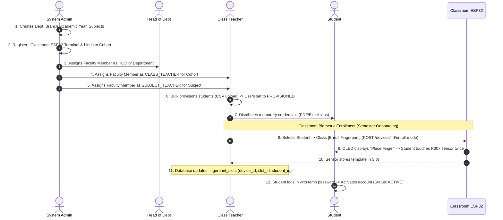
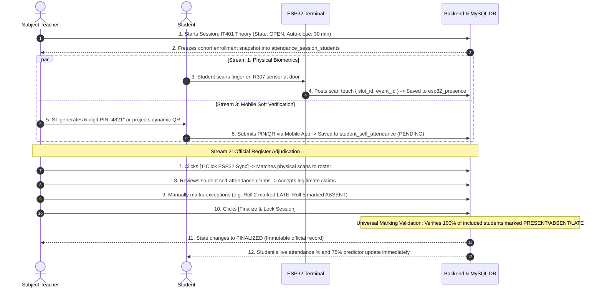
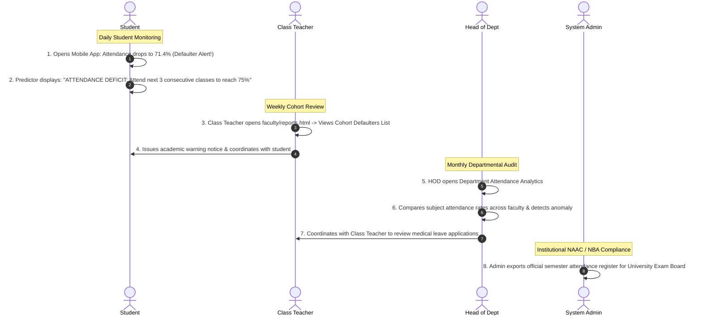
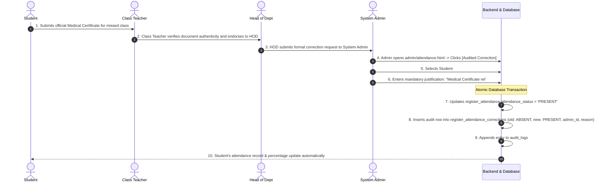

# College Attendance System — Engineering Team Role Guides

> **Location:** `docs/attendance/roles/`  
> **Team Structure:** 4 Core Engineering Roles  
> **Target System:** Local-First College Attendance System (Web + Mobile + Hardware + Database)

---

## 1. Team Structure & Role Distribution

To execute the project with maximum speed, clear accountability, and zero role overlap, project responsibilities are divided among **four specialized engineering roles**:

```
                              ┌────────────────────────┐
                              │   DATABASE DESIGNER    │
                              │ MySQL 8.x Architecture │
                              │   & Relational Guard   │
                              └───────────┬────────────┘
                                          │ Schema, Migrations,
                                          │ Indexes & Transactions
                                          ▼
                              ┌────────────────────────┐
                              │   BACK-END DEVELOPER   │
                              │  Node.js / Express API │
                              │ Single Source of Truth │
                              └─────┬────────────┬─────┘
                     REST API /     │            │  REST API /
                     JSON (LAN)     │            │  JSON (Wi-Fi)
                                    ▼            ▼
         ┌────────────────────────────┐        ┌────────────────────────────┐
         │    FRONT-END DEVELOPER     │        │   APPLICATION DEVELOPER    │
         │  Responsive Web Frontend   │        │ React Native Mobile Apps   │
         │ (HTML5 / CSS / Vanilla JS) │        │  & ESP32 IoT Integration   │
         └────────────────────────────┘        └────────────────────────────┘
```

---

## 2. Master Role Catalog & Guides

| Role # | Guide Document | Focus Area | Primary Deliverables |
|---|---|---|---|
| **1** | [`01_FRONTEND_DEVELOPER.md`](01_FRONTEND_DEVELOPER.md) | **Web Frontend Engineer** | Semantic HTML5, CSS custom properties (`variables.css`), Vanilla JS, Student Portal, Faculty Portal, Admin Portal, Live Attendance Console, client-side threshold prediction algorithm. |
| **2** | [`02_BACKEND_DEVELOPER.md`](02_BACKEND_DEVELOPER.md) | **Back-End API Architect** | Express REST API (`/api/v1/`), JWT session rotation & revocation, dynamic scoped RBAC (`requireScope.js`), session state machine, auto-close cron scanner, universal marking validator, audit logging. |
| **3** | [`03_APPLICATION_DEVELOPER.md`](03_APPLICATION_DEVELOPER.md) | **Mobile & IoT Engineer** | React Native cross-platform app (iOS & Android) for Student & Teacher, native camera QR scanner, device biometrics, offline Wi-Fi retry queue, and ESP32 hardware webhook protocol with pinned TLS. |
| **4** | [`04_DATABASE_DESIGNER.md`](04_DATABASE_DESIGNER.md) | **MySQL Database Architect**| 26-table relational DDL (all tables responsible for the institutional ER diagram), InnoDB optimization, foreign key cascade/restrict rules, unique constraints, composite indexing, master seeds, daily automated backups (`backup.ps1`), and disaster recovery. |

---

## 3. Institutional Actor Hierarchy & Cross-Actor Workflow Engine

The UIAP College Attendance System enforces a strict 5-tier actor hierarchy. Clean system roles in `user_roles` are coupled with dynamic academic scopes in `teacher_assignments`:

$$\textbf{System Admin} \succ \textbf{HOD} \succ \textbf{Class Teacher} \succ \textbf{Subject Teacher} \succ \textbf{Student}$$

```
        ┌────────────────────────────────────────────────────────┐
        │                  SYSTEM ADMINISTRATOR                  │
        │       (Institution-Wide Superuser & Edge DBA)          │
        └───────────────────────────┬────────────────────────────┘
                                    │ Governs
                                    ▼
        ┌────────────────────────────────────────────────────────┐
        │                 HEAD OF DEPARTMENT (HOD)               │
        │         (Department-Wide Academic Authority)           │
        └───────────────────────────┬────────────────────────────┘
                                    │ Oversees
                                    ▼
        ┌────────────────────────────────────────────────────────┐
        │                     CLASS TEACHER                      │
        │        (Cohort Guardian, Provisioning & Biometrics)    │
        └───────────────────────────┬────────────────────────────┘
                                    │ Coordinates With
                                    ▼
        ┌────────────────────────────────────────────────────────┐
        │                    SUBJECT TEACHER                     │
        │         (Classroom Sessions, Registers & Live ESP32)   │
        └───────────────────────────┬────────────────────────────┘
                                    │ Evaluates & Records
                                    ▼
        ┌────────────────────────────────────────────────────────┐
        │                        STUDENT                         │
        │          (Learner, Self-Marking & Biometric Scans)     │
        └────────────────────────────────────────────────┘
```

### 3.1 Actor Summary & Web/App Interaction Matrix

| Actor Level | System Role / Scope | Primary Responsibilities | Web Platform Access | Mobile App Access |
|---|---|---|---|---|
| **1. Admin** | `SYSTEM_ADMIN` | Master data, hardware terminal registry (`devices.html`), user accounts, settings, audited corrections. | Full access to `/admin/*` desktop console. | None (workstation-only). |
| **2. HOD** | `TEACHER` + `HOD` | Departmental compliance, cross-cohort attendance monitoring, faculty teaching audit. | Department dashboard (`faculty/reports.html`, `faculty/cohorts.html`). | Teacher App (Department overview & alerts). |
| **3. Class Teacher** | `TEACHER` + `CLASS_TEACHER` | Cohort provisioning, registration approvals, **classroom ESP32 fingerprint enrollment**, defaulter tracking. | Cohort console (`faculty/students.html`, `faculty/registrations.html`). | Teacher App (Pending approvals, cohort stats). |
| **4. Subject Teacher** | `TEACHER` + `SUBJECT_TEACHER` | Classroom teaching, live session management, 1-click ESP32 sync, PIN/QR broadcast, register locking. | Live attendance console (`faculty/attendance/live.html`). | Teacher App (Live attendance marking & PIN/QR). |
| **5. Student** | `STUDENT` | Classroom learning, optical fingerprint touch at door, soft self-marking (Button/PIN/QR), 75% predictor. | Student portal (`student/dashboard.html`, `student/attendance/*`). | Student App (Camera QR scanner, predictor widget). |

---

### 3.2 End-to-End Inter-Actor Interaction Flows

#### Flow 1: Academic Setup, Student Provisioning & Biometric Enrollment


#### Flow 2: Live Classroom Attendance & Three-Stream Marking


#### Flow 3: Attendance Defaulter Monitoring & Administrative Intervention


#### Flow 4: Exception Handling & Audited Register Corrections


---

## 4. Project Responsibility Matrix (RACI)

- **R (Responsible):** The role that performs the work.
- **A (Accountable):** The role with final approval and accountability.
- **C (Consulted):** The role providing critical input, contracts, or schemas.
- **I (Informed):** The role kept updated on progress or changes.

| Feature Area | Front-End Dev | Back-End Dev | Application Dev | Database Designer |
|---|:---:|:---:|:---:|:---:|
| **Database Schema & Constraints** | I | C | I | **R / A** |
| **Master Seed Data & Initial Admin**| I | C | I | **R / A** |
| **Database Backups & Disaster Recovery**| I | C | I | **R / A** |
| **REST API Foundation & Security** | C | **R / A** | C | C |
| **JWT Auth, Tokens & Session Revocation**| C | **R / A** | C | C |
| **Dynamic Scopes (`teacher_assignments`)**| C | **R / A** | C | C |
| **Student Provisioning & Temp Credentials**| C | **R / A** | I | C |
| **Credential Slips (Excel / PDF Exporter)**| C | **R / A** | I | I |
| **Attendance Session State Machine** | C | **R / A** | C | C |
| **ESP32 Hardware Webhook & Deduplication**| I | **R / A** | C | C |
| **Web UI: Public & Auth Screens** | **R / A** | C | I | I |
| **Web UI: Student Portal & Predictor**| **R / A** | C | I | I |
| **Web UI: Faculty Live Attendance Console**| **R / A** | C | I | I |
| **Web UI: Admin Master Data Management**| **R / A** | C | I | I |
| **Reports Engine & CSV Stream** | C | **R / A** | I | C |
| **React Native Mobile App (Phase 3)**| I | C | **R / A** | I |
| **Native QR Scanner & Device Biometrics**| I | C | **R / A** | I |
| **ESP32 Firmware Protocol & Flash Queue**| I | C | **R / A** | C |

---

## 4. Cross-Role Collaboration Contracts

To prevent miscommunication and blockages, every team member must adhere to these bilateral collaboration protocols:

1. **Back-End $\longleftrightarrow$ Database Designer:**
   - The Database Designer provides DDL scripts in `backend/database/migrations/`. The Back-End Developer never writes raw `CREATE TABLE` statements in application code.
   - The Back-End Developer must wrap any multi-table operation (such as student provisioning or session roster creation) in an explicit transaction using `withTransaction`.
2. **Front-End $\longleftrightarrow$ Back-End:**
   - All HTTP interactions must strictly adhere to the payload schemas and status codes defined in [`04_API_CONTRACT.md`](../04_API_CONTRACT.md).
   - The Front-End Developer must expect standard error envelopes (`{ success: false, error: { code, message, details } }`) and display `error.message` directly in toast notifications.
3. **Application Developer $\longleftrightarrow$ Back-End:**
   - The Application Developer consumes the identical `/api/v1/` routes as the web client.
   - The Back-End Developer must ensure refresh tokens work via both `httpOnly` cookies (for web) and authorization request bodies / headers (for mobile).
4. **Front-End $\longleftrightarrow$ Application Developer:**
   - Both client developers must maintain design continuity: use the exact same HSL color tokens for attendance statuses (`--status-present: hsl(142, 71%, 45%)`, etc.), identical threshold forecast logic, and identical roll-sorted list behaviors.
5. **Universal JSON API Input/Output Specifications:**
   - To eliminate ambiguity across team members, **every role guide includes a dedicated Section 6** providing exact JSON input schemas, HTTP status codes, and expected JSON output envelopes for its operational boundaries:
     - Front-End (`01_FRONTEND_DEVELOPER.md#6`): What JSON outputs each web portal page and dashboard widget must parse and render.
     - Back-End (`02_BACKEND_DEVELOPER.md#6`): What request schemas and response envelopes each Express controller must implement.
     - Application Developer (`03_APPLICATION_DEVELOPER.md#6`): What JSON outputs the React Native app consumes and the exact ESP32 C++ HTTP client webhook payload.
     - Database Designer (`04_DATABASE_DESIGNER.md#6`): Native MySQL JSON column structures (`payload`, `details`) and relational SQL query result to API JSON mapping.

---

## 5. Development Phasing Roadmap

```
PHASE 1: ATTENDANCE WEB SYSTEM (CURRENT FOCUS)
  • Database Designer: Deploy 26-table MySQL schema & initial master seeds.
  • Back-End Developer: Express server, auth, dynamic scopes, session engine, webhook.
  • Front-End Developer: HTML5/CSS/Vanilla JS portals, live attendance console, predictor.
  • Application Developer: Verify ESP32 webhook protocol & firmware transmission payload.

PHASE 2: API STABILIZATION & HARDENING
  • Security penetration audit, rate limiting benchmarks, end-to-end integration tests.

PHASE 3: REACT NATIVE MOBILE APPS
  • Application Developer: Student & Teacher mobile apps consuming /api/v1/.
  • Front-End & Back-End: Provide support & verify shared contract parity.

PHASES 4–7: FUTURE ACADEMIC MODULES
  • Incremental delivery of Assignments, Test Scores, Study Material, Timetable, Notices,
    Calendar, Exam Schedule, and Performance Analytics.
```
