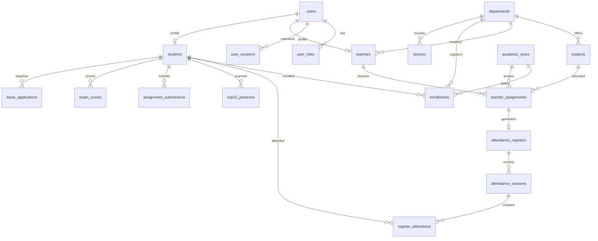

# 🗄️ Database Schema & Relational Data Models

Vidya uses a unified relational database architecture supporting both SQLite3 (local and embedded) and MySQL 8.x (production cloud deployments).

---

## 1. Entity Relationship Overview

---

## 2. Table Catalog & Schema Descriptions

### Core Identity & Access Control
1. **`users`**:
   - `id` (INTEGER PK AUTOINCREMENT)
   - `username` (VARCHAR(128) UNIQUE) — Institutional email or enrollment number.
   - `email` (VARCHAR(191) UNIQUE)
   - `password_hash` (VARCHAR(255))
   - `temp_password_hash` (VARCHAR(255))
   - `must_change_password` (TINYINT) — Enforces password reset upon first login.
   - `status` (VARCHAR(32)) — `ACTIVE`, `PENDING`, `SUSPENDED`, `ALUMNI`.
   - `google_sub` (VARCHAR(128)) — Google SSO subject identifier.
2. **`user_roles`**:
   - `id` (INTEGER PK AUTOINCREMENT)
   - `user_id` (INTEGER FK -> users.id)
   - `role` (VARCHAR(32)) — `SYSTEM_ADMIN`, `TEACHER`, `STUDENT`.
3. **`user_sessions`**:
   - `id` (INTEGER PK AUTOINCREMENT)
   - `user_id` (INTEGER FK -> users.id)
   - `token_hash` (VARCHAR(255))
   - `is_revoked` (TINYINT)
   - `expires_at` (DATETIME)

### Institutional Hierarchy
4. **`departments`**:
   - `id` (INTEGER PK AUTOINCREMENT)
   - `name` (VARCHAR(128)) — e.g. "Information Technology"
   - `code` (VARCHAR(32) UNIQUE) — e.g. "IT"
   - `degree_duration_years` (INTEGER) — Typically 3 years (6 semesters).
   - `active_term` (VARCHAR(16)) — `ODD` or `EVEN`.
   - `hod_user_id` (INTEGER FK -> users.id)
   - `is_active` (TINYINT)
5. **`academic_years`**:
   - `id` (INTEGER PK AUTOINCREMENT)
   - `label` (VARCHAR(64)) — e.g. "2026-2027"
   - `start_date` (DATE), `end_date` (DATE)
   - `is_current` (TINYINT) — Active institutional academic year flag.
6. **`teachers`**:
   - `id` (INTEGER PK AUTOINCREMENT)
   - `user_id` (INTEGER FK -> users.id)
   - `department_id` (INTEGER FK -> departments.id)
   - `employee_id` (VARCHAR(64) UNIQUE)
   - `full_name` (VARCHAR(128))
   - `phone` (VARCHAR(32))
7. **`students`**:
   - `id` (INTEGER PK AUTOINCREMENT)
   - `user_id` (INTEGER FK -> users.id)
   - `official_enrollment_no` (VARCHAR(64) UNIQUE) — Ubiquitous institutional roll.
   - `registration_no` (VARCHAR(64)) — UBTER state registration number.
   - `full_name` (VARCHAR(128))
   - `entry_mode` (VARCHAR(32)) — `regular`, `lateral_entry`, `hod_provisioned`.
   - `is_lateral_entry` (TINYINT)
   - `admission_year` (INTEGER)
   - `graduation_year` (INTEGER) — Populated when student graduates.

### Coursework & Curriculum
8. **`subjects`**:
   - `id` (INTEGER PK AUTOINCREMENT)
   - `department_id` (INTEGER FK -> departments.id)
   - `year` (INTEGER), `semester` (INTEGER)
   - `name` (VARCHAR(128))
   - `code` (VARCHAR(32))
   - `has_practical` (TINYINT)
   - `syllabus_scheme` (VARCHAR(32))
   - `is_active` (TINYINT)
9. **`teacher_assignments`**:
   - `id` (INTEGER PK AUTOINCREMENT)
   - `teacher_id` (INTEGER FK -> teachers.id)
   - `assignment_type` (VARCHAR(32)) — `SUBJECT_TEACHER` or `CLASS_TEACHER`.
   - `session_type_scope` (VARCHAR(32)) — `ALL`, `THEORY`, or `PRACTICAL`.
   - `department_id` (INTEGER FK -> departments.id)
   - `subject_id` (INTEGER FK -> subjects.id, nullable for Class Teacher)
   - `year` (INTEGER), `semester` (INTEGER)
   - `academic_year_id` (INTEGER FK -> academic_years.id)
   - `is_active` (TINYINT)

### Attendance Registers & Tracking
10. **`attendance_registers`**:
    - `id` (INTEGER PK AUTOINCREMENT)
    - `name` (VARCHAR(128))
    - `assignment_id` (INTEGER FK -> teacher_assignments.id)
    - `teacher_id` (INTEGER FK -> teachers.id)
    - `subject_id` (INTEGER FK -> subjects.id)
    - `department_id` (INTEGER FK -> departments.id)
    - `year` (INTEGER), `semester` (INTEGER)
    - `session_type_scope` (VARCHAR(32))
    - `is_official` (TINYINT)
11. **`attendance_sessions`**:
    - `id` (INTEGER PK AUTOINCREMENT)
    - `register_id` (INTEGER FK -> attendance_registers.id)
    - `teacher_id` (INTEGER FK -> teachers.id)
    - `subject_id` (INTEGER FK -> subjects.id)
    - `session_date` (DATE)
    - `period_number` (INTEGER)
    - `session_type` (VARCHAR(32)) — `THEORY`, `PRACTICAL`, `TUTORIAL`.
    - `state` (VARCHAR(32)) — `DRAFT`, `OPEN`, `FINALIZED`.
    - `current_pin` (VARCHAR(8)) — 6-digit dynamic PIN.
    - `qr_token` (VARCHAR(128)) — Dynamic QR code verification token.
12. **`register_attendance`**:
    - `id` (INTEGER PK AUTOINCREMENT)
    - `session_id` (INTEGER FK -> attendance_sessions.id)
    - `student_id` (INTEGER FK -> students.id)
    - `attendance_status` (VARCHAR(16)) — `PRESENT`, `ABSENT`, `LATE`.
    - `remarks` (TEXT)

### IoT Hardware & Biometrics
13. **`devices`**:
    - `id` (INTEGER PK AUTOINCREMENT)
    - `device_uid` (VARCHAR(64) UNIQUE)
    - `name` (VARCHAR(64))
    - `department_id` (INTEGER FK -> departments.id)
    - `secret_hash` (VARCHAR(255))
    - `is_active` (TINYINT)
    - `last_heartbeat_at` (DATETIME)
14. **`esp32_presence`**:
    - `id` (INTEGER PK AUTOINCREMENT)
    - `device_id` (INTEGER FK -> devices.id)
    - `student_id` (INTEGER FK -> students.id)
    - `fingerprint_slot` (INTEGER)
    - `scan_time` (DATETIME)

### Extended Academic Modules
15. **`assignments`**: Coursework specifications, due dates, attachments.
16. **`assignment_submissions`**: Student files, timestamps, scores, feedback.
17. **`exams`**: Test definitions, maximum marks, passing scores.
18. **`exam_scores`**: Recorded student test marks with validation clamping.
19. **`leave_applications`**: Student leave requests with date ranges and approval status.
20. **`timetable_slots`**: Weekly scheduling slots linking rooms, subjects, and teachers.
21. **`audit_logs`**: Comprehensive security audit trail recording all administrative operations.
