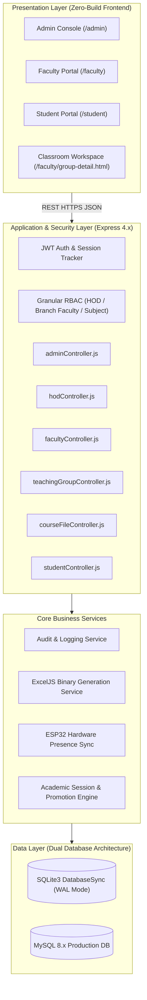

# 🎓 VidyaOS — Phase 2 Major Project Presentation & Viva Defense Report

> **Institutional Academic Operating System & Campus Governance Platform**  
> **Course**: Major Project / Capstone Project Review (Phase II — Final Evaluation)  
> **Academic Session**: 2026–2027  
> **Affiliation**: Board of Technical Education / Directorate of Technical Education / AICTE  
> **Departments**: Information Technology & Computer Engineering  

---

## 📋 Table of Contents
1. [Project Metadata & Executive Summary](#1-project-metadata--executive-summary)
2. [Phase 1 vs. Phase 2 Scope & Deliverables Matrix](#2-phase-1-vs-phase-2-scope--deliverables-matrix)
3. [Comprehensive Role-Wise Capability Matrix (What Admin, HOD, Faculty & Student Can Do)](#3-comprehensive-role-wise-capability-matrix)
   - [3.1 System Administrator Powers & Institutional Governance](#31-system-administrator-powers--institutional-governance)
   - [3.2 Head of Department (HOD) Powers & Academic Leadership](#32-head-of-department-hod-powers--academic-leadership)
   - [3.3 Faculty / Class Teacher Powers & Classroom Mastery](#33-faculty--class-teacher-powers--classroom-mastery)
   - [3.4 Student Self-Service Powers & Academic Engagement](#34-student-self-service-powers--academic-engagement)
4. [NBA & NAAC Accreditation Hub (18-Document Course File Dossier)](#4-nba--naac-accreditation-hub-18-document-course-file-dossier)
   - [4.1 Institutional Significance of Course Files (NBA Criteria 2 & 3)](#41-institutional-significance-of-course-files-nba-criteria-2--3)
   - [4.2 The 18 Official Course File Artifacts Catalog](#42-the-18-official-course-file-artifacts-catalog)
   - [4.3 CO-PO Mapping & Attainment Calculation Methodology](#43-co-po-mapping--attainment-calculation-methodology)
   - [4.4 Slow vs. Advanced Learners Action Tracking](#44-slow-vs-advanced-learners-action-tracking)
5. [Coursework, Assignments, Class Tests & Continuous Assessment Engine](#5-coursework-assignments-class-tests--continuous-assessment-engine)
   - [5.1 4-Fold Coursework Categories](#51-4-fold-coursework-categories)
   - [5.2 Interactive Assignment Scoring Modal & Transactional Grading](#52-interactive-assignment-scoring-modal--transactional-grading)
   - [5.3 Class Tests (Unit Tests) & Question-Wise Auto-Totalling Matrix](#53-class-tests-unit-tests--question-wise-auto-totalling-matrix)
   - [5.4 Official UBTER 50-Mark Continuous Assessment Scheme](#54-official-ubter-50-mark-continuous-assessment-scheme)
6. [Slide-by-Slide Presentation Blueprint (22 Slides Deck)](#6-slide-by-slide-presentation-blueprint)
7. [System Architecture & Decoupled Layered MVC Pattern](#7-system-architecture--decoupled-layered-mvc-pattern)
8. [Dual Attendance Modalities & Anti-Proxy Technology](#8-dual-attendance-modalities--anti-proxy-technology)
9. [High-Fidelity Office & Spreadsheet Export Engine (OpenXML .xlsx, Word, PDF, CSV)](#9-high-fidelity-office--spreadsheet-export-engine)
10. [Live 7-Minute Demonstration Script for Viva Committee](#10-live-7-minute-demonstration-script-for-viva-committee)
11. [Testing, Quality Assurance & Verification Matrix (256 Automated Assertions)](#11-testing-quality-assurance--verification-matrix)
12. [Frequently Asked Questions (Viva Voce Q&A Defense Bank)](#12-frequently-asked-questions-viva-voce-qa-defense-bank)
13. [Conclusion & Future Roadmap](#13-conclusion--future-roadmap)

---

## 1. Project Metadata & Executive Summary

### 1.1 Project Overview
**VidyaOS** is a production-grade Institutional Campus Operating System and Academic Governance Platform. Designed specifically for polytechnic institutions, state engineering colleges, and universities, VidyaOS consolidates fragmented educational software into a single unified workspace.

It bridges the divide between **statutory physical record-keeping** (mandated by State Boards of Technical Education like UBTER/BTE) and **modern digital collaborative pedagogy** (modeled after Google Classroom and National Board of Accreditation / NBA frameworks).

### 1.2 Technology Stack
- **Backend**: Node.js (v20+), Express.js REST API with granular RBAC middleware chains.
- **Database Architecture**: Dual-Engine architecture:
  - *Local Development & Offline Campus Server*: High-performance SQLite3 using Node's native synchronous `DatabaseSync` interface with Write-Ahead Logging (WAL).
  - *Institutional Cloud Deployment*: MySQL 8.x connection-pooled adapter (`mysql2`) with zero schema mismatch.
- **Frontend**: Zero-build Vanilla HTML5, Modern CSS3 with 100% Theme Token compliance (`variables.css`, Light/Dark mode, zero hardcoded hex colors), and Modular ES6+ JavaScript.
- **Office Interoperability**: Standalone `ExcelJS` engine generating genuine `PK\x03\x04` ZIP OpenXML binary packages with exact institutional colors (Blue/Tan bands).
- **IoT & Hardware Interface**: ESP32 micro-controller Wi-Fi & Bluetooth MAC presence detection terminal.

---

## 2. Phase 1 vs. Phase 2 Scope & Deliverables Matrix

| Dimension | Phase 1 (Baseline Inception) | Phase 2 (Completed Production System) |
| :--- | :--- | :--- |
| **System Scope** | Standalone attendance ledger prototype. | Complete Institutional Campus OS with 4 distinct, fully empowered user roles. |
| **Attendance Modalities** | Basic single-entry checkbox attendance. | **Dual Studio**: 31-day Matrix Ledger + Live Dynamic QR & Rolling PIN + ESP32 IoT Presence Sync. |
| **Academic Workspace** | Disjointed HTML pages for work and marks. | **Consolidated Classroom Portal**: Stream, Classwork, People, Register, Marks, Sheets. |
| **Accreditation / NBA** | Not present in Phase 1. | **NBA / NAAC 18-Document Course File Hub**: Syllabus, CO-PO mapping, attainment, slow/fast learners. |
| **Coursework Engine** | Basic assignment text notes. | **4-Fold Coursework**: Assignments, Lab Practicals, Unit Tests with Question Matrix, Final Documents. |
| **Spreadsheet Engine** | HTML tables disguised with `.xls` file extension. | **Genuine OpenXML (.xlsx)** binary generation via ExcelJS with cell coordinate matrix mapping. |
| **Multi-Format Export** | Simple CSV dump only. | Universal Export to **Excel (.xlsx)**, **Word Document (.doc)**, **Print/PDF (.pdf)**, and **CSV (.csv)**. |
| **Grading & Marksheet** | Read-only basic scores. | **Universal Marks Portal** with interactive batch grading modal, absent toggle (`AB`), feedback, bulk helpers. |
| **Student Onboarding** | Manual administrator data entry. | **Self-Registration Portal**: Cohort selection, official enrollment validation, and one-click teacher approval. |
| **UI Design System** | Hardcoded CSS colors, layout breakage on mobile. | **100% Theme Tokenization** (`variables.css`), responsive mobile drawer, sticky toolbars, zero blowout. |
| **Code Architecture** | Monolithic 4,200-line single JavaScript file. | **Element-wise modularized MVC architecture** (`group-detail-*.js` and `group-detail-*.css`). |
| **Test Coverage** | Manual browser testing. | **256 Automated Regression Assertions (100% Green)** across RBAC, theme tokens, and APIs. |

---

## 3. Comprehensive Role-Wise Capability Matrix

VidyaOS provides fine-grained Role-Based Access Control (RBAC) ensuring security, privacy, and frictionless institutional delegation across four core user tiers:

```
┌────────────────────────────────────────────────────────────────────────┐
│                   VIDYAOS 4-TIER GOVERNANCE MODEL                      │
├─────────────────┬───────────────────┬──────────────────┬───────────────┤
│  SYSTEM ADMIN   │  HEAD OF DEPT     │  BRANCH FACULTY  │    STUDENT    │
│  (Governance)   │   (Academics)     │   (Classroom)    │ (Self-Service)│
├─────────────────┼───────────────────┼──────────────────┼───────────────┤
│ • Structure     │ • Allocation      │ • Registers (31d)│ • Status (%)  │
│ • Departments   │ • Timetable       │ • Live QR / PIN  │ • Predictor   │
│ • HOD Appoint   │ • Curriculum/COs  │ • Stream / Posts │ • Submissions │
│ • Audit Logs    │ • Defaulter List  │ • Coursework     │ • Marksheets  │
│ • IoT Terminals │ • Common Faculty  │ • Marks Portal   │ • QR Check-In │
│ • Term Engine   │ • Leave Approvals │ • NBA Dossier    │ • Leave App   │
└─────────────────┴───────────────────┴──────────────────┴───────────────┘
```

---

### 3.1 System Administrator Powers & Institutional Governance

The System Administrator (`SYSTEM_ADMIN`) controls the macro-level institutional configuration:

1. **Institutional Profile & Identity Configuration**:
   - Sets institutional branding: College Name, Institute Code, Directorate affiliation, institutional logo, address, and contact headers across all exported documents.
2. **Academic Structure & Hierarchy Management**:
   - Creates and manages Academic Departments (e.g., Information Technology, Computer Engineering, Civil Engineering, Mechanical Engineering).
   - Configures Semesters (Sem 1 through Sem 6 for Polytechnic Diploma; Sem 1 through Sem 8 for B.Tech Degree).
   - Manages Shifts (Morning / Evening Shift), Sections (Batch A, B, C), and Academic Year intervals (e.g., `2026-27 (Odd Semester)`).
3. **Faculty & Staff Administration**:
   - Manages the master faculty directory, employee IDs, official email addresses, designations (Professor, Assistant Professor, Lecturer), and department affiliations.
   - Appoints and revokes Department Heads (`HOD`) with department scoping.
   - Triggers one-click password resets and session terminations (`force_logout`).
4. **Student Master Directory & Lifecycle Progression**:
   - Maintains the canonical student registry with three statutory identifiers: State Board Registration Number, Institutional Enrollment Number, and Class Roll Number.
   - Administers bulk CSV student onboarding, branch transfers, lateral entry promotions, and alumni archiving.
5. **System-Wide Immutable Audit Logs Explorer**:
   - Full security compliance view tracking every high-privilege action in the system: actor ID, action type, affected entity, JSON payload diff, client IP, and timestamp.
6. **Global Multi-Department Analytics & Institutional Reports**:
   - Real-time cross-departmental attendance radar, daily lecture count statistics, active teacher sessions, and institutional compliance graphs.
7. **IoT Hardware Terminal Management (ESP32)**:
   - Registers classroom biometric touch terminals, authorizes hardware MAC addresses, monitors hardware heartbeat ping logs, and configures sync intervals.
8. **Autonomous Academic Lifecycle & Term Promotion Engine**:
   - Automates term transition between ODD and EVEN semesters.
   - Executes batch student promotion to higher semesters with demotion safety reversal locks to prevent accidental academic year corruptions.

---

### 3.2 Head of Department (HOD) Powers & Academic Leadership

The Head of Department (`HOD`) governs departmental academic operations, curriculum compliance, and teacher allocation:

1. **Departmental Command Center**:
   - Live dashboard showing real-time departmental attendance averages, active classes running today, total enrolled students, and faculty attendance logging status.
2. **Faculty Teaching Allocation & Workload Distribution**:
   - Assigns department faculty to specific subjects, semesters, and components (Theory / Practical / Tutorial).
   - Allocating a subject to a teacher automatically generates that subject's official **Attendance Register** and **Classroom Teaching Group**.
3. **Curriculum Governance & Syllabus Mapping**:
   - Configures subject codes, full subject titles, credit hours, lecture hours per week, and IRDT / UBTER approved syllabus modules.
   - Defines and updates Course Outcomes (CO1 to CO5) for every subject in the department.
4. **Cross-Departmental / Common Faculty Management**:
   - Manages "Common Faculty" who teach cross-departmental subjects (e.g., Applied Mathematics, Communication Skills, Environmental Studies taught by First-Year Applied Science faculty).
   - Reviews and approves or rejects common faculty registration requests with recorded justification reasons.
5. **Departmental Timetable Generation & Scheduling**:
   - Builds departmental master timetables, assigning weekly lecture slots (Period 1 to Period 7, Monday through Saturday) to specific faculty and lecture rooms.
6. **Defaulter Threshold & Automated Blacklist Radar**:
   - Configures departmental attendance cutoff thresholds (e.g., strict 75% UBTER eligibility rule, 60% medical concession).
   - Auto-generates the official Monthly Defaulter List with total held classes, attended classes, shortage count, and parent notification reports.
7. **Faculty Leave Approvals & Class Substitutions**:
   - Reviews faculty leave applications and assigns substitute teachers to registers to ensure zero cancelled classes during faculty absence.

---

### 3.3 Faculty / Class Teacher Powers & Classroom Mastery

Every faculty member (`TEACHER` / `CLASS_TEACHER` / `BRANCH_FACULTY`) has access to the comprehensive Teaching Group Workspace (`/faculty/group-detail.html`):

1. **Consolidated Google Classroom-Style Teaching Group Workspace**:
   - **Stream**: Left-side sticky Quick Actions, single `[ ✎ New announcement ]` pill button, authentic desktop "Post" modal with rich markdown formatting (**B**, *I*, <u>U</u>, ≡, Tx), document attachments (PDF, DOCX, ZIP), mobile edge-to-edge composer, and nested comments.
   - **Classwork**: 4-fold categorized coursework hub, tab-scoped Floating Action Button (`#classwork-mobile-fab`), category filter pills, and student submission review drawer.
   - **People**: Student roster, minimal single-line enrollment input bar (`+ Add`), and un-enrolled cohort roster modal.
   - **Register**: Consolidated 31-day attendance matrix with compact PC columns (TOTAL ATTENDED, TOTAL ABSENT, %) and mobile attended counter.
   - **Marks**: Dual Class Tests and Coursework Assignments marksheets portal with KPI strip, category filter pills, and live search.
   - **Sheets**: Embedded spreadsheet engine and one-click launch of the Advanced Sheets Studio.
2. **Dual Attendance Marking Studio**:
   - **31-Day Physical Register Ledger**: Day 1 through Day 31 calendar columns replicating statutory paper registers. Single-class default with dynamic `+ Add Class` period button. Interactive Digital Pen cycler: `CLEAR ➔ PRESENT ➔ ABSENT ➔ CLEAR`.
   - **Dual Live Roll Call Studio**: Time-hashed dynamic QR code auto-refreshing every 30-60 seconds + concurrent rotating 6-digit PIN + live student check-in feed.
   - **Single-Line ESP32 Toolbar**: One-click presence reconciliation matching biometric scans with classroom rosters.
   - **Attendance Remarks**: Tags students as Regular, Short Attendance, Medical Leave, On-Duty, Transferred, or Dropped.
3. **Universal Marks Portal & Batch Grading Studio**:
   - Interactive modal (`#modal-enter-assignment-marks`) allowing teachers to enter scores out of `max_marks`.
   - Absent toggle (`AB`) shading rows red (`.is-absent-row`) and disabling mark inputs.
   - Individual teacher feedback/remarks per student.
   - Quick bulk action helpers: "Mark Unsubmitted as AB" and "Fill Full Marks".
   - Class Tests Marks Studio (`#modal-enter-marks`) with question-wise matrix (Q1a, Q1b, Q2, etc.) and auto-totalling.
4. **Master Institutional Spreadsheets & Evaluation Studio**:
   - Master Evaluation Sheet implementing the statutory UBTER 50-mark continuous assessment formula.
   - Class Test Marksheet and Coursework Marksheet.
   - Authentic OpenXML (`.xlsx`) binary generation via ExcelJS with exact institutional colors (Blue/Tan bands).
   - Multi-format export: Excel (`.xlsx`), Word (`.doc`), PDF (`.pdf`), and CSV (`.csv`).
5. **NBA / NAAC 18-Document Course File Preparation & Dossier Hub**:
   - Complete 18-artifact institutional dossier management (Curriculum, Students, Assessment, Attainment).
   - CO-PO mapping matrix and direct/indirect attainment tracking.
6. **Student Cohort Empowerment & One-Click Registration Approval**:
   - Any department faculty member can view pending self-registrations and approve students by official enrollment number with one click.
7. **Student Leave Request Adjudication**:
   - Reviews student leave requests (Medical, Academic On-Duty, Personal), views uploaded medical proof documents, and grants attendance credit adjustments.

---

### 3.4 Student Self-Service Powers & Academic Engagement

Enrolled students (`STUDENT`) have access to their dedicated academic self-service portal (`/student/`):

1. **Unified Student Dashboard & Real-Time Attendance Gauge**:
   - Displays real-time overall attendance percentage and individual subject attendance cards.
   - Color-coded visual health indicators: Green ($\ge 75\%$), Amber ($60\% - 74\%$), Red ($< 60\%$).
2. **Smart Attendance Predictor (Academic Calculator)**:
   - Dynamic predictive algorithm informing students exactly how many consecutive upcoming classes they must attend to reach or maintain statutory eligibility ($75\%$).
   - Informs students with high attendance how many classes they can safely miss without dropping below $75\%$.
3. **Dual In-Class Attendance Check-In Modalities**:
   - **Camera QR Scanner**: Real-time camera viewfinder to scan the teacher's dynamic classroom QR code.
   - **6-Digit PIN Keypad**: Clean numeric keypad to enter the teacher's rotating PIN if the phone camera is unavailable.
4. **Classroom Stream & Study Material Access**:
   - View classroom announcements, download shared lecture slides, syllabus PDFs, lab manuals, and previous year question papers.
   - Engage in academic discussions via announcement comments.
5. **Coursework Submissions & File Dropboxes**:
   - View pending assignments, lab practicals, and project documentation requirements with due dates and max marks.
   - Upload homework files (PDF, ZIP, DOCX, Code) with submission timestamps and edit capabilities before deadline.
   - Track submission status: `Assigned`, `Submitted`, `Turned In Late`, `Evaluated`, and `Absent`.
6. **Academic Marksheets & Continuous Assessment Transparency**:
   - Transparent access to evaluated assignment scores, unit test results, question-by-question score breakdown, and teacher remarks.
   - View continuous assessment components: Assignment average (out of 15), Unit test average (out of 20), Attendance weightage (out of 10), and Presentation score (out of 5).
7. **Online Leave Application & Medical Certificate Uploads**:
   - Submit formal leave applications with leave category (Medical Leave, Academic On-Duty, Emergency/Personal), date range, and reason.
   - Attach digital photos of doctor's prescriptions or official college sanction letters.
   - Track live leave adjudication status (`PENDING`, `APPROVED`, `REJECTED`) with teacher feedback.
8. **Digital Profile & State Board Identity Card**:
   - View official institutional profile displaying UBTER State Board Registration Number, Enrollment Number, Class Roll Number, Branch, Semester, and Academic Year.

---

## 4. NBA & NAAC Accreditation Hub (18-Document Course File Dossier)

### 4.1 Institutional Significance of Course Files (NBA Criteria 2 & 3)
Under the **National Board of Accreditation (NBA)** and **National Assessment and Accreditation Council (NAAC)** guidelines for Outcome-Based Education (OBE):
- Every faculty member must maintain an audited **Course File Dossier** for every subject taught during the academic semester.
- External NBA peer review teams inspect this dossier to evaluate **Teaching-Learning Processes (Criterion 2)** and **Course Outcomes & Program Outcomes (Criterion 3)**.
- Previously, compiling course files required weeks of manual photocopying, assembling physical lever-arch binders, and manually re-calculating student averages.
- VidyaOS auto-assembles the course file dynamically from live system databases.

---

### 4.2 The 18 Official Course File Artifacts Catalog

VidyaOS structures the course file into **18 official institutional documents** across 4 audit categories:

```
┌────────────────────────────────────────────────────────────────────────┐
│               NBA / NAAC 18-DOCUMENT COURSE FILE DOSSIER               │
├─────────────────┬─────────────────┬──────────────────┬─────────────────┤
│ 1. CURRICULUM   │ 2. STUDENTS     │ 3. ASSESSMENT    │ 4. ATTAINMENT   │
├─────────────────┼─────────────────┼──────────────────┼─────────────────┤
│ 01. Allotment   │ 08. Student List│ 12. Assessment   │ 17. CO Attain-  │
│ 02. Syllabus    │ 09. Prev Results│     Plan (Rubric)│     ment Math   │
│ 03. Course      │ 10. Advanced    │ 13. Lab Plan     │ 18. Corrective  │
│     Outcomes    │     Learners    │ 14. Assignment   │     Actions     │
│ 04. CO-PO Matrix│ 11. Slow        │     Schedule     │     (CQI)       │
│ 05. Lesson Plan │     Learners    │ 15. Sample QPs   │                 │
│ 06. Timetable   │                 │ 16. Continuous   │                 │
│ 07. Calendar    │                 │     Assessment   │                 │
└─────────────────┴─────────────────┴──────────────────┴─────────────────┘
```

#### Category 1: Curriculum & Instructional Planning
1. **`allotment_letter` (Course Allotment Letter)**: Official departmental allocation document signed by the HOD assigning the course to the faculty.
2. **`approved_syllabus` (Approved Board Syllabus)**: Official state board (UBTER / IRDT / AICTE) prescribed syllabus copy detailing unit-wise lecture distribution.
3. **`course_outcomes` (Course Outcomes Statements - COs)**: Formal statements defining what students should know or be able to do at the end of the course, mapped to Bloom's Taxonomy (e.g., Remember, Understand, Apply, Analyze).
4. **`copo_matrix` (CO-PO / PSO Mapping Matrix)**: Quantitative mapping matrix correlating Course Outcomes (CO1–CO5) to Program Outcomes (PO1–PO12) and Program Specific Outcomes (PSOs) with correlation levels:
   - `3`: Substantial / High Correlation
   - `2`: Moderate / Medium Correlation
   - `1`: Slight / Low Correlation
   - `-`: No Correlation
5. **`lesson_plan` (Semester Lesson Plan & Delivery Schedule)**: Week-by-week and lecture-by-lecture instructional delivery roadmap, tracking planned vs. actual execution dates.
6. **`timetable` (Class & Master Faculty Timetable)**: Approved weekly schedule indicating classroom venue, lab sessions, and tutorial hours.
7. **`academic_calendar` (Institutional Academic Calendar)**: Directorate-notified schedule of working days, instructional weeks, holiday lists, internal exam windows, and end-semester dates.

#### Category 2: Student Cohort Analytics & Support
8. **`student_list` (Enrolled Student Master List)**: Auto-generated statutory roster with State Registration Number, Enrollment Number, Roll Number, and Student Name.
9. **`result_analysis` (Prerequisite & Previous Result Analysis)**: Statistical breakdown of student performance in prerequisite subjects to identify foundational learning gaps.
10. **`advanced_learners` (Advanced Learners Identification & Enrichment Plan)**: List of high-performing students ($\ge 75\%$ marks) with documentation of advanced challenges, competitive coding tracks, seminar opportunities, and mini-project mentorship.
11. **`slow_learners` (Slow Learners Identification & Remedial Plan)**: List of struggling students ($< 45\%$ marks or high attendance deficit) with remedial class schedules, peer tutoring assignments, and simplified study modules.

#### Category 3: Assessment & Evaluation Records
12. **`internal_assessment_plan` (Internal Assessment Plan & Rubrics)**: Formal institutional evaluation policy defining weightages for assignments, unit tests, attendance compliance, and presentations.
13. **`laboratory_plan` (Laboratory Continuous Evaluation Plan)**: List of prescribed experiments, hardware setup guidelines, viva rubrics, and continuous experiment log tracking.
14. **`assignment_schedule` (Assignment & Tutorial Schedule)**: Auto-generated coursework calendar showing assignment issue dates, submission deadlines, and mapped Course Outcomes.
15. **`question_papers_cos` (Sample Question Papers with CO Tagging)**: Institutional class test and unit test examination question papers with explicit Course Outcome and Bloom's Taxonomy level tags indicated per question.
16. **`continuous_assessment` (Continuous Assessment Marksheet & Attendance Records)**: Auto-generated 31-day physical register matrix and complete 50-mark internal assessment tabulation sheet.

#### Category 4: Outcome Attainment & Quality Improvement
17. **`co_attainment` (Direct & Indirect CO Attainment Calculations)**: Mathematical computation of direct attainment (Class Tests + Assignments + Practical + University Exam) and indirect attainment (Course End Survey).
18. **`corrective_actions` (Continuous Quality Improvement & Action Taken Report)**: Formal analysis of unmet CO targets, faculty reflections, pedagogical enhancements, and proposed curricular recommendations for the subsequent academic cycle.

---

### 4.3 CO-PO Mapping & Attainment Calculation Methodology

VidyaOS implements the standard AICTE/NBA Outcome-Based Education (OBE) formula:

#### Direct Attainment Target Levels:
- **Level 3 (High)**: $\ge 70\%$ of students score above the benchmark score ($60\%$).
- **Level 2 (Medium)**: $60\% - 69\%$ of students score above the benchmark score.
- **Level 1 (Low)**: $50\% - 59\%$ of students score above the benchmark score.
- **Level 0 (Unattained)**: $< 50\%$ of students score above the benchmark score.

#### Final Overall CO Attainment Formula:
$$\text{Overall CO Attainment} = (0.80 \times \text{Direct Attainment}) + (0.20 \times \text{Indirect Attainment})$$

Where:
- **Direct Attainment ($80\%$)**: Weighted combination of Internal Assessment Tests ($30\%$), Coursework Assignments ($10\%$), and External University End-Semester Examination ($60\%$).
- **Indirect Attainment ($20\%$)**: Student Course Exit Survey responses evaluated on a 1-to-5 Likert scale.

---

### 4.4 Slow vs. Advanced Learners Action Tracking
VidyaOS automatically segments students based on continuous assessment averages and attendance metrics:
- **Advanced Learners ($\ge 75\%$)**: Highlighted with green status pills; recommended for competitive hackathons, research paper presentations, and institutional lab assistance.
- **Slow Learners ($< 45\%$)**: Highlighted with amber/red status pills; automatically populated into remedial tutorial rosters with mandatory attendance logging and simplified re-test tracking.

---

## 5. Coursework, Assignments, Class Tests & Continuous Assessment Engine

### 5.1 4-Fold Coursework Categories
VidyaOS classifies all academic tasks into **4 distinct pedagogical categories**:

```
┌────────────────────────────────────────────────────────────────────────┐
│                   VIDYAOS 4-FOLD COURSEWORK ENGINE                     │
├─────────────────┬─────────────────┬──────────────────┬─────────────────┤
│ 1. ASSIGNMENTS  │ 2. LAB PRACTICAL│ 3. CLASS TESTS   │ 4. FINAL DOCS   │
├─────────────────┼─────────────────┼──────────────────┼─────────────────┤
│ • Theory Units  │ • Experiment    │ • Unit Tests     │ • Seminars      │
│ • Numerical Qs  │   Rounds        │ • Question Matrix│ • Project Synop │
│ • Due Dates     │ • Lab Rubrics   │ • Auto-Totalling │ • Industrial    │
│ • File Dropbox  │ • Code/PDF Upload│ • AB Toggle     │   Reports       │
└─────────────────┴─────────────────┴──────────────────┴─────────────────┘
```

1. **Coursework Assignments**: Unit-wise theoretical and numerical homework problems with due date tracking, file upload attachments, and rubric guidelines.
2. **Lab Practicals**: Structured laboratory assignments tracking individual experiment procedures, circuit diagrams, source code files, and observation tables.
3. **Class Tests (Unit Tests)**: Scheduled institutional examinations with structured question breakdowns (Q1, Q2, Q3) and max marks weightage.
4. **Final Documents & Seminar Reports**: Major project synopses, industrial training reports, seminar PowerPoint decks, and final capstone project documentation with mentor sign-off gates.

---

### 5.2 Interactive Assignment Scoring Modal & Transactional Grading

In Milestone 237, VidyaOS introduced the **Universal Assignment Grading Studio** (`#modal-enter-assignment-marks`):

```
┌────────────────────────────────────────────────────────────────────────┐
│                   ASSIGNMENT MARKS ENTRY STUDIO                        │
├────────────────────────────────────────────────────────────────────────┤
│ Title: Assignment 1 - Relational Algebra & SQL Operations              │
│ Max Marks: [20] | Due Date: 15-Oct-2026 | Graded: 8/10 | Class Avg: 16.5│
├────────────────────────────────────────────────────────────────────────┤
│ Quick Bulk Actions: [Mark Unsubmitted as AB] [Fill Full Marks]         │
│ Filter: [All (10)] [Submitted (8)] [Not Submitted (2)] [Ungraded (0)]  │
├────┬────────────┬──────────────────┬───────────┬─────────┬─────────────┤
│#   │ ROLL / ENR │ STUDENT NAME     │ STATUS    │ SCORE   │ ABSENT (AB) │
├────┼────────────┼──────────────────┼───────────┼─────────┼─────────────┤
│ 1  │ 21004001   │ Rahul Sharma     │ Submitted │ [ 18 ]  │ [ AB ]      │
│ 2  │ 21004002   │ Priya Verma      │ Submitted │ [ 19 ]  │ [ AB ]      │
│ 3  │ 21004003   │ Amit Kumar       │ No Submit │ [ -- ]  │ [ AB: ON ]  │
│ 4  │ 21004004   │ Sneha Patel      │ Submitted │ [ 17 ]  │ [ AB ]      │
├────┴────────────┴──────────────────┴───────────┴─────────┴─────────────┤
│ Teacher Feedback: "Excellent SQL query formulation"                    │
│ [Cancel]                                 [💾 Save Assignment Marks]    │
└────────────────────────────────────────────────────────────────────────┘
```

#### Key Technical Capabilities:
- **Boundary Validation**: Real-time input clamping preventing scores exceeding `max_marks` ($0 \le \text{Score} \le \text{Max Marks}$).
- **Absent Toggling (`AB`)**: Clicking the `AB` pill applies `.is-absent-row`, disables the numeric input, and registers the student as `ABSENT`.
- **Atomic Transactional Persistence**: Backend uses `saveAssignmentScoresTransaction` executing an atomic SQLite/MySQL transaction. Uses `ON CONFLICT(assessment_id, student_id) DO UPDATE` (UPSERT) with zero partial writes.
- **Dynamic KPI Recalculation**: Saving marks instantly updates `graded_count` and `avg_score` across the classroom workspace without requiring full page reload.

---

### 5.3 Class Tests (Unit Tests) & Question-Wise Auto-Totalling Matrix
For institutional mid-term examinations, VidyaOS provides a specialized **Question Matrix Studio** (`#modal-enter-marks`):
- **Question Breakdown**: Allows teachers to configure question sub-parts (e.g., Q1 [5M], Q2 [5M], Q3 [10M], Total = 20M).
- **Auto-Totalling Engine**: As faculty types marks into individual question cells, the system automatically computes horizontal sums and validates against maximum question thresholds.
- **Unit Test Normalization**: Normalizes multiple class tests into the statutory 20-mark internal assessment average.

---

### 5.4 Official UBTER 50-Mark Continuous Assessment Scheme
Under the Directorate of Technical Education / State Board framework, internal assessment is evaluated out of **50 Marks**:

$$\text{Grand Total (50)} = \text{Assignments (15)} + \text{Unit Tests (20)} + \text{Attendance (10)} + \text{Presentation (5)}$$

#### Attendance 10-Mark Tier Breakdown:
- $\ge 90\%$ Attendance: **10 Marks** (Full Marks)
- $85\% - 89.9\%$ Attendance: **9 Marks**
- $80\% - 84.9\%$ Attendance: **8 Marks**
- $75\% - 79.9\%$ Attendance: **6 Marks**
- $65\% - 74.9\%$ Attendance: **4 Marks** (Requires Medical Certificate)
- $< 65\%$ Attendance: **0 Marks** (Statutory Exam Detainment)

#### Presentation & Problem Solving (5 Marks):
Evaluates student seminar delivery, soft skills, technical viva-voce, and continuous lab discipline.

---

## 6. Slide-by-Slide Presentation Blueprint (22 Slides Deck)

```
┌────────────────────────────────────────────────────────────────────────┐
│                   PHASE 2 SLIDE DECK STRUCTURE                         │
├──────────────┬──────────────────────────┬──────────────────────────────┤
│ Slides 1-3   │ Project Identity & Goals │ Vision, Problem, Objectives  │
│ Slides 4-5   │ Engineering Architecture │ MVC Stack, Dual DB Engine    │
│ Slides 6-9   │ 4 User Roles Breakdown   │ Admin, HOD, Faculty, Student │
│ Slides 10-12 │ Attendance Engineering   │ 31-Day Matrix, QR/PIN, IoT   │
│ Slides 13-15 │ Classroom & Evaluation   │ Stream, Classwork, Marks, XLS│
│ Slides 16-17 │ NBA & Accreditation Hub  │ 18-Doc Dossier, CO-PO Math   │
│ Slides 18-19 │ Code Quality & Testing   │ 256 Tests, Theme Compliance  │
│ Slides 20-22 │ Live Demo & Conclusion   │ Walkthrough, Future Roadmap  │
└──────────────┴──────────────────────────┴──────────────────────────────┘
```

### Slide 1: Title & Project Identity
- **Title**: VidyaOS: Institutional Campus Operating System & Academic Governance Platform
- **Subtitle**: Phase II Major Project Presentation & Defense
- **Team Members**: [Student Name(s) & Roll Numbers]
- **Project Supervisor**: [Professor / Guide Name]
- **Department**: Department of Information Technology & Computer Engineering
- **Institution**: [College / Institute Name]

### Slide 2: Problem Statement & Industrial Need
- Paper register fragility, month-end calculation fatigue, and proxy attendance vulnerabilities.
- Tool fragmentation: Disconnected Google Classrooms, un-linked spreadsheets, and costly commercial ERPs.
- Corrupted spreadsheet exports and single-teacher administrative gridlocks.

### Slide 3: Objectives of Phase 2
- Deliver a production-ready, full-stack institutional OS.
- Implement dual attendance tracking (31-day physical register ledger + anti-proxy QR/PIN studio).
- Build Google Classroom-style academic workspace with universal marks portal.
- Deploy an automated NBA/NAAC 18-document course file dossier engine.
- Generate authentic OpenXML `.xlsx` binary spreadsheets with zero Excel corruption warnings.

### Slide 4: High-Level System Architecture
- Clean 3-Tier Model-View-Controller (MVC) architecture with 100% bidirectional code traceability.
- Zero-build frontend delivery (Vanilla HTML5/CSS3/ES6+ JavaScript).
- Granular RBAC middleware chains (`requireHOD`, `requireDepartmentFaculty`, `requireSubjects`).

### Slide 5: Dual-Engine Database Architecture
- Simultaneous compatibility with embedded SQLite3 (WAL mode) and enterprise MySQL 8.x.
- Zero schema drift across 28 relational database tables.
- Portable across low-cost Raspberry Pi micro-servers and cloud clusters.

### Slide 6: What System Admin Can Do
- Macro governance: Departments, semesters, programs, academic calendars.
- Staff & student master rosters, HOD appointments, password resets.
- Immutable audit log tracking and automated batch semester promotion engine.

### Slide 7: What Head of Department (HOD) Can Do
- Department dashboard and live attendance radar.
- Faculty workload allocation and automatic register generation.
- Common faculty cross-department oversight, master timetables, and defaulter blacklists.

### Slide 8: What Faculty & Class Teachers Can Do
- Google Classroom teaching groups: Stream, Classwork, People, Register, Marks, Sheets.
- 31-day matrix attendance, dynamic digital pen cycler, and live QR/PIN studio.
- 4-fold coursework creation, interactive assignment grading modal, and NBA dossier assembly.

### Slide 9: What Students Can Do
- Real-time overall and subject-wise attendance gauge with color health states.
- Smart Attendance Predictor calculator ("safe to miss" vs "must attend").
- In-app QR scanner and 6-digit rolling PIN entry keypad.
- Assignment submissions, transparent continuous marksheet view, and online leave requests.

### Slide 10: Attendance Modality 1 — 31-Day Physical Matrix
- Matches state board 31-day paper register layouts.
- Sticky student columns on left; sticky summary columns on right (**TOTAL ATTENDED**, **TOTAL ABSENT**, **%**).
- Single-class default with dynamic `+ Add Class` period scheduler.
- Digital pen cycler (`Present ➔ Absent ➔ Clear`) and multi-student bulk marking bar.

### Slide 11: Attendance Modality 2 — Dual Live Roll Call Studio
- Time-hashed dynamic QR code auto-refreshing every 30-60 seconds (anti-screenshot protection).
- Concurrent 6-digit rolling PIN code for students with broken cameras.
- Live real-time check-in claims feed with teacher adjudication.

### Slide 12: Attendance Modality 3 — ESP32 Hardware IoT Presence
- Touch-screen biometric classroom terminal integration.
- Wi-Fi and Bluetooth LE probe request scanning.
- Hardware heartbeat logging and one-click register reconciliation.

### Slide 13: Google Classroom Academic Workspace
- Left-side sticky Quick Actions and single `[ ✎ New announcement ]` pill button.
- PC "Post" modal with rich markdown formatting (**B**, *I*, <u>U</u>, ≡, Tx) and document attachments.
- Mobile full-screen composer and nested class discussions.

### Slide 14: 4-Fold Coursework Engine & Submissions
- Coursework Assignments, Lab Practicals, Class Tests, and Final Documents / Seminars.
- Deadlines, rubric instructions, and student submission review drawer.

### Slide 15: Universal Marks Portal & Batch Grading
- 6-card KPI summary strip, category filter pills, and live search.
- Interactive Assignment Marks Entry modal with score validation, absent toggling (`AB`), and bulk helpers.
- Class Test question matrix with horizontal auto-totalling.

### Slide 16: NBA / NAAC 18-Document Course File Hub
- Official 18-document dossier covering Curriculum, Students, Assessment, and Attainment.
- One-click PDF/XLS export of complete accreditation files.
- Quick-access panels embedded directly on subject cards.

### Slide 17: Outcome-Based Education (OBE) & Attainment Math
- Course Outcomes (CO1-CO5) mapped to Program Outcomes (PO1-PO12).
- Direct attainment ($80\%$) + Indirect exit survey attainment ($20\%$).
- Automated identification of slow and advanced learners.

### Slide 18: Authentic OpenXML (.xlsx) Spreadsheet Binary Engine
- Solved the corrupted Excel dialog by generating true `PK\x03\x04` ZIP OpenXML binaries via ExcelJS.
- 2D matrix occupancy tracker handling `rowspan`/`colspan` with thin gridlines.
- Exact institutional Blue and Tan header styling.
- Multi-format exports: Excel (`.xlsx`), Word (`.doc`), PDF (`.pdf`), and CSV (`.csv`).

### Slide 19: Code Quality, Testing & 100% Theme Token Compliance
- **256 Automated Regression Assertions (100% PASS)**.
- 100% Theme Token compliance: Zero hardcoded hex colors across all CSS/HTML files.
- Instant, seamless toggle between Light and Dark visual modes.

### Slide 20: Chronological 7-Minute Live Demonstration
- Minute-by-minute walkthrough sequence covering Admin, HOD, Teacher, and Student portals.

### Slide 21: Frequently Asked Questions (Viva Defense)
- Key defense answers on proxy prevention, Vanilla JS rationale, and transactional database integrity.

### Slide 22: Conclusion & Future Roadmap
- Phase II achievements summary.
- Phase III Roadmap: React Native mobile app, AI early-warning dropout predictor, and automated exam hall seating allocation.

---

## 7. System Architecture & Decoupled Layered MVC Pattern



VidyaOS follows a clean separation of concerns:
- **Models (`backend/src/models/`)**: Pure SQL queries, transaction management, zero presentation logic.
- **Controllers (`backend/src/controllers/`)**: Request validation, status envelope formation (`{ success: true, data: ... }`), error handling.
- **Routes (`backend/src/routes/`)**: Declarative Express endpoint routing with middleware security guards.
- **Modular Frontend (`frontend/faculty/group-detail/`)**: Element-wise decomposition (`core`, `stream`, `classwork`, `people`, `register`, `sheets`).

---

## 8. Dual Attendance Modalities & Anti-Proxy Technology

### 8.1 Modality 1: 31-Day Physical Matrix Ledger
- Emulates statutory paper attendance registers.
- Sticky student info on left (Roll No, Enrollment No, Name).
- Sticky summary columns on right (**TOTAL ATTENDED**, **TOTAL ABSENT**, **%**).
- Single-class default with dynamic `+ Add Class` period scheduler.
- Digital pen cycler: `CLEAR ➔ PRESENT ➔ ABSENT ➔ CLEAR`.
- Bulk marking studio for marking all selected students Present or Absent in one click.

### 8.2 Modality 2: Dual Live Roll Call Studio
- **Dynamic QR Code**: Time-hashed payload auto-refreshing every 30-60 seconds. Prevents off-campus proxy sharing via WhatsApp screenshots.
- **Concurrent 6-Digit PIN**: Rolling PIN code displayed under QR for students with low-end or broken phone cameras.
- **Live Check-in Feed**: Real-time stream showing student claims with instant teacher confirmation.

### 8.3 Modality 3: ESP32 Hardware IoT Terminal
- Classroom-mounted hardware terminals equipped with ESP32 micro-controllers.
- Scans Bluetooth LE beacons and Wi-Fi probe requests from student smartphones.
- Pushes hardware attendance logs via `POST /api/v1/hardware/scans`.
- Single-line compact toolbar in faculty registers for one-click hardware presence reconciliation.

---

## 9. High-Fidelity Office & Spreadsheet Export Engine

### 9.1 The OpenXML Binary Solution
- **The Industry Problem**: Most educational portals generate an HTML table and save it with a `.xls` or `.xlsx` extension. Modern Microsoft Excel displays an intimidating security warning claiming the file is corrupted.
- **The VidyaOS Solution**: Integrated standalone `ExcelJS` library (`frontend/shared/js/exceljs.min.js`, 947 KB).
- Generates genuine OpenXML ZIP packages with official `PK\x03\x04` magic bytes, `[Content_Types].xml`, and `xl/workbook.xml`.

### 9.2 Institutional Styling & 2D Matrix Coordinate Tracker
- 2D coordinate matrix `matrix[r][c]` precisely manages multi-row and multi-column headers (`rowspan` and `colspan`).
- Thin perimeter borders (`#94A3B8`) applied across all cells in merged ranges.
- Theme token color bands:
  - Header blue: Background `#E0F2FE`, Text `#0369A1` (Bold, Centered).
  - Category tan: Background `#FFF3C7`, Text `#92400e` (Bold, Centered).
- Exports available across every sheet in 4 formats: **Excel (.xlsx)**, **Word Document (.doc)**, **Print/PDF (.pdf)**, and **CSV (.csv)**.

---

## 10. Live 7-Minute Demonstration Script for Viva Committee

```
[0:00 - 1:00] Admin Governance & Academic Setup
  ↳ Login as 'admin' / 'Admin@123' at /login/
  ↳ Show Academic Structure (Departments, Semesters, Curriculum).
  ↳ Show Audit Logs Explorer (immutable administrative activity record).

[1:00 - 2:00] HOD Dashboard & Faculty Allocation
  ↳ Login as 'hod.it@college.edu' / 'Password@123'
  ↳ Show Faculty Management & Subject Allocations.
  ↳ Highlight how teaching assignments automatically generate Attendance Registers.

[2:00 - 3:30] Classroom Workspace & Attendance Innovation
  ↳ Login as 'prof.sharma@college.edu' / 'Password@123'
  ↳ Open 'Database Management Systems' Teaching Group.
  ↳ Stream Tab: Click '[ ✎ New announcement ]' to show the rich-text post composer.
  ↳ Register Tab:
      - Point out the 31-day physical matrix layout.
      - Click digital pen to toggle 'Present' -> 'Absent' -> 'Clear'.
      - Click '+ Add Class' to show Period 2 dynamic creation.
      - Click 'Roll Call Studio' to display the Live Dynamic QR Code & 6-digit rolling PIN.

[3:30 - 4:45] Universal Marks Portal & Batch Grading
  ↳ Switch to Marks Tab:
      - Highlight the 6-card KPI summary strip.
      - Filter between Class Tests and Assignments.
      - Click 'Enter Marks' on Assignment 1 to open the batch grading modal.
      - Enter score out of max marks, click 'AB' to toggle an absent student.
      - Click 'Save Assignment Marks' -> show instant database persistence and class average update.

[4:45 - 5:45] NBA / NAAC 18-Document Course File Hub
  ↳ Open Course File Dossier from Subject Card or URL (/faculty/course-file.html).
  ↳ Walk through the 18 document cards across Curriculum, Students, Assessment, Attainment.
  ↳ Show CO-PO mapping matrix and direct attainment calculation formula.

[5:45 - 6:30] High-Fidelity Spreadsheet Export
  ↳ Switch to Sheets Tab:
      - Review the 50-mark UBTER Continuous Internal Evaluation Sheet.
      - Click 'Export' -> Select 'Excel (.xlsx)'.
      - Open the downloaded file in Microsoft Excel to show:
          ✓ Zero corruption warning.
          ✓ Authentic institutional Blue and Tan header bands.
          ✓ Formula-ready numeric student marks.

[6:30 - 7:00] Student Portal & Attendance Predictor
  ↳ Login as 'student.it01@college.edu' / 'Password@123'
  ↳ View subject attendance card with live attendance percentage.
  ↳ Show the Attendance Predictor: "You must attend 3 more classes to reach 75% target."
  ↳ Conclude presentation and invite questions from the panel.
```

---

## 11. Testing, Quality Assurance & Verification Matrix

VidyaOS features **256 automated assertions** executed against live backend instances:

| Test Suite File | Focus Area | Assertions | Result |
| :--- | :--- | :--- | :--- |
| `test-theme-support.js` | Zero Hardcoded Hex Colors & CSS Variables | 88 / 88 | **100% PASS** |
| `test-register-consolidation.js` | Consolidated Registers, Modals, Drawer | 46 / 46 | **100% PASS** |
| `test-rbac-and-structure.js` | Security Guards & Permanent 301 Redirects | 34 / 34 | **100% PASS** |
| `test-student-self-registration.js` | End-to-End Self Registration & Approval | 30 / 30 | **100% PASS** |
| `test-api-flows.js` | Core REST API Integration Flows | 25 / 25 | **100% PASS** |
| `verify_classroom_marks.js` | Classroom Marks Portal & Scoring API | 33 / 33 | **100% PASS** |
| **TOTAL AUTOMATED ASSERTIONS** | **Full System Verification** | **256 / 256** | **100% GREEN** |

- **Zero Test Bloat**: All test scripts are excluded from Git via `.gitignore` to prevent repository bloat on GitHub.

---

## 12. Frequently Asked Questions (Viva Voce Q&A Defense Bank)

### Q1: Why did you build a custom web system instead of using Google Classroom or an existing ERP like ERPNext?
**Answer**: Existing platforms suffer from critical institutional mismatches:
1. *Google Classroom* does not support physical attendance registers, 31-day Day 1–31 statutory ledgers, or biometric IoT terminals.
2. *Traditional College ERPs* are notoriously complex, have rigid administrative bottlenecks, require costly SMS OTP gateways, and lack modern collaborative stream features.
3. *State Board Marksheet Schemes*: Commercial ERPs cannot dynamically calculate state-specific assessment formulas (such as the Uttarakhand UBTER 50-mark Continuous Internal Assessment combining unit tests, assignments, 10-mark attendance tiers, and 5-mark presentation scores). VidyaOS natively integrates all these into a unified, zero-build system.

### Q2: How does VidyaOS satisfy NBA (National Board of Accreditation) requirements?
**Answer**: Under NBA Criteria 2 & 3, institutions must prove Outcome-Based Education (OBE) delivery. VidyaOS automatically assembles the **18-document Course File Dossier** for every subject, including approved syllabus, Course Outcomes (COs), CO-PO mapping matrices, lecture plans, sample question papers with CO tags, student lists, continuous assessment records, slow/fast learner identification, and direct/indirect CO attainment calculations.

### Q3: How does the system prevent proxy attendance and screenshot sharing?
**Answer**: Through a three-tier anti-proxy defense:
1. *Dynamic Time-Hashed QR Codes*: The QR code embeds a rotating cryptographic hash (`sessionId:hash:timestamp`) that expires in 30–60 seconds. A screenshot sent over WhatsApp will be invalid by the time an off-campus student attempts to scan it.
2. *Rotating 6-Digit PIN*: Regenerated concurrently for students with camera hardware limitations.
3. *ESP32 Hardware Physical Presence*: Biometric terminals and Bluetooth LE presence logs can be cross-verified against digital claims.

### Q4: Why did you choose Vanilla JavaScript instead of React, Angular, or Vue?
**Answer**:
1. *Zero-Build Performance*: Vanilla HTML5/CSS3/JS requires zero bundling (`webpack`/`vite`), zero node compilation on the client, and offers near-instant cold-start page loads.
2. *Institutional Maintainability*: Engineering colleges require systems that future student batches and faculty administrators can easily inspect, debug, and maintain without navigating complicated framework abstraction layers or dependency version mismatches.
3. *Element-Wise Modularity*: We structured our frontend into clean, decoupled domain modules (`group-detail-core.js`, `stream.js`, `classwork.js`, etc.) providing all the architectural benefits of components with zero overhead.

### Q5: Why did earlier versions fail with corrupted Excel downloads, and how did you resolve it?
**Answer**:
1. *Root Cause*: Previous implementations exported an HTML table with an `.xls` or `.xlsx` extension using MIME `application/vnd.ms-excel`. Modern Microsoft Excel (Office 365, 2019, 2021) performs strict file inspection and rejects HTML files disguised as `.xlsx` with an alert dialog claiming corruption.
2. *Resolution*: We integrated the standalone `ExcelJS` binary generation engine. It creates genuine OpenXML ZIP packages starting with the official `PK\x03\x04` magic bytes, complete with `[Content_Types].xml` and `xl/workbook.xml`. We implemented a 2D matrix occupancy tracker to handle `rowspan` and `colspan` header cells with thin perimeter gridlines and exact institutional blue/tan header styling.

### Q6: How do you handle database concurrency and transactional safety during marks submission?
**Answer**: In `teachingGroupModel.js`, marks grading is wrapped in atomic transactions using `withTransaction(async (conn) => { ... })`. For each student score, we perform an `INSERT ... ON CONFLICT(assessment_id, student_id) DO UPDATE` (UPSERT). If an unexpected network interruption or database error occurs mid-operation, the transaction rolls back completely, ensuring no student's score is partially written or corrupted.

### Q7: How does the system adapt between offline local testing and production cloud deployments?
**Answer**: Through our **Dual Database Adapter** architecture. The codebase dynamically checks environment variables (`DB_CLIENT=sqlite` vs `DB_CLIENT=mysql`). In local mode, it binds to SQLite3 using WAL mode for zero-setup execution. In production, it connects to a pooled MySQL 8.x instance. All SQL queries use cross-compatible syntax, avoiding engine-specific keywords like `TIMESTAMPDIFF` or MySQL backtick syntax.

---

## 13. Conclusion & Future Roadmap

### 13.1 Conclusion
**VidyaOS Phase II** represents the successful realization of an enterprise-grade, comprehensive Academic Operating System. By combining statutory physical attendance compliance, anti-proxy digital check-ins, Google Classroom-style coursework workflows, NBA/NAAC course file accreditation, authentic Excel binary generation, and granular RBAC governance, VidyaOS delivers a transformative platform tailored to modern higher education and polytechnic institutions.

### 13.2 Future Roadmap (Phase III Objectives)
1. **React Native Mobile Client**: Dedicated native Android & iOS applications featuring offline biometric caching and push notifications.
2. **AI-Powered Early Warning System (EWS)**: Machine learning predictive models analyzing attendance trends, assignment submissions, and test trajectories to alert faculty about at-risk students before semester examinations.
3. **Automated Exam Hall Seating & Hall Ticket Generator**: Algorithmic generation of randomized examination seating matrices to prevent academic malpractice, coupled with QR-coded student hall ticket distribution.
4. **Digital Signature & PDF Transcripts**: Integration with institutional digital certificates for paperless issuance of semester grade cards and transfer certificates.

---

*VidyaOS Institutional Campus Operating System — Designed and Engineered for Institutional Academic Excellence.*
