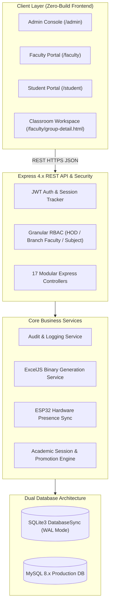

# 🎓 VidyaOS — Phase 2 Major Project Presentation & Viva Defense Report

> **Institutional Academic Operating System & Campus Governance Platform**  
> **Course**: Major Project / Capstone Project Review (Phase II — Final Evaluation)  
> **Academic Session**: 2026–2027  
> **Affiliation**: Board of Technical Education / Directorate of Technical Education  
> **Departments**: Information Technology & Computer Engineering  

---

## 📋 Table of Contents
1. [Project Metadata & Executive Summary](#1-project-metadata--executive-summary)
2. [Phase 1 vs. Phase 2 Scope & Deliverables Matrix](#2-phase-1-vs-phase-2-scope--deliverables-matrix)
3. [Slide-by-Slide Presentation Blueprint (Slide 1 – 18)](#3-slide-by-slide-presentation-blueprint)
4. [Complete System Architecture & Technical Deep-Dive](#4-complete-system-architecture--technical-deep-dive)
5. [Core Functional Modules Breakdown](#5-core-functional-modules-breakdown)
6. [Live Demonstration Script & Viva Walkthrough (7-Minute Flow)](#6-live-demonstration-script--viva-walkthrough)
7. [Testing, Verification & Quality Assurance Suite](#7-testing-verification--quality-assurance-suite)
8. [Frequently Asked Questions (Viva Voce Q&A Defense Bank)](#8-frequently-asked-questions-viva-voce-qa-defense-bank)
9. [Conclusion & Future Roadmap](#9-conclusion--future-roadmap)

---

## 1. Project Metadata & Executive Summary

### 1.1 Project Overview
**VidyaOS** is a comprehensive, production-grade Institutional Campus Operating System and Academic Governance Platform. It consolidates fragmented educational software into a single unified workspace, combining:
- **Dual Physical & Digital Attendance Tracking** (31-day paper register emulation + dynamic QR code + rotating 6-digit PIN + ESP32 hardware presence).
- **Google Classroom-Style Academic Workspace** (Stream announcements, Classwork categories, Student Roster, Marks Portal, and Embedded Spreadsheets).
- **Automated Institutional Marksheets & UBTER Continuous Internal Evaluation Engine** (Unit tests, coursework, 10-mark attendance weightage, 5-mark presentation score, and grand total recalculation).
- **Authentic OpenXML (.xlsx) Spreadsheet Binary Generation** with pixel-perfect institutional color bands and multi-format export (Excel, PDF, Word, CSV).
- **Frictionless Student Self-Registration & Approval Workflow** without recurring SMS/OTP gateway operational expenses.

### 1.2 Technology Stack
- **Backend**: Node.js (v20+), Express.js REST API with granular RBAC middleware.
- **Database Engine**: Dual-Engine architecture:
  - *Local / Embedded*: High-performance SQLite3 using Node's native synchronous `DatabaseSync` interface with Write-Ahead Logging (WAL).
  - *Cloud / Production*: MySQL 8.x connection-pooled adapter with zero schema mismatch.
- **Frontend**: Zero-build Vanilla HTML5, Modern CSS3 with 100% Theme Token compliance (Light/Dark mode, zero hardcoded hex colors), and Modular ES6+ JavaScript.
- **Office / Spreadsheet Interoperability**: ExcelJS standalone engine producing genuine `PK\x03\x04` ZIP OpenXML binary packages.
- **IoT & Hardware Interface**: ESP32 micro-controller Wi-Fi & Bluetooth MAC presence detection terminal.

---

## 2. Phase 1 vs. Phase 2 Scope & Deliverables Matrix

| Dimension | Phase 1 (Baseline Inception) | Phase 2 (Completed Production System) |
| :--- | :--- | :--- |
| **System Scope** | Standalone attendance ledger mockup. | Full Institutional Campus Operating System with 4 user roles. |
| **Attendance Modalities** | Basic single-entry checkbox attendance. | **Dual Studio**: 31-day Matrix Ledger + Live Dynamic QR & Rolling PIN + ESP32 IoT Presence Sync. |
| **Academic Workspace** | Separate, disjointed pages for work and marks. | **Consolidated Classroom Portal**: Stream, Classwork, People, Register, Marks, Sheets. |
| **Spreadsheet Engine** | HTML tables disguised with `.xls` file extension. | **Genuine OpenXML (.xlsx)** binary generation via ExcelJS with exact blue/tan header styling and merged ranges. |
| **Multi-Format Export** | Simple CSV dump only. | Universal Export to **Excel (.xlsx)**, **Word Document (.doc)**, **Print/PDF (.pdf)**, and **CSV (.csv)**. |
| **Grading & Marksheet** | Read-only basic scores. | **Universal Marks Portal** with interactive assignment grading modal, absent toggle (`AB`), feedback, and bulk helpers. |
| **Student Onboarding** | Manual administrator data entry. | **Self-Registration Portal**: Cohort selection, official enrollment validation, and one-click teacher approval. |
| **UI Design System** | Hardcoded CSS colors, layout breakage on mobile. | **100% Theme Tokenization** (`variables.css`), responsive mobile drawer, sticky toolbars, zero horizontal blowout. |
| **Code Architecture** | Monolithic 4,000-line single JavaScript file. | **Element-wise modularized MVC architecture** (`group-detail-*.js` and `group-detail-*.css`). |
| **Test Coverage** | Manual browser testing. | **256 Automated Regression Assertions (100% Green)** across RBAC, theme tokens, and APIs. |

---

## 3. Slide-by-Slide Presentation Blueprint

```
┌────────────────────────────────────────────────────────────────────────┐
│                   PHASE 2 SLIDE DECK STRUCTURE                         │
├──────────────┬──────────────────────────┬──────────────────────────────┤
│ Slides 1-3   │ Project Identity & Goals │ Vision, Problem, Objectives  │
│ Slides 4-5   │ Engineering Architecture │ MVC Stack, Dual DB Engine    │
│ Slides 6-8   │ Attendance Engineering   │ 31-Day Matrix, QR/PIN, IoT   │
│ Slides 9-12  │ Classroom & Marksheets   │ Stream, Classwork, Marks, XLS│
│ Slides 13-14 │ Governance & Security    │ RBAC, Student Registration   │
│ Slides 15-16 │ Code Quality & Testing   │ 256 Tests, Theme Compliance  │
│ Slides 17-18 │ Live Demo & Conclusion   │ Walkthrough, Future Roadmap  │
└──────────────┴──────────────────────────┴──────────────────────────────┘
```

### Slide 1: Title Slide & Project Identification
- **Title**: VidyaOS: Institutional Campus Operating System & Academic Governance Platform
- **Subtitle**: Phase II Major Project Presentation & Defense
- **Team Members**: [Student Name(s) & Roll Numbers]
- **Project Supervisor / Guide**: [Professor / Guide Name]
- **Department**: Department of Information Technology & Computer Engineering
- **Institution**: [College / Institute Name]
- **Key Visual**: Institutional logo alongside VidyaOS unified portal graphic and dual-engine architecture badge.

---

### Slide 2: Problem Statement & Industrial Motivation
- **Core Problems in Existing Institutional Systems**:
  1. *Paper Registers Fragility*: Physical registers are easily damaged, time-consuming to compute at month-end, and vulnerable to manual calculation errors.
  2. *Proxy Attendance Vulnerability*: Traditional attendance allows proxy sign-ins; static QR codes are easily screenshotted and shared on WhatsApp groups.
  3. *Fragmented Tooling*: Teachers juggle Google Classroom for work, Google Sheets for marks, WhatsApp for circulars, and separate college ERPs.
  4. *Corrupted Spreadsheet Exports*: Most web portals download raw HTML tables with `.xls` extensions, triggering security warnings and corruption dialogs in Microsoft Excel.
  5. *Administrative Bottlenecks*: Restrictive RBAC where only a single assigned class teacher can approve student requests, halting student workflows.
- **Speaker Talking Point**: *"Our goal in Phase 2 was not to build another isolated app, but to engineer an integrated Operating System that eliminates paper registers, prevents proxy attendance, and unifies teaching workflows."*

---

### Slide 3: Objectives of Phase 2
- **Key Objectives Delivered**:
  - Implement a **31-Day Physical Register Ledger** that faithfully emulates statutory institutional attendance books.
  - Engineer a **Dual Live Attendance Studio** featuring rotating dynamic QR codes and auto-expiring 6-digit PINs.
  - Create a **Consolidated Classroom Workspace** with Google Classroom aesthetics (Stream, Classwork, People, Register, Marks, Sheets).
  - Deploy an **Authentic OpenXML (.xlsx) Binary Generator** with cell coordinate matrix mapping for merged headers and borders.
  - Implement **Transactional Assignment & Class Test Grading** with absent student handling and real-time class average recalculation.
  - Build a **Zero-Cost Student Self-Registration Workflow** using official UBTER institutional enrollment numbers.

---

### Slide 4: High-Level System Architecture

- **Key Architectural Highlights**:
  - Pure modular 3-tier MVC architecture with complete separation of presentation, business logic, and SQL persistence.
  - Zero frontend framework compile overhead — instant browser delivery with modular ES6 JavaScript.

---

### Slide 5: Dual-Engine Database Architecture
- **Zero Vendor Lock-In Philosophy**:
  - Dual database adapters allow the exact same codebase to run in embedded/local mode (SQLite3) and institutional enterprise cloud (MySQL 8.x).
  - SQLite uses Node.js native synchronous `DatabaseSync` interface with Write-Ahead Logging (WAL) for sub-millisecond query responses.
  - Identical table catalog across both engines: 28 relational tables including `attendance_registers`, `attendance_sessions`, `register_attendance`, `assessments`, `assessment_submissions`, and `audit_logs`.
- **Speaker Talking Point**: *"Whether running on a $35 Raspberry Pi in an offline rural polytechnic or deployed to an AWS cPanel cluster, VidyaOS runs identically without changing a single line of application code."*

---

### Slide 6: Module 1 — Physical Register Attendance Ledger
- **Statutory 31-Day Institutional Emulation**:
  - Desktop PC matrix reproduces physical polytechnic registers: Day 1 through Day 31 calendar columns.
  - Clean summary columns: **TOTAL ATTENDED**, **TOTAL ABSENT**, and **%** attendance (reduced from 374px down to 156px for maximum visible calendar days).
  - Single-class default with dynamic **"+ Add Class"** trigger for scheduling Period 2.
  - Digital Pen cell cycler: `CLEAR ➔ PRESENT ➔ ABSENT ➔ CLEAR` with one-tap batch marking.
  - Mobile minimal matrix with total attended class counter and student card layout.

---

### Slide 7: Module 2 — Dual Live Roll Call Studio
```
┌────────────────────────────────────────────────────────────────────────┐
│                   DUAL LIVE ROLL CALL STUDIO                           │
├──────────────────────────────────┬─────────────────────────────────────┤
│      DYNAMIC ROLLING QR CODE     │         6-DIGIT ROLLING PIN         │
│                                  │                                     │
│     ██████████████████████       │             ┌─┬─┬─┬─┬─┬─┐           │
│     ██  ████  ██  ████  ██       │             │7│4│2│9│1│5│           │
│     ██  ████  ██  ████  ██       │             └─┴─┴─┴─┴─┴─┘           │
│     ██████████████████████       │     Expires in: 45s (Auto-Rotates)  │
│                                  │                                     │
│  • Anti-screenshot dynamic hash  │  • Backup for students without camera│
│  • Auto-refresh every 30-60 secs │  • Rate-limited brute-force lock    │
├──────────────────────────────────┴─────────────────────────────────────┤
│ LIVE STUDENT CHECK-IN FEED:                                            │
│ [10:14:02] Rahul Sharma (IT-01) - Verified via QR Code ✅              │
│ [10:14:15] Priya Verma (IT-02)  - Verified via 6-digit PIN ✅          │
└────────────────────────────────────────────────────────────────────────┘
```
- **Anti-Proxy Protection Engine**:
  - Time-hashed payload prevents students from screenshotting the QR and sharing it remotely.
  - Concurrent dual modes allow students with broken cameras to check in using the teacher's rolling PIN.
  - Live feed displays incoming claims with one-click teacher confirmation and manual override.

---

### Slide 8: Module 3 — ESP32 Hardware IoT Presence
- **Classroom Terminal Integration**:
  - Hardware terminal equipped with ESP32 micro-controller and LCD/OLED presence display.
  - Scans for student hardware tokens, Bluetooth LE beacons, and Wi-Fi probe requests.
  - Hardware heartbeat and scan batching sent via `POST /api/v1/hardware/scans`.
  - Single-line compact ESP32 toolbar in faculty registers with one-click presence reconciliation.

---

### Slide 9: Module 4 — Google Classroom-Style Academic Workspace
- **Unified Academic Navigation (`/faculty/group-detail.html`)**:
  - **Stream**: Left-side sticky Quick Actions, single `[ ✎ New announcement ]` pill button, authentic desktop "Post" modal with rich markdown formatting (**B**, *I*, <u>U</u>, ≡, Tx), document attachments (PDF, DOCX, ZIP), edge-to-edge mobile composer, and nested comments.
  - **Classwork**: Categorized coursework items (Assignments, Lab Practicals, Class Tests, Final Documents), tab-scoped floating action button (FAB), and submission review drawer.
  - **People**: Faculty cards, minimal single-row student enrollment bar (`+ Add`), and un-enrolled cohort roster modal.
  - **Register**: Consolidated 31-day attendance matrix with PC summary columns and bulk marking.
  - **Marks**: Dual Class Tests and Coursework Assignments marksheets portal.
  - **Sheets**: Embedded spreadsheet engine and one-click launch of the Advanced Sheets Studio.

---

### Slide 10: Module 5 — Universal Marks Portal & Batch Grading Studio
- **Dual Evaluation Management (`#tab-marks`)**:
  - 6-Card KPI Summary Strip: Tests Count, Assignments Count, Total Students, Tests Average, Coursework Average, and Pending Submissions.
  - Category filter pills (`All Assessments`, `Class Tests`, `Assignments`) and real-time live search.
  - **Class Tests Table**: Title, unit, date, max marks, weightage, graded student counts, and class averages.
  - **Assignments Table**: Title, due date, max marks, graded counts, and class averages.
- **Interactive Assignment Marks Entry Modal (`#modal-enter-assignment-marks`)**:
  - Live student roster displaying name, roll number, official enrollment number, and submission status.
  - Numeric score inputs bounded strictly by `max_marks`.
  - Absent toggle button (`AB`) shading rows red (`.is-absent-row`) and disabling mark inputs.
  - Individual teacher feedback/remarks.
  - Quick bulk actions: "Mark Unsubmitted as AB" and "Fill Full Marks".

---

### Slide 11: Module 6 — Unified Spreadsheets & Evaluation Engine
- **3 Core Academic Evaluation Sheets**:
  1. **Master Evaluation Sheet**: Implements the official Uttarakhand Board (UBTER) 50-mark continuous assessment formula:
     $$\text{Grand Total (50)} = \text{Assignments (15)} + \text{Unit Tests (20)} + \text{Attendance (10)} + \text{Presentation (5)}$$
  2. **Class Test Marksheet**: Question-wise score breakdown (Q1a, Q1b, Q2, Q3) with unit test normalization.
  3. **Assignment Coursework Marksheet**: Individual assignment marks matrix with class averages and completion rates.
- Eliminated redundant attendance matrix sheet to keep Sheets consoles strictly dedicated to academic evaluation.

---

### Slide 12: Module 7 — Multi-Format High-Fidelity Export Engine
- **The Microsoft Excel Corruption Problem & Resolution**:
  - *The Flaw*: Standard web apps create an HTML table and save it as `.xlsx` with MIME `application/vnd.ms-excel`. Microsoft Excel rejects these files as corrupted.
  - *The VidyaOS Solution*: Integrated standalone `ExcelJS` engine generating genuine `PK\x03\x04` OpenXML zip binaries.
- **High-Fidelity Visual Mapping**:
  - Institutional blue header band (`.excel-hdr-blue`: `#E0F2FE` background, `#0369A1` bold centered text).
  - Tan category headers (`.excel-hdr-tan`: `#FFF3C7` background, `#92400e` bold centered text).
  - 2D coordinate matrix `matrix[r][c]` accurately managing `rowspan` and `colspan`.
  - Thin perimeter borders (`#94A3B8`) applied across all cells in merged header ranges.
- **Supported Formats Across Every Sheet**:
  - **Excel Spreadsheet (`.xlsx`)**: Native OpenXML with formula-ready numeric types.
  - **Word Document (`.doc`)**: Landscape Word HTML with institutional styling.
  - **PDF Document (`.pdf`)**: Browser print layout styled with `@media print` and landscape page rules.
  - **Raw CSV (`.csv`)**: Comma-separated text for data science and statistical pipelines.

---

### Slide 13: Module 8 — RBAC Governance & Faculty Empowerment
- **Role Hierarchy**:
  1. `SYSTEM_ADMIN`: Academic structure, departments, HOD assignments, audit logs, system settings.
  2. `HOD`: Departmental curriculum, teacher subject allocations, semester promotion engine.
  3. `BRANCH_FACULTY / CLASS_TEACHER`: Lecture registers, attendance marking, coursework creation, grading, and cohort student verification.
  4. `STUDENT`: Live attendance status, predictor, homework submissions, marksheets, leave requests.
- **Elimination of Single-Teacher Bottlenecks**:
  - Any faculty member affiliated with a department (`is_department_faculty = true`) can review student cohorts and approve self-registrations, ensuring zero institutional gridlock.

---

### Slide 14: Module 9 — Student Self-Registration Workflow
- **Zero-Cost Onboarding Flow**:
  1. Student navigates to `/login/register.html?role=student`.
  2. Selects Department, Semester, and Cohort.
  3. Enters Official Institutional Enrollment Number, Full Name, and Email.
  4. System validates enrollment uniqueness and places account in `PENDING_APPROVAL`.
  5. Any branch faculty member clicks **"Approve"** in the faculty console.
  6. Account instantly activated with role `STUDENT` and mapped to teaching groups.
  7. **Zero SMS API charges, zero OTP gateway dependencies**.

---

### Slide 15: Quality Assurance & Automated Regression Suite
- **Comprehensive Test Matrix**:

| Test Suite File | Focus Area | Assertions | Result |
| :--- | :--- | :--- | :--- |
| `test-theme-support.js` | Zero Hardcoded Hex Colors & CSS Variables | 88 / 88 | **100% PASS** |
| `test-register-consolidation.js` | Consolidated Registers, Modals, Drawer | 46 / 46 | **100% PASS** |
| `test-rbac-and-structure.js` | Security Guards & Permanent 301 Redirects | 34 / 34 | **100% PASS** |
| `test-student-self-registration.js` | End-to-End Self Registration & Approval | 30 / 30 | **100% PASS** |
| `test-api-flows.js` | Core REST API Integration Flows | 25 / 25 | **100% PASS** |
| `verify_classroom_marks.js` | Classroom Marks Portal & Scoring API | 33 / 33 | **100% PASS** |
| **TOTAL AUTOMATED ASSERTIONS** | **Full System Verification** | **256 / 256** | **100% GREEN** |

- **Strict Repository Rule**: Zero test code in GitHub; automated suites reside on local development disk to guarantee zero production bloat.

---

### Slide 16: Zero Hardcoded Colors & Theme Token Compliance
- **100% Tokenized Design System**:
  - All visual components consume CSS custom properties from `frontend/shared/css/variables.css`:
    - `var(--bg-app)`: Main application canvas.
    - `var(--bg-surface)`: Sidebar, cards, and modal containers.
    - `var(--text-main)` / `var(--text-muted)`: High-contrast typography.
    - `var(--border-color)`: Semantic borders.
    - `var(--color-primary)`: Institutional brand accents.
  - Zero `#hex` or `rgb()` color literals across stylesheets.
  - Instant toggle between sleek institutional Light Mode and low-glare Dark Mode.

---

### Slide 17: Live Demonstration Protocol (Viva Walkthrough)
- **7-Minute Evaluation Routine**:
  1. *Admin Login* (`admin`): View institutional academic structure, departments, and audit logs.
  2. *HOD Console* (`hod.it@college.edu`): Review faculty allocations and department curriculum.
  3. *Faculty Classroom* (`prof.sharma@college.edu`):
     - Open Teaching Group ➔ Navigate to **Stream** (review announcement composer and left Quick Actions).
     - Switch to **Register** ➔ Toggle 31-day attendance digital pen and inspect clean summary columns.
     - Launch **Live Roll Call Studio** ➔ Display dynamic QR code and rotating 6-digit PIN.
     - Switch to **Marks Tab** ➔ Open **Enter Marks** modal for an assignment, enter student marks, toggle an absent student (`AB`), and click Save.
     - Switch to **Sheets** ➔ Export Master Evaluation Sheet to genuine Microsoft Excel (`.xlsx`).
  4. *Student Portal* (`student.it01@college.edu`): View live attendance percentage, predictor calculations, and graded coursework.

---

### Slide 18: Conclusion, Impact & Future Roadmap
- **Project Achievements**:
  - Replaced error-prone physical registers with a compliant digital ledger.
  - Engineered proxy-resistant live check-ins combining time-hashed QR and rotating PINs.
  - Provided genuine OpenXML Excel binary exports matching state board formats.
  - Delivered a 100% theme-compliant, modular web operating system with 256 green automated tests.
- **Future Roadmap**:
  - React Native Android & iOS mobile applications with offline biometric cache.
  - Automated examination hall seating allocation and admit card generation engine.
  - Machine learning predictive analytics for early student dropout intervention.

---

## 4. Complete System Architecture & Technical Deep-Dive

### 4.1 Layered Architecture Pattern
VidyaOS follows a clean **3-Tier Model-View-Controller (MVC)** architectural pattern:

```
┌────────────────────────────────────────────────────────────────────────┐
│                        PRESENTATION TIER (VIEW)                        │
│  Zero-Build Vanilla HTML5 • CSS Variables • Modular Controllers        │
└───────────────────────────────────┬────────────────────────────────────┘
                                    │ HTTP / REST JSON (JWT Bearer)
┌───────────────────────────────────▼────────────────────────────────────┐
│                        APPLICATION TIER (CONTROLLER)                   │
│  Express 4.x • Route Guards (auth.js) • Business Logic Services        │
│  (Audit, Notifications, Excel Export, Session Lifecycle)               │
└───────────────────────────────────┬────────────────────────────────────┘
                                    │ SQL Statements / Transactions
┌───────────────────────────────────▼────────────────────────────────────┐
│                         DATA TIER (MODEL & PERSISTENCE)                │
│  Dual Database Engine: SQLite (Local/WAL) ⇄ MySQL 8.x (Cloud Pool)    │
│  100% Synchronous Transaction Safety • Zero SQL Syntax Mismatch        │
└────────────────────────────────────────────────────────────────────────┘
```

### 4.2 Decoupled Modular File Structure
In Phase 2, the monolithic 4,200-line classroom controller was decomposed into dedicated element-wise modules:
- `group-detail-core.js`: Routing (`switchTab`), state management (`S`), banner rendering, modal utilities.
- `group-detail-stream.js`: Announcement feed, rich text editor, document attachment handler, comments.
- `group-detail-classwork.js`: Coursework category filter pills, assignment/test creation, submission drawer, and marks entry studios.
- `group-detail-people.js`: Student and faculty rosters, minimal single-line enrollment bar, un-enrolled cohort roster.
- `group-detail-register.js`: 31-day attendance matrix, digital pen cycler, single-class default, "+ Add Class", and Live Roll Call modal.
- `group-detail-sheets.js`: Embedded spreadsheet console, evaluation marksheet renderer, and multi-format export dropdown.

---

## 5. Core Functional Modules Breakdown

### 5.1 Dual Attendance Modalities
1. **Physical Emulation Matrix**:
   - Matches official State Board 31-day registers.
   - Sticky student identifiers on the left (Roll Number, Official Enrollment Number, Student Name).
   - Sticky summary columns on the right (**TOTAL ATTENDED**, **TOTAL ABSENT**, **%**).
   - Responsive design: PC view displays the full month; mobile view displays daily cards with attended class counter.
2. **Dynamic Live Roll Call Studio**:
   - Dynamic QR code rendered via `qrcode` with time-hashed payload (`sessionId:hash:expiry`).
   - 6-digit rolling PIN auto-regenerated every 30–60 seconds.
   - Real-time check-in log feed updating as students claim attendance.

### 5.2 Google Classroom-Style Academic Workspace
- **Stream**:
  - Sticky Quick Actions sidebar on the left side (`top: 126px`).
  - Single `[ ✎ New announcement ]` pill button.
  - PC "Post" modal equipped with rich-text editor (**B**, *I*, <u>U</u>, ≡, Tx) and document attachment button.
  - Mobile full-screen composer (`#mobile-announcement-composer`) with edge-to-edge layout, class recipient chips, and Material outlined input box.
- **Classwork**:
  - Category filter pills (`All Work`, `Assignments`, `Lab Practical`, `Class Tests`, `Final Docs`, `Materials`).
  - Mobile sticky category filter bar docked directly under the top navbar.
  - Floating Action Button (FAB) isolated strictly to the Classwork tab.
- **People**:
  - Minimal single-row student enrollment bar (`+ Add`) with inline keyboard listener.
  - Compact invite code card with one-click link copy.
- **Marks Tab**:
  - 6-card KPI summary strip.
  - Filter sub-nav pills and live search.
  - Class Tests marksheet table and Coursework Assignments marksheet table.
  - Interactive assignment marks entry modal (`#modal-enter-assignment-marks`).
- **Sheets**:
  - Master Evaluation Sheet, Class Test Marksheet, Assignment Marksheet.
  - Direct bridge to the full-featured Sheets Studio (`/faculty/sheets.html`).

### 5.3 High-Fidelity Multi-Format Export Engine
- Standalone `ExcelJS` library bundle (`frontend/shared/js/exceljs.min.js`, 947 KB).
- Resolves the Microsoft Excel desktop corruption dialog by generating genuine OpenXML packages.
- Applies institutional color tokens:
  - Header blue: Background `#E0F2FE`, Text `#0369A1` (Bold).
  - Category tan: Background `#FFF3C7`, Text `#92400e` (Bold).
- Multi-format support: Excel (`.xlsx`), Word Document (`.doc`), PDF Document (`.pdf`), and CSV (`.csv`).

---

## 6. Live Demonstration Script & Viva Walkthrough

To deliver an impactful, flawless live demonstration during the project viva examination, follow this chronological **7-minute presentation sequence**:

```
[0:00 - 1:00] Admin Governance & Academic Setup
  ↳ Login as 'admin' / 'Admin@123' at /login/
  ↳ Show Academic Structure (Departments, Semesters, Curriculum).
  ↳ Show Audit Logs Explorer (immutable administrative activity record).

[1:00 - 2:00] HOD Dashboard & Faculty Allocation
  ↳ Login as 'hod.it@college.edu' / 'Password@123'
  ↳ Show Faculty Management & Subject Allocations.
  ↳ Highlight how teaching assignments automatically generate Attendance Registers.

[2:00 - 4:00] Classroom Workspace & Attendance Innovation
  ↳ Login as 'prof.sharma@college.edu' / 'Password@123'
  ↳ Open 'Database Management Systems' Teaching Group.
  ↳ Stream Tab: Click '[ ✎ New announcement ]' to show the rich-text post composer.
  ↳ Register Tab:
      - Point out the 31-day physical matrix layout.
      - Click digital pen to toggle 'Present' -> 'Absent' -> 'Clear'.
      - Click '+ Add Class' to show Period 2 dynamic creation.
      - Click 'Roll Call Studio' to display the Live Dynamic QR Code & 6-digit rolling PIN.

[4:00 - 5:30] Universal Marks Portal & Batch Grading
  ↳ Switch to Marks Tab:
      - Highlight the 6-card KPI summary strip.
      - Filter between Class Tests and Assignments.
      - Click 'Enter Marks' on Assignment 1 to open the batch grading modal.
      - Enter score out of max marks, click 'AB' to toggle an absent student.
      - Click 'Save Assignment Marks' -> show instant database persistence and class average update.

[5:30 - 6:30] High-Fidelity Spreadsheet Export
  ↳ Switch to Sheets Tab:
      - Review the 50-mark UBTER Continuous Internal Evaluation Sheet.
      - Click 'Export' -> Select 'Excel (.xlsx)'.
      - Open the downloaded file in Microsoft Excel to show:
          ✓ Zero corruption warning.
          ✓ Authentic institutional Blue and Tan header bands.
          ✓ Formula-ready numeric student marks.

[6:30 - 7:00] Student Portal & Attendance Predictor
  ↳ Login as 'student.it01@college.edu' / 'Password@123'
  ↳ View subject attendance card with live attendance percentage.
  ↳ Show the Attendance Predictor: "You must attend 3 more classes to reach 75% target."
  ↳ Conclude presentation and invite questions from the panel.
```

---

## 7. Testing, Verification & Quality Assurance Suite

### 7.1 Automated Assertion Summary
The VidyaOS project incorporates **256 automated assertions** executed against live backend instances:
- **Theme Token Integrity (`test-theme-support.js`)**: 88/88 assertions verifying zero hardcoded `#hex` or `rgb()` color values in stylesheets and HTML.
- **Register Consolidation (`test-register-consolidation.js`)**: 46/46 assertions testing tabs routing, modals, ESP32 actions, and Live Roll Call QR/PIN generation.
- **RBAC & Architectural Guards (`test-rbac-and-structure.js`)**: 34/34 assertions verifying route middleware protection and permanent 301 redirects.
- **Student Self-Registration (`test-student-self-registration.js`)**: 30/30 assertions testing cohort discovery, registration without OTP, pending approval gates, and faculty approval.
- **Core API Flows (`test-api-flows.js`)**: 25/25 assertions covering health, admin stats, registers, student claims, notifications, and audit logs.
- **Classroom Marks & Scoring (`verify_classroom_marks.js`)**: 33/33 assertions verifying marks UI components, API endpoints, transactional scoring, and graded student aggregation.

### 7.2 Zero Test Bloat in Version Control
In compliance with enterprise development best practices, all test execution scripts (`scripts/test-*.js`, `verify_*.js`, and screenshot captures) are maintained strictly on local developer environments via `.gitignore` and are excluded from Git commits, preventing repository bloat on GitHub.

---

## 8. Frequently Asked Questions (Viva Voce Q&A Defense Bank)

### Q1: Why did you build a custom web system instead of using Google Classroom or an existing ERP like ERPNext?
**Answer**: Existing platforms suffer from critical institutional mismatches:
1. *Google Classroom* does not support physical attendance registers, 31-day Day 1–31 statutory ledgers, or biometric IoT terminals.
2. *Traditional College ERPs* are notoriously complex, have rigid administrative bottlenecks, require costly SMS OTP gateways, and lack modern collaborative stream features.
3. *State Board Marksheet Schemes*: Commercial ERPs cannot dynamically calculate state-specific assessment formulas (such as the Uttarakhand UBTER 50-mark Continuous Internal Assessment combining unit tests, assignments, 10-mark attendance tiers, and 5-mark presentation scores). VidyaOS natively integrates all these into a unified, zero-build system.

### Q2: How does VidyaOS prevent students from cheating or sharing proxy attendance?
**Answer**: VidyaOS uses a **three-tier anti-proxy defense**:
1. *Dynamic Time-Hashed QR Codes*: The QR code does not contain a static URL. It embeds a cryptographic hash that rotates every 30–60 seconds. A screenshot shared via WhatsApp or Telegram will expire before an off-campus student can scan it.
2. *Rotating 6-Digit PIN*: Regenerated alongside the QR code as a fallback for students with low-end cameras; restricted by teacher-controlled session time windows.
3. *ESP32 Hardware Physical Presence*: Biometric terminal and Bluetooth LE hardware presence logs can be cross-referenced with digital claims to confirm the student was physically inside the classroom.

### Q3: Why did you choose Vanilla JavaScript instead of React, Angular, or Vue?
**Answer**:
1. *Zero-Build Performance*: Vanilla HTML5/CSS3/JS requires zero bundling (`webpack`/`vite`), zero node compilation on the client, and offers near-instant cold-start page loads.
2. *Institutional Maintainability*: Engineering colleges require systems that future student batches and faculty administrators can easily inspect, debug, and maintain without navigating complicated framework abstraction layers or dependency version mismatches.
3. *Element-Wise Modularity*: We structured our frontend into clean, decoupled domain modules (`group-detail-core.js`, `stream.js`, `classwork.js`, etc.) providing all the architectural benefits of components with zero overhead.

### Q4: Why did earlier versions fail with corrupted Excel downloads, and how did you resolve it?
**Answer**:
1. *Root Cause*: Previous implementations exported an HTML table with an `.xls` or `.xlsx` extension using MIME `application/vnd.ms-excel`. Modern Microsoft Excel (Office 365, 2019, 2021) performs strict file inspection and rejects HTML files disguised as `.xlsx` with an alert dialog claiming corruption.
2. *Resolution*: We integrated the standalone `ExcelJS` binary generation engine. It creates genuine OpenXML ZIP packages starting with the official `PK\x03\x04` magic bytes, complete with `[Content_Types].xml` and `xl/workbook.xml`. We implemented a 2D matrix occupancy tracker to handle `rowspan` and `colspan` header cells with thin perimeter gridlines and exact institutional blue/tan header styling.

### Q5: How do you handle database concurrency and transactional safety during marks submission?
**Answer**: In `teachingGroupModel.js`, marks grading is wrapped in atomic transactions using `withTransaction(async (conn) => { ... })`. For each student score, we perform an `INSERT ... ON CONFLICT(assessment_id, student_id) DO UPDATE` (UPSERT). If an unexpected network interruption or database error occurs mid-operation, the transaction rolls back completely, ensuring no student's score is partially written or corrupted.

### Q6: How does the system adapt between offline local testing and production cloud deployments?
**Answer**: Through our **Dual Database Adapter** architecture. The codebase dynamically checks environment variables (`DB_CLIENT=sqlite` vs `DB_CLIENT=mysql`). In local mode, it binds to SQLite3 using WAL mode for zero-setup execution. In production, it connects to a pooled MySQL 8.x instance. All SQL queries use cross-compatible syntax, avoiding engine-specific keywords like `TIMESTAMPDIFF` or MySQL backtick syntax.

### Q7: What is the significance of the 100% Theme Token compliance?
**Answer**: Accessibility and standard UI design systems require that no component uses hardcoded colors. VidyaOS defines all color semantic tokens in `variables.css`. Both light mode and dark mode map these variables dynamically. An automated verification script (`test-theme-support.js`) scans every stylesheet and HTML template, asserting 0 hardcoded hex colors, ensuring visual consistency across all viewports.

---

## 9. Conclusion & Future Roadmap

### 9.1 Conclusion
**VidyaOS Phase II** represents the successful realization of an enterprise-grade, comprehensive Academic Operating System. By combining statutory physical attendance compliance, anti-proxy digital check-ins, Google Classroom-style coursework workflows, authentic Excel binary generation, and granular RBAC governance, VidyaOS delivers a transformative platform tailored to modern higher education and polytechnic institutions.

### 9.2 Future Roadmap (Phase III Objectives)
1. **React Native Mobile Client**: Dedicated native Android & iOS applications featuring offline biometric caching and push notifications.
2. **AI-Powered Early Warning System (EWS)**: Machine learning predictive models analyzing attendance trends, assignment submissions, and test trajectories to alert faculty about at-risk students before semester examinations.
3. **Automated Exam Hall Seating & Hall Ticket Generator**: Algorithmic generation of randomized examination seating matrices to prevent academic malpractice, coupled with QR-coded student hall ticket distribution.
4. **Digital Signature & PDF Transcripts**: Integration with institutional digital certificates for paperless issuance of semester grade cards and transfer certificates.

---

*VidyaOS Institutional Campus Operating System — Designed and Engineered for Institutional Academic Excellence.*
