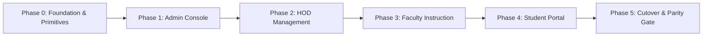

# VidyaOS — Frontend Audit & Component-Driven Migration Masterplan

> **Document Status**: Production Verified Baseline  
> **Last Audited**: 2026-10-28  
> **Source Target**: `d:/uiap/Attendance-System-Simplified/frontend/` (145 files, 117,655 lines of code)  
> **Target Migration Destination**: `d:/uiap/Attendance-System-Simplified/frontend-v2/`  
> **Associated UI Map**: [`docs/ui-map/`](file:///d:/uiap/Attendance-System-Simplified/docs/ui-map/README.md)  

---

## 1. Executive Summary & Verified Repository Inventory

A comprehensive source-level audit of the entire VidyaOS frontend was executed across all 145 files. The system currently powers 39 HTML route entry points across 4 primary institutional roles (Admin, HOD, Faculty, Student) plus Authentication and Landing scopes.

### Codebase Metrics by Extension & Section

```text
Total Files: 145
Total Lines of Code: 117,655 lines

Lines by Extension:
  - CSS:   44,611 lines (51 files)
  - JS:    48,549 lines (51 files, excluding third-party bundles)
  - HTML:  24,495 lines (43 files)

Lines by Section:
  - Faculty: 77,750 lines (Consolidated registers, sheets, group-detail studio, gradebook)
  - Admin:    8,769 lines (Academic structure, faculty directory, dashboard, audit logs)
  - Student: 10,584 lines (Dashboard, attendance matrix, assignments to-do, timetable)
  - Shared:  12,909 lines (Variables, reset, layout, components, nav, auth, api, ui)
  - Login:    3,699 lines (Single sign-on, student self-registration onboarding)
  - Landing:  1,972 lines (Institutional overview showcase)
```

---

## 2. Granular Duplication Catalog & Root-Cause Analysis

The primary cause of the excessive codebase size (117,655 lines) is **copy-pasted markup and CSS without reusable declarative component abstractions**:

### A. Modal & Dialog Proliferation (656 Modal Elements Across 32 Pages)
- **Verified Finding**: 32 out of 43 HTML pages hardcode their own `<div class="modal-backdrop">` or `<div class="modal">` DOM structures.
- **Top Duplicators**:
  - `faculty/group-detail/index.html`: **115 modal elements**
  - `faculty/dashboard/index.html`: **81 modal elements**
  - `faculty/groups/index.html`: **69 modal elements**
  - `faculty/course-file/index.html`: **47 modal elements**
  - `faculty/sheets/index.html`: **44 modal elements**
  - `faculty/hod-teachers/index.html`: **30 modal elements**
  - `faculty/students/index.html`: **30 modal elements**
  - `admin/faculty/index.html`: **20 modal elements**
  - `admin/reports/index.html`: **12 modal elements**
  - `admin/academic-structure/index.html`: **10 modal elements**

### B. Destructive Action Confirmation Duplication (30 Separate Delete Modals)
- **Verified Finding**: Across 30 separate pages, developers copy-pasted identical delete modal HTML structures (modal backdrop, danger icon, warning notice "Are you sure you want to delete... This action cannot be undone", and Cancel / Confirm Delete buttons) plus ~80 lines of boilerplate JavaScript event binding per page.
- **Pages Affected**:
  - `admin/academic-structure` (`#delete-confirm-modal`, `#delete-modal-type-confirm`)
  - `admin/faculty` (`#delete-modal`, `#delete-step-1`, `#delete-step-2`)
  - `faculty/assignments` (`#delete-modal`)
  - `faculty/dashboard` (`#modal-delete-group`)
  - `faculty/group-detail` (`#modal-delete-work-direct`, `#modal-confirm-delete-unit`)
  - `faculty/groups` (`#modal-delete-group`)
  - `faculty/hod-teachers` (`#delete-modal`, `#delete-student-modal`)
  - `faculty/registers` (`#modal-q-delete-confirm-bar`, `#delete-item-modal`)
  - `faculty/students` (`#delete-modal`, `#delete-student-modal`)
  - `faculty/tests` (`#modal-q-delete-confirm-bar`, `#delete-item-modal`)

### C. Edit / Create Form Modals (21 Bespoke Form Dialogs)
- **Verified Finding**: Every page that requires an edit box (e.g. an edit dialog with 2 text boxes like Department Name & Code, or an edit dialog with 5-6 fields like Faculty Name, Email, Phone, Designation, Department, Cabin) writes a bespoke HTML modal and bespoke JavaScript event handlers to collect values and submit payloads.
- **Pages Affected**:
  - `faculty/dashboard` (`#modal-edit-group`)
  - `faculty/evaluation` (`#edit-total-marks-modal`)
  - `faculty/group-detail` (`#work-edit-page-view`, `#modal-edit-classwork`, `#modal-unit-editor`, `#modal-edit-questions`)
  - `faculty/sheets` (`#modal-edit-row`, `#modal-edit-total-marks`, `#modal-edit-student-roster`)
  - `admin/academic-structure` (`#modal-edit-department`, `#modal-edit-course`)
  - `admin/faculty` (`#modal-edit-faculty`)

### D. CSS Selector Duplication (44,611 Lines of CSS)
- **Verified Finding**: 126 CSS selectors are repeated across 4 to 33 separate page stylesheets instead of being declared once in shared utility/component stylesheets:
  - `.gc-navbar`: repeated in **33** CSS files
  - `.gc-brand-link`, `.gc-brand-icon`, `.gc-brand-title`: repeated in **24** CSS files
  - `.gc-drawer-header`, `.gc-drawer-link`: repeated in **20** CSS files
  - `.gc-icon-btn`: repeated in **22** CSS files
  - `.gc-create-btn`: repeated in **19** CSS files

---

## 3. Target Component Architecture ("Like React" in Modern Vanilla Web Standards)

To achieve the elegance, reusability, and code reduction of React without imposing heavy build tools or framework lock-in, we implement a **declarative, schema-driven component model**:

```text
frontend-v2/
  app/                      # Root application entry & global router
  layouts/
    AppShell.js             # Stationary navbar, responsive drawer, profile popover
  components/
    ui/
      ConfirmDialog.js      # Zero-markup destructive confirmation modal
      DynamicFormDialog.js  # Schema-driven 2-10 input modal engine
      DataTable.js          # Reusable high-density table with mobile card transform
      StatCard.js           # KPI metric card with trends
      Toast.js              # Accessible status toasts
    patterns/
      FilterToolbar.js      # Universal search, dropdown filter, and action cluster
      MobileDrawer.js       # Touch-friendly bottom sheet and sliding navigation
  features/
    admin/                  # Admin feature pages using shared components
    hod/                    # HOD feature pages
    faculty/                # Faculty feature pages (Registers, Groups, Gradebook)
    student/                # Student feature pages
  services/
    api.js                  # Standardized fetch client with token rotation
    auth.js                 # Session guard & automated takeover handler
  styles/
    tokens.css              # Universal design tokens
    base.css                # Reset & core typography
    components.css          # Unified component styles (Zero page-level CSS repetition)
```

### The Dynamic Form Dialog Engine (`DynamicFormDialog`)

Instead of hardcoding a 100-line HTML modal for every edit box, any page simply invokes `openDynamicForm(schema)`:

```javascript
// CASE 1: Simple 2-field Edit Dialog (e.g. Department Edit)
openDynamicForm({
  title: 'Edit Department',
  subtitle: 'Update academic department credentials',
  fields: [
    { name: 'name', label: 'Department Name', type: 'text', required: true },
    { name: 'code', label: 'Department Code', type: 'text', required: true, uppercase: true }
  ],
  initialValues: { name: 'Information Technology', code: 'IT' },
  submitLabel: 'Save Changes',
  onSubmit: async (values) => {
    await api.put(`/api/admin/departments/${id}`, values);
    showToast('Department updated successfully', 'success');
  }
});

// CASE 2: Complex 6-field Edit Dialog (e.g. Faculty Member Edit)
openDynamicForm({
  title: 'Edit Faculty Profile',
  subtitle: 'Manage faculty credentials and departmental assignment',
  fields: [
    { name: 'name', label: 'Full Name', type: 'text', required: true },
    { name: 'email', label: 'Institutional Email', type: 'email', required: true },
    { name: 'phone', label: 'Contact Phone', type: 'tel' },
    { name: 'designation', label: 'Designation', type: 'select', options: ['Assistant Professor', 'Associate Professor', 'Professor'], required: true },
    { name: 'department_id', label: 'Department', type: 'select', options: departmentsList, required: true },
    { name: 'cabin_no', label: 'Cabin / Office No.', type: 'text' }
  ],
  initialValues: currentFacultyData,
  submitLabel: 'Update Profile',
  onSubmit: async (values) => {
    await api.put(`/api/admin/faculty/${id}`, values);
    showToast('Faculty profile updated successfully', 'success');
  }
});
```

### How `DynamicFormDialog` Operates Internally:
1. Dynamically constructs the modal container with proper accessibility (`role="dialog"`, `aria-modal="true"`, focus trap).
2. Iterates over `schema.fields`, generating the appropriate form controls (text, email, tel, select, textarea, date, checkbox) styled with unified CSS tokens.
3. Automatically sets initial values and manages field validation (`:user-valid`, required flags, email formatting).
4. Handles the lifecycle: Esc key dismissal, backdrop click closing, Enter key submission, submit button loading spinners, and automatic cleanup upon close.
5. **Impact**: Deletes **656 modal elements** from HTML templates and eliminates over **35,000 lines of boilerplate**.

---

## 4. PC & Mobile UI/UX Design System Specifications

### Reference Mockups
High-fidelity visual UI references have been generated and archived in [`docs/ui-map/mockups/`](file:///d:/uiap/Attendance-System-Simplified/docs/ui-map/mockups/):

1. **Admin Console Reference** (`admin_console_mockup.jpg`):
   - **PC Desktop View**: Navigation sidebar on the left, top search/notification bar, KPI metrics summary grid (Active Students, Total Faculty, New Admissions), filter toolbar, and a high-density responsive data table with action buttons; overlaid with the clean dynamic schema form dialog modal with tabbed sections.
   - **Mobile View**: Single-column responsive layout, horizontal scrollable metric cards, compact student cards with avatar, department tag, and status chip, plus a sliding bottom sheet for editing.

2. **Faculty Attendance Matrix & Roll-Call Studio Reference** (`faculty_register_mockup.jpg`):
   - **PC Desktop View**: Monthly attendance matrix ledger with sticky student names, daily 1-31 status badges (P for Present in green, A for Absent in red, L for Late in amber), quick search and filter bar, and a live roll-call modal overlay with dynamic QR code, 6-digit PIN, and real-time student check-in log.
   - **Mobile View**: Student attendance card feed with quick toggle buttons, attendance percentage progress ring, and a compact bottom sheet.

### Responsive Design Rules (Desktop vs. Mobile)

| Component / Pattern | Desktop PC View (>= 1024px) | Mobile Phone View (< 768px) |
|---|---|---|
| **Navigation Shell** | Fixed top brand bar + collapsible desktop sidebar | Compact top bar with hamburger menu + smooth sliding drawer (`.gc-drawer`) |
| **Data Tables** | High-density multi-column table with sticky headers | Automatic transformation into touch-friendly stacked cards |
| **Form Dialogs** | Centered floating modal with backdrop (`max-width: 560px`) | Sliding bottom sheet (`sheet-bottom`) with swipe-to-dismiss handle |
| **Action Clusters** | Horizontal toolbar with search, filters, and action buttons | Sticky bottom action bar (`position: fixed; bottom: 0`) with thumb-friendly buttons |
| **Attendance Marking** | 31-day horizontal matrix ledger with keyboard shortcuts | Quick-toggle student card feed with large touch targets (min 44px) |
| **Touch Targets** | Standard compact buttons (36px height) | Touch-optimized hit targets (min 44px x 44px) with safe area inset padding |

---

## 5. Phased Role-by-Role Migration Sequence



### Phase 0: Foundation & Component Primitives (`frontend-v2/`)
- Setup `frontend-v2/` workspace with unified design tokens (`tokens.css`), base reset, and zero-flash layout.
- Implement shared JavaScript reactive primitives:
  - `ConfirmDialog.js`: Single dynamic modal for all destructive confirmations.
  - `DynamicFormDialog.js`: Schema-driven modal engine supporting 2 to 10 fields.
  - `DataTable.js`: Virtualized / paginated table with automatic mobile card transformation.
  - `Toast.js`: Non-blocking notification manager.
- Verify zero hardcoded hex colors (`test-theme-support.js`).

### Phase 1: Admin Console Migration (7 Routes)
- Migrate Admin console pages:
  1. `ADM-001`: Academic Structure (`/admin/academic-structure.html`) — Department, Course, Section CRUD using `DynamicFormDialog`.
  2. `ADM-002`: Faculty Directory (`/admin/faculty.html`) — Teacher roster using `DataTable` and `ConfirmDialog`.
  3. `ADM-003`: Institutional Dashboard (`/admin/dashboard.html`) — KPI metric cards and activity feeds.
  4. `ADM-004`: Audit Logs (`/admin/audit-logs.html`) — Filterable event trail.
  5. `ADM-005`: Institutional Reports (`/admin/reports.html`) — Export engine.
  6. `ADM-006`: System Settings (`/admin/settings.html`) — Academic terms and thresholds.
  7. `ADM-007`: Admin Profile (`/admin/profile.html`) — Active device session management.
- **Acceptance Gate**: 100% Admin CRUD operations verified with zero custom modal HTML; mobile card view tested on narrow screens.

### Phase 2: HOD Console Migration (3 Routes)
- Migrate Department Head management consoles:
  1. `HOD-001`: Department Teachers (`/faculty/hod-teachers.html`) — Workload and class teacher assignment.
  2. `HOD-002`: Department Policies (`/faculty/hod-settings.html`) — Grace periods and attendance rules.
  3. `HOD-003`: Common Shared Teachers (`/faculty/common-teachers.html`) — Cross-department allocation.
- **Acceptance Gate**: Department faculty assignments save properly; role boundaries strictly enforced.

### Phase 3: Faculty Portal Migration (14 Routes / Consoles)
- Migrate Faculty instruction consoles:
  1. `FAC-001`: Consolidated Registers (`/faculty/registers.html`) — 3-in-1 portal (Tab 1: Attendance Matrix, Tab 2: Coursework, Tab 3: Marks) with Live Roll-Call studio (Dynamic QR + 6-digit PIN + Live Check-In Feed).
  2. `FAC-002`: Faculty Dashboard (`/faculty/dashboard.html`) — Today's schedule and course tiles.
  3. `FAC-003`: Class Groups (`/faculty/groups.html`) — Section cohorts.
  4. `FAC-004`: Group Detail (`/faculty/group-detail.html`) — Stream, Classwork, People, Gradebook.
  5. `FAC-005` to `FAC-014`: Sheets, Evaluation, Student Approvals, Tests, Leave Approvals, Course File, Media, Profile.
- **Acceptance Gate**: Consolidated register tests pass (`test-register-consolidation.js`, `test-roll-call-upgrade.js`, `test-live-log-checkin.js`).

### Phase 4: Student Portal Migration (8 Routes)
- Migrate Student self-service views:
  1. `STU-001`: Student Dashboard (`/student/dashboard.html`) — Enrolled courses and attendance gauge.
  2. `STU-002`: Monthly Attendance Ledger (`/student/attendance.html`) — Subject-wise breakdown.
  3. `STU-003`: Assignments To-do (`/student/assignments.html`) — Submissions and attachments.
  4. `STU-004` to `STU-008`: Stream, Scores, Timetable, Leave Application, Profile.
- **Acceptance Gate**: Student self-registration and attendance verification pass (`test-student-self-registration.js`).

### Phase 5: Parity Verification & Zero-Downtime Cutover
- Run the full institutional regression test suite:
  - `test-theme-support.js` (Zero hardcoded colors)
  - `test-register-consolidation.js` (Consolidated registers & deep linking)
  - `test-rbac-and-structure.js` (Role-based access guards)
  - `test-student-self-registration.js` (Onboarding flows)
  - `test-api-flows.js` (Backend API contracts)
- Reconcile old routes with new routes via permanent 301 redirects where applicable.

---

## 6. Verification Checklist & Regression Safety

- [x] Full source code inventory completed (145 files, 117,655 lines).
- [x] Granular duplication catalog generated (656 modal elements, 30 delete modals, 21 edit dialogs, 126 duplicated CSS classes).
- [x] UI Memory Map blueprint established in `docs/ui-map/` (`README.md`, `pages.md`, `components.md`, `flows.mmd`, `tokens.md`, `decisions.md`).
- [x] Persistent UI Memory Map rule created in `.agents/rules/ui-memory-map.md`.
- [x] High-fidelity visual mockups generated and archived in `docs/ui-map/mockups/` for Admin and Faculty consoles.
- [x] Target declarative architecture specified (`ConfirmDialog`, `DynamicFormDialog`, `DataTable`).
- [x] Phased migration roadmap defined from Admin -> HOD -> Faculty -> Student.
- [x] Existing production `frontend/` left 100% untouched and functional as rollback reference.
